# C4 Container Diagram — aiml Plugin

## Container View

```mermaid
C4Container
    title aiml Plugin — Container View

    Person(engineer, "Software Engineer", "Runs /aiml:* skills and answers their questions")

    Container_Boundary(aiml, "aiml Plugin") {
        Container(skills, "12 skills", "Markdown (skills/*/SKILL.md)", "Ask the person. Dispatch one agent each with the Agent tool. orchestrate runs the next skill with the Skill tool.")

        Container(decision, "decision-agent", "Agent / opus", "LLM, ML or hybrid. Writes decision.md.")
        Container(design_analyst, "design-analyst", "Agent / opus", "Data requirements and model architecture. Two parallel runs. Writes the input file of the feasibility check.")
        Container(design, "design-agent", "Agent / opus", "AIML spec. Merges the analyses and the feasibility result. Writes spec.md and the ADR.")
        Container(plan, "plan-agent", "Agent / sonnet", "Implementation plan. Writes plan.md.")
        Container(sim_checker, "simulation-checker", "Agent / opus", "Adversarial plan review of one part. Three parallel runs.")
        Container(simulator, "simulator-agent", "Agent / opus", "Merges the three checks. Writes simulation-report.md.")
        Container(scaffold, "scaffold-agent", "Agent / sonnet", "Runnable starter code. HuggingFace for LLM, scikit-learn for ML.")
        Container(tune, "tune-agent", "Agent / sonnet", "Loss curve diagnosis. Writes tune-recommendations.md.")
        Container(evaluate, "evaluate-agent", "Agent / sonnet", "Pre-training and post-training evaluation.")
        Container(ops, "ops-agent", "Agent / sonnet", "MLOps pipeline design. Writes pipeline.md and a CI/CD template.")
        Container(producers, "3 emitter agents", "Agent / haiku", "cost-amplifier-readout, p15-trigger-detector, archetype-baseline-telemetry. Each reads the file that its skill made with an emitter script, and writes the handoff.")

        Container(metric_calc, "metric_calculator.py", "Python script", "Precision, recall, F1, accuracy, ROC-AUC")
        Container(data_val, "data_validator.py", "Python script", "Split ratios, class balance, minimum samples, leakage")
        Container(cost_est, "cost_estimator.py", "Python script", "Training and inference cost")
        Container(feasibility, "feasibility_check.py", "Python script", "Feasibility check of the design skill. Calls cost_estimator and data_validator.")
        Container(hp_val, "hyperparameter_validator.py", "Python script", "Learning rate, batch size, epochs, LoRA settings")
        Container(emitters, "emitter scripts", "Python scripts", "Load, compose and write the three producer files. Validate against schemas/.")

        ContainerDb(handoff, ".aiml/handoff.json", "JSON state", "Phase, approach, artifacts, training status, completed skills")
        ContainerDb(questions, ".aiml/open-questions.md", "Markdown", "Questions of an agent that the skill asks the person")
        ContainerDb(schemas, "schemas/", "JSON Schema", "The 5 schemas of the producer files")
    }

    Rel(engineer, skills, "Runs and answers")
    Rel(skills, decision, "Dispatches")
    Rel(skills, design_analyst, "Dispatches 2 runs")
    Rel(skills, feasibility, "Runs between the analysts and the design agent")
    Rel(skills, metric_calc, "evaluate runs it between its 2 agent runs")
    Rel(skills, data_val, "evaluate runs it between its 2 agent runs")
    Rel(skills, hp_val, "tune runs it between its 2 agent runs")
    Rel(skills, design, "Dispatches")
    Rel(skills, plan, "Dispatches")
    Rel(skills, sim_checker, "Dispatches 3 runs")
    Rel(skills, simulator, "Dispatches")
    Rel(skills, scaffold, "Dispatches")
    Rel(skills, tune, "Dispatches")
    Rel(skills, evaluate, "Dispatches")
    Rel(skills, ops, "Dispatches")
    Rel(skills, producers, "Dispatches")

    Rel(feasibility, data_val, "Data sufficiency check")
    Rel(feasibility, cost_est, "Cost estimate")
    Rel(skills, emitters, "The 3 emitter skills run them with uv run, before they dispatch the agent")
    Rel(emitters, schemas, "Validate output")

    Rel(decision, handoff, "Writes approach and phase")
    Rel(design, handoff, "Writes artifacts")
    Rel(plan, handoff, "Writes phase")
    Rel(simulator, handoff, "Writes simulation_gaps")
    Rel(ops, handoff, "Writes done: true")
    Rel(skills, handoff, "Reads phase and completed_skills")
    Rel(decision, questions, "Writes when it needs input")
    Rel(skills, questions, "Reads and asks")
```

## Run order of a skill

1. The skill checks its inputs and asks the person its questions.
2. The skill dispatches its agent with the `Agent` tool. The prompt holds the answers as fields.
3. The agent does the work, writes its files, and updates `.aiml/handoff.json`.
4. The agent ends its reply with `DONE: <agent>`, or with `NEEDS-INPUT: <agent>` after it writes `.aiml/open-questions.md`.
5. On `NEEDS-INPUT`, the skill asks the questions and goes back to step 2.

## Model tier rationale

| Agent | Model | Reason |
|---|---|---|
| decision-agent | opus | The tradeoffs of LLM and ML are not obvious. It needs multi-step reasoning under doubt. |
| design-agent, design-analyst | opus | Architecture choices add up. A wrong model family means a full redesign. |
| simulator-agent, simulation-checker | opus | It must find the gaps that the engineer missed. |
| plan-agent, scaffold-agent, tune-agent, evaluate-agent, ops-agent | sonnet | Structured work: planning, code, scoring, pipeline design. |
| 3 emitter agents | haiku | They read one file and write the handoff. The result is deterministic. |
