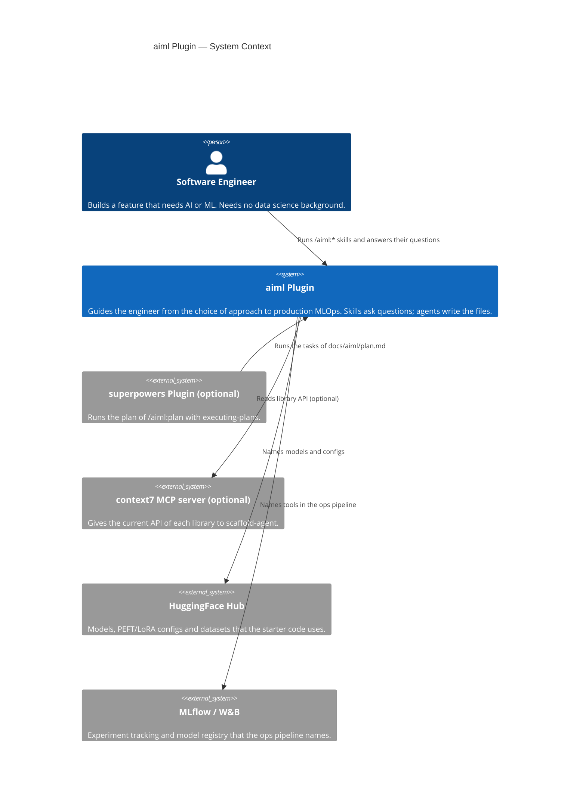

# C4 Context Diagram — aiml Plugin

## System Context

## Key Relationships

| Actor | Interaction |
|---|---|
| Software Engineer | Runs the `/aiml:*` skills and answers the questions of each skill |
| superpowers (optional) | Runs `docs/aiml/plan.md` with `superpowers:executing-plans`. Without it, the engineer does the tasks in order |
| context7 (optional) | `scaffold-agent` reads the current API of each library from it. Without it, the agent writes the code from the spec and the plan |
| HuggingFace Hub | The starter code and the specs name its models and datasets. The plugin makes no network call |
| MLflow / W&B | The ops pipeline names them for tracking and the registry. The plugin makes no network call |
