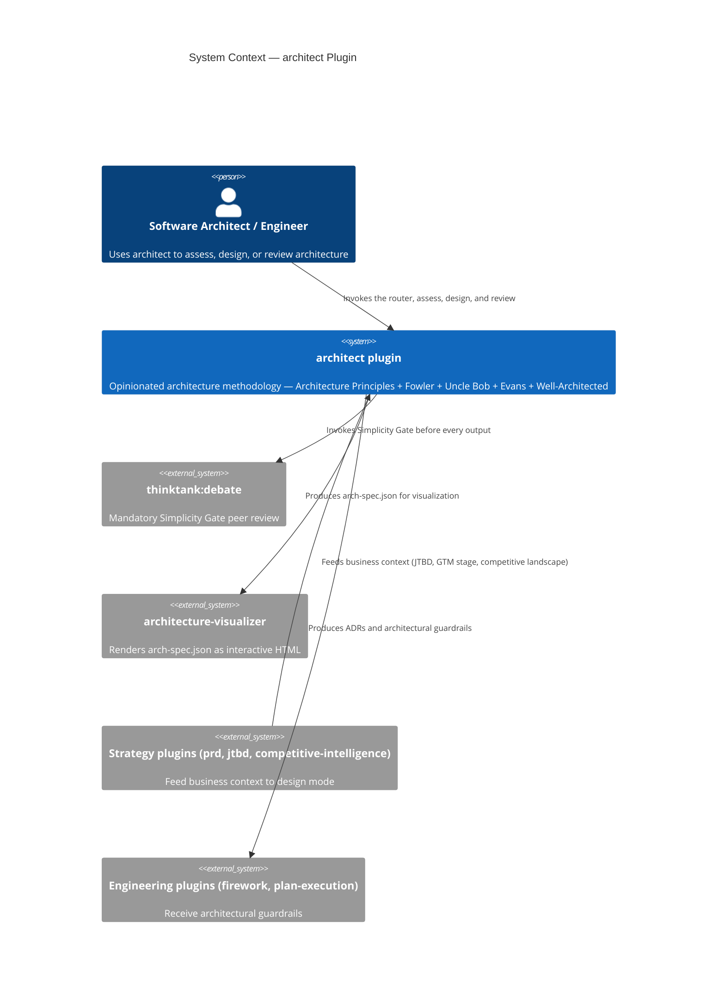
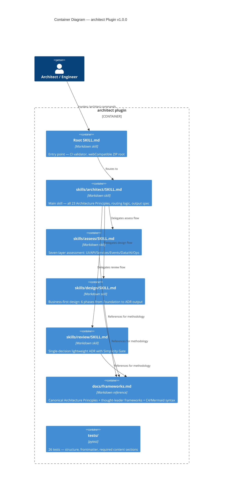

# ADR-001: Architect Plugin — Architecture Decisions

**Status:** Superseded by ADR-002
**Date:** 2026-02-25
**Plugin:** architect v1.0.0

---

## Context

The Claude Code marketplace of the authors had engineering tools (firework, plan-execution), business strategy tools (value-ip, competitive-intelligence, jtbd-market-discovery), and a visualization tool (architecture-visualizer) — but nothing that sat at the intersection of *business strategy + architectural philosophy + multi-layer technical assessment*.

The gap: architects need a tool that starts from business and product strategy before touching a single technical layer, applies a unified opinionated methodology, and produces industry-standard artifacts (ADRs + C4/Mermaid diagrams) — without generating code.

This ADR documents the key architectural decisions made in building the `architect` plugin itself.

---

## Decision Drivers

- **Architecture Principle #1** — Evolutionary Architecture First: start as simple as needed for the JTBD
- **Architecture Principle #17** — Economic equation: cost proportional to speed × accuracy
- **Architecture Principle #16** — Serverless and usage-based by default
- **Fowler: Monolith First** — don't decompose prematurely; a well-structured skill-only plugin is correct for this stage
- **Uncle Bob: Single Responsibility** — the plugin's one job is methodology + assessment/design/review; code generation belongs to engineering plugins

---

## Considered Options

### Option A: Skill-only plugin (no Python scripts, no agents)
Implement the plugin entirely as SKILL.md files that guide Claude through a structured methodology. No executable scripts. Tests validate structure and skill file integrity.

### Option B: Agent-based plugin with Python orchestration
Implement each command as a Claude sub-agent with Python scripts for codebase scanning, report generation, and ADR templating.

### Option C: Hybrid — skills for methodology, Python for artifact generation
SKILL.md files for the thinking methodology; Python scripts to auto-generate ADR templates, parse codebases, and produce Mermaid diagrams.

---

## Decision Outcome

**Chosen: Option A — Skill-only plugin.**

**Rationale:**

1. **This is a thinking tool, not a code-executing tool.** The plugin's value is in applying a methodology — guiding structured thinking, surfacing the right questions, ensuring the right frameworks are applied. Claude itself provides the analytical intelligence; Python scripts add no value to that process.

2. **Separation of concerns is already solved.** Codebase scanning exists in the intake flow as natural language (ask Claude to read files). ADR production is Markdown output. Mermaid diagrams are text strings. None of this requires Python execution.

3. **Simplicity Gate verdict on Option B/C:** Agents and Python scripts would add: a new agent configuration layer, Python dependencies, script maintenance burden, and CI/CD for Python execution — none of which delivers proportional speed/accuracy value over skill-driven Claude output. This complexity is unjustified at v1.0.0.

4. **webCompatible=true is cleanly achievable.** Skill-only plugins package as ZIP files with zero runtime dependencies — simpler deployment, easier web compatibility, no execution environment concerns.

5. **Evolution path is clear.** If future requirements (e.g., automated codebase scanning at scale, batch ADR generation) justify Python scripts, Option C is the natural evolution. The current design explicitly avoids premature investment in infrastructure the current JTBD doesn't require.

### Consequences

**Becomes easier:**
- Plugin packaging and deployment (zero Python dependencies to manage)
- Contribution (anyone can edit SKILL.md Markdown files)
- webCompatible ZIP distribution
- Evolution — adding Python scripts later is additive, not a rewrite

**Becomes harder:**
- Automated batch codebase scanning (requires human to invoke Claude on specific files)
- Reproducible ADR templating without human guidance (Claude drives, not a template engine)

---

## Decision Drivers — Secondary Decisions

### Command Structure: Four Commands (Router + Assess + Design + Review)

**Decision:** Four slash commands — a router, `assess`, `design`, and `review`. (After the port to this marketplace, the router is gone and the commands are `/architecture-assess:assess`, `/architecture-assess:design`, and `/architecture-assess:review`.)

**Rationale:** Three distinct workflows with fundamentally different information requirements, output formats, and user contexts. A single command would conflate them. The router entry point removes the burden from the user to know which mode to invoke — Claude detects context and routes.

**Alternative considered:** Single command with mode selection inside the skill. Rejected: too much logic in one skill, harder to maintain, harder to test independently.

---

### Methodology Authority: Architecture Principles as Primary, Four Thought-Leaders as Synthesized

**Decision:** Architecture Principles (23) are the primary authority. Fowler, Uncle Bob, Evans, and Cloud Well-Architected are synthesized secondary sources.

**Rationale:** Existing plugins already reference Fowler, Evans, and SOLID. The gap was an AI-era perspective that grounds architecture in business economics (Principle #17), evolutionary thinking calibrated to business stage (Principle #1), and AI-specific architectural requirements (Principle #7). The Architecture Principles provide this perspective. The thought-leader frameworks provide validation and depth in their respective domains.

**Where tensions exist:** Surfaced explicitly in ADR trade-offs sections — the plugin never silently resolves framework conflicts. The human architect decides.

---

### Simplicity Gate: Mandatory `thinktank:debate` Before Every Output

**Decision:** Every assess, design, and review invokes `thinktank:debate` before producing the final ADR.

**Rationale:** Architecture decisions tend systematically toward over-engineering. Left unchallenged, architects add complexity because they can, not because the business needs it. A mandatory peer-challenge via `thinktank:debate` — with a specific Simplicity Gate question — creates a structural forcing function against premature complexity.

**The question:** *"Is this architecture as simple as it has to be for the problem being solved, the business stage, and the product strategy — and nothing more?"*

**Alternative considered:** Optional simplicity review at the architect's discretion. Rejected: optional gates are skipped. The constraint must be mandatory or it provides no value.

---

### Diagram Standard: C4 Model (All 4 Levels) in Mermaid

**Decision:** C4 Model as the primary diagram standard, all four levels, implemented in Mermaid syntax.

**Rationale:**
- C4 is audience-adaptable (L1 for executives, L2 for technical stakeholders, L3-L4 for engineers) — one standard that serves all stakeholders
- Mermaid renders natively in GitHub, GitLab, Notion, VS Code — zero tooling friction
- Text-based diagrams are version-controllable alongside code
- All four levels are needed: L1+L2 always; L3 for component design decisions; L4 (`classDiagram`) for domain aggregate and Clean Architecture dependency reviews

**Alternatives considered:** PlantUML (requires server/rendering tooling), draw.io (binary format, not version-controllable), Lucidchart (SaaS, external dependency). All rejected: external tooling creates friction; text-based Mermaid is always available in the Claude context.

---

### Integration Architecture: Receive Feeds, Hand Off Outputs

**Decision:** The plugin receives feeds from strategy plugins and hands off to execution plugins — it does not call them directly.

| Direction | From | To |
|---|---|---|
| Input feeds | `product`, `jtbd-market-discovery`, `competitive-intelligence`, `product-finance` | `architect` Phase 1 business context |
| Output hand-offs | `architect` design output (the visualizer makes `arch-spec.json`) | `architecture-visualizer` |
| Peer review | `architect` pre-output | `thinktank:debate` (Simplicity Gate) |
| IP claims | `architect` when IP/moat decisions surface | `value-ip` |
| Guardrails | `architect` assess/design output | Engineering plugins (firework, plan-execution) |

**Rationale:** Loose coupling — `architect` is not aware of the internal implementation of other plugins. The hand-off protocol is: offer the design to architecture-visualizer, produce ADRs as guardrails (for engineering plugins), invoke `thinktank:debate` by name (for Simplicity Gate).

---

## Diagrams

### Plugin in the Marketplace Context (C4 Level 1)

### Plugin Internal Structure (C4 Level 2 — v1.0.0 architecture, superseded by ADR-002)

---

## Evolution Roadmap

### v1.0.0 — Current (Skill-only)
Skill-only plugin. Methodology is fully documented and operational. All four commands work. No automated codebase scanning — Claude does it through natural language intake.

### v1.x — Candidate Evolution Triggers
- **Automated codebase scanning:** if architects report that the intake phase (Phase 1 Scan) is consistently slow or incomplete, add a Python script that traverses a repo and produces a structured summary fed into the skill
- **ADR template generation:** if architects want pre-populated ADR stubs, add a Python script that outputs a filled ADR template from a JSON spec
- **Batch assessment:** if multiple codebases need to be assessed in parallel (enterprise use case), introduce an agent-based orchestration layer

### v2.0.0 — Delivered (2026-02-26) — See ADR-002
- 9-agent orchestration with 6 specialist domain agents, thin skill entry points, and Constitution Protocol
- Dispatchable by `subagent_type` from a skill
- 10 commands covering assess, design, review, and 6 domain deep-dives

---

## Simplicity Gate Verdict

**`thinktank:debate` challenge applied to this plugin's own architecture:**

*"Is this plugin as simple as it has to be for the problem being solved — and nothing more?"*

**What was deliberately NOT built and why:**

| Not Built | Reason |
|---|---|
| Python codebase scanner script | Claude reads files naturally via intake flow; script adds no speed/accuracy value at this stage |
| Agent-based orchestration | Skill-only achieves the same methodology outcome; agents add orchestration complexity without user-visible benefit |
| ADR template engine (Python) | Claude generates ADR Markdown; a template engine adds infrastructure for output that Claude already produces |
| LLM-based diagram auto-generation | Mermaid is text; Claude writes it directly; a diagram generation pipeline adds tooling complexity with no quality gain |
| Database of ADRs / cross-session memory | Each session is self-contained; persistent ADR storage belongs in the user's repo, not this plugin |

**Verdict:** Plugin is appropriately minimal for v1.0.0. Complexity investment is proportional to the current JTBD. Evolution triggers are documented and explicit.
