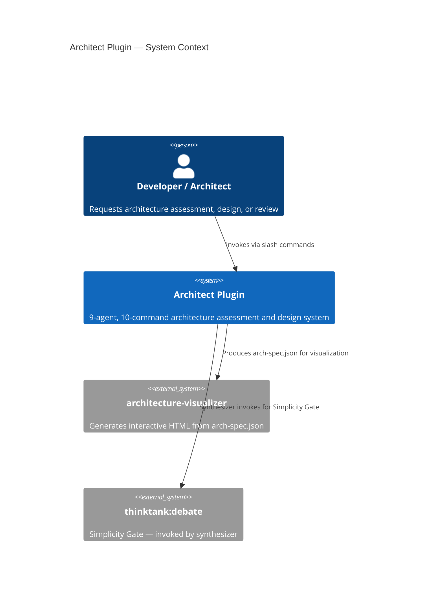
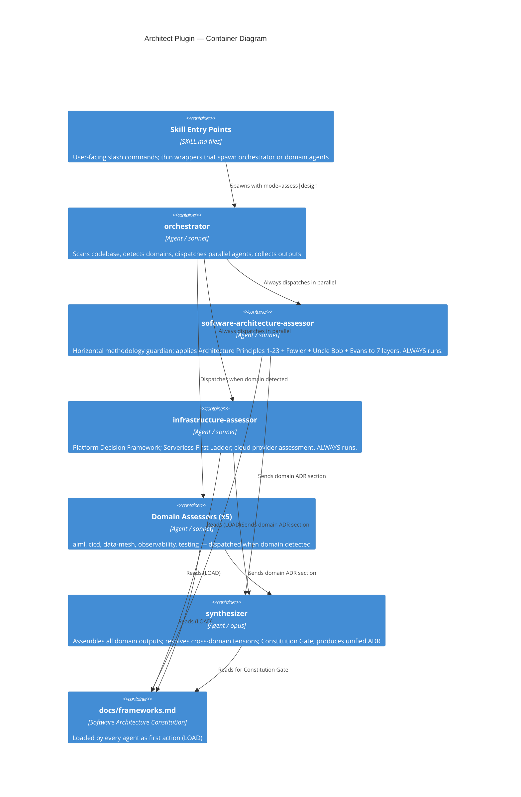

# ADR-002: Architect Plugin v2.0.0 — Pivot from Skill-Only to Agent-Based Architecture

**Status:** Accepted
**Date:** 2026-02-26
**Supersedes:** ADR-001 (which documented the original skill-only architecture)

## Context

The architect plugin (v1.0.1) was a skill-only plugin with 4 commands and a single execution thread. It applied horizontal architectural methodology (Architecture Principles, Fowler, Uncle Bob, Evans DDD) inline within one SKILL.md flow.

Two requirements made this architecture insufficient:

1. **Dispatch by agent name:** An orchestrator dispatches workers by `subagent_type` (agent name). It cannot natively dispatch a skill. A skill-only architect plugin is opaque to orchestrators.

2. **6 new architectural domains:** Adding AI/ML, CI/CD, Data Mesh, Observability, Testing, and Platform/Infrastructure as inline skill content would produce a SKILL.md that is too large to be useful, too slow to navigate, and not independently executable.

## Decision Drivers

- **Architecture Principle #9:** Compose Skills into AI Agents
- **Architecture Principle #12:** Agents Orchestrate Agents
- **Architecture Principle #18:** The Continuous Intelligence Loop requires dedicated domain agents that can independently observe, analyze, and assess different layers of the system simultaneously
- **Simplicity Principle:** The minimum architecture that satisfies both requirements — parallel execution + orchestrator dispatch — is an agent-based design with thin skill entry points
- **Principle of Explicit Architecture:** The horizontal/vertical split must be visible to users and contributors, not implicit in file naming

## Considered Options

### Option A: Expand Skill Files (rejected)

Add 6 new SKILL.md files for the new domains. Keep skill-only architecture.

**Why rejected:** Skills run sequentially within one Claude thread. No parallel execution. An orchestrator cannot dispatch them by agent type. Output is narrative, not structured for synthesizer consumption. Adding 6 domains inline would produce unwieldy SKILL.md files.

### Option B: Agent-Based with Skill Entry Points (chosen)

9 agents behind thin skill entry points. Skills remain as the user-facing interface. Agents do the work in parallel.

### Option C: Pure Agent Architecture (rejected)

Remove skills entirely — users invoke agents directly.

**Why rejected:** The skill-name routing system is the user-facing interface. Removing skills breaks discoverability and the `review` lightweight path.

## Decision Outcome

**Chosen: Option B — 9 agents with thin skill entry points.**

### The 9-Agent Architecture

| Agent | Model | Always Runs |
|---|---|---|
| `architecture-assess:orchestrator` | sonnet | — |
| `architecture-assess:software-architecture-assessor` | sonnet | YES |
| `architecture-assess:aiml-assessor` | sonnet | when detected |
| `architecture-assess:cicd-assessor` | sonnet | when detected |
| `architecture-assess:data-mesh-assessor` | sonnet | when detected |
| `architecture-assess:observability-assessor` | sonnet | when detected |
| `architecture-assess:testing-assessor` | sonnet | when detected |
| `architecture-assess:infrastructure-assessor` | sonnet | YES |
| `architecture-assess:synthesizer` | **opus** | — |

### Key Architectural Decisions

**Why `software-architecture-assessor` always runs:** Every system has foundational architecture. The horizontal methodology (Architecture Principles #1–#23, Fowler, Uncle Bob, Evans DDD) must be applied regardless of which domain agents are triggered. This agent is the explicit guardian of the Software Architecture Constitution.

**Why `infrastructure-assessor` always runs:** Every system has an infrastructure layer. The Serverless-First Ladder and Platform Decision Framework apply to every architecture, regardless of what application domains are present. Infrastructure is never optional.

**Why `synthesizer` uses opus:** Reconciling 6–9 domain reports, resolving cross-domain tensions, applying the Simplicity Gate, and producing a unified ADR is the most cognitively demanding task in the pipeline. Opus is the right model for this quality bar. Same reasoning as `tech-contracts:draft-agent`.

**Why horizontal frameworks are the Constitution, not agents:** Making the Architecture Principles + Fowler + Uncle Bob + Evans agents would fragment the methodology. They are evaluative criteria that all domain agents apply — not separate domains of assessment. The horizontal split is preserved by having every agent read `docs/frameworks.md` (LOAD), embed relevant principles (ANCHOR), and gate output through a Constitution Check (VERIFY).

**Why `software-architecture-assessor` is explicitly named (not "core-assessor" or folded into "orchestrator"):** The name makes the horizontal/vertical split visible. Contributors and users immediately understand that this agent applies cross-cutting software architecture methodology — it is not a domain specialist. The name is documentation.

**Why Architecture Principle #18 is reflected in the architecture:** The Continuous Intelligence Loop (OBSERVE → ANALYZE → DERIVE → TEST → TRAIN → DEPLOY → VERIFY → REINFORCE) requires dedicated agents that can independently assess the observability layer (OBSERVE), data pipeline (ANALYZE/TRAIN data), CI/CD layer (DEPLOY FREQUENTLY), testing layer (VERIFY OUTCOMES), and AI/ML layer (REINFORCE via RL loop). The agent decomposition directly mirrors the intelligence loop.

### The Constitution Protocol

Three-stage protocol ensuring horizontal principles govern every agent output:

1. **LOAD:** `Read docs/frameworks.md` — first action of every agent, always
2. **ANCHOR:** Domain-relevant Architecture Principles quoted directly in each agent's prompt (dilution defense)
3. **VERIFY:** Constitution Check before output — every recommendation grounded in constitution or flagged as outside methodology

### Consequences

**What becomes easier:**
- An orchestrator can dispatch any architect agent by `subagent_type`
- Domain agents run in parallel — full assessment in one orchestrated session
- Each domain can be invoked independently for a focused deep-dive (`/architecture-assess:cicd`, `/architecture-assess:aiml`, and so on)
- New domains can be added by adding one agent file + one skill file (O(1) growth, not O(n) complexity)
- The horizontal/vertical split is explicit, testable, and visible to contributors
- Architecture Principle #18 loop assessment spans dedicated agents (observability, data-mesh, cicd, testing, aiml)

**What becomes harder:**
- More files to maintain (25 total vs. 5 original)
- Agent prompt quality determines output quality — requires careful authoring
- Constitution Protocol adds a structural requirement to every future agent file

**When to revisit this architecture:**
- If agents regularly fail to synthesize across domains (revisit synthesizer model choice or add more structured output contracts)
- If the Constitution Protocol proves insufficient to prevent drift (consider runtime constitution injection)
- If use reveals orchestration patterns requiring a different agent interface

### Trade-offs

**Agent granularity vs. coordination overhead:** 9 agents means more coordination cost per run. Mitigated by: (1) always-run agents handle the common case; (2) domain detection is fast (file scanning, not reasoning); (3) orchestrator presents the plan before dispatching (user confirms scope).

**Skill entry points vs. direct agent dispatch:** Users continue to use familiar slash commands. The indirection (skill → agent) adds one hop. Benefit: skills remain the stable public interface; agents can evolve internally without breaking the user-facing interface.

## Diagrams

### C4 Level 1 — System Context

### C4 Level 2 — Container Diagram

## Simplicity Gate Verdict

**Is 9 agents justified?**

Yes. Each agent has a non-overlapping scope, a dedicated set of files to scan, specialist thought leaders, and can be independently invoked. The synthesis step (opus) is genuinely more demanding than any single domain assessment — a separate agent with a different model is correct.

The 9-agent count directly mirrors the structure of Architecture Principle #18: each stage of the intelligence loop (observe → analyze → train → deploy → verify → reinforce) maps to one or more dedicated agents. The architecture practices what it assesses.

**Could we achieve this with fewer agents?**

Combining domain agents would produce a bloated assessor that cannot be dispatched independently. The granularity matches the independence of the domains.

**What was ruled out:**

- Single "mega-assessor" agent: too large, not independently dispatchable
- Shared agent for infrastructure + software-architecture: both always run, but infrastructure is a separate domain (platform, cloud, serverless ladder) from the horizontal methodology (design patterns, layers, DDD)
- Haiku for any agent: all agents require substantive reasoning; haiku is not appropriate for architecture work
- Agents for the Architecture Principles + Fowler + Uncle Bob + Evans: these are horizontal evaluation criteria, not domains — they become the Constitution, not specialists
