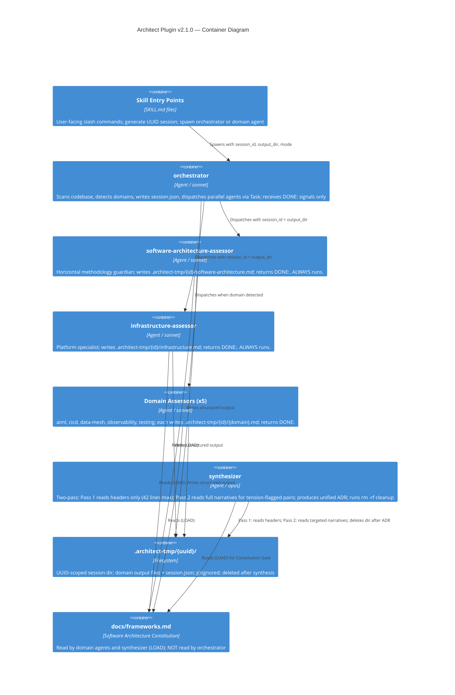

# ADR-003: Architect Plugin v2.1.0 — File-Based Inter-Agent Protocol and Context Window Optimization

**Status:** Accepted
**Date:** 2026-02-27
**Supersedes:** Partially — extends ADR-002 (which defined the 9-agent architecture); does not supersede it

---

## Context

The architect plugin v2.0.0 (ADR-002) introduced a 9-agent architecture where domain agents run in parallel and pass their outputs back through the Task tool to the orchestrator, which then forwards all content inline to the synthesizer. In production use — particularly when the orchestrator runs as a subagent — three compounding context window pressure points emerged:

### Problem 1: Orchestrator-as-Relay

Task tool results return to the caller's context window. With 2–7 domain agents each producing 200–500+ lines of structured assessment output, the orchestrator accumulates 400–3,500+ lines of domain content before it can dispatch the synthesizer. The orchestrator — whose only job is coordination — becomes a domain content dump.

**Impact:** Orchestrator compaction before synthesizer dispatch; coordination logic degraded by content overload.

### Problem 2: Synthesizer Inline Overload

All domain outputs were passed inline to the synthesizer's prompt. The synthesizer also reads `docs/frameworks.md` (474 lines). The agent doing the hardest cognitive work — cross-domain tension resolution, Simplicity Gate, Constitution Gate, ADR production — burned most of its context budget on receiving content rather than reasoning about it.

**Impact:** Context compaction mid-synthesis causes loss of cross-domain tension resolution state, directly degrading ADR accuracy.

### Problem 3: Orchestrator LOAD Waste

The orchestrator read all 474 lines of `docs/frameworks.md` as its first action (per the Constitution Protocol). However, the orchestrator only uses 4 coordination principles from the constitution. Its ANCHOR already embeds these 4 principles verbatim. The 474-line read was redundant for the orchestrator's actual function.

**Impact:** 474 lines of context budget consumed before any codebase scanning or coordination work begins.

### Subagent Amplification

When a skill dispatches `architecture-assess:orchestrator` as a sub-agent, the entire pipeline must fit within one context session. There is no external relay: the orchestrator, all domain agent results, and synthesizer must all share the same context window. The relay problem becomes acute.

---

## Decision Drivers

- **Architecture Principle #9:** Compose Skills into AI Agents — inter-agent contracts should be explicit and bounded
- **Architecture Principle #12:** Agents Orchestrate Agents — orchestrators coordinate, they do not accumulate
- **Architecture Principle #15:** Design for Resilience — pipelines that degrade under load are not resilient
- **Architecture Principle #18:** The Continuous Intelligence Loop — the loop cannot complete reliably if the agents in the loop share contaminated context
- **Simplicity Principle:** The minimum change that eliminates the problem without breaking the external interface
- **Zero-Commit Principle:** Temp artifacts used only for inter-agent coordination must never enter the git history

---

## Considered Options

### Option A: Increase Agent Context Budget (rejected)

Accept larger context windows as models improve. Do nothing architecturally.

**Why rejected:** Model context limits are finite and unpredictable; compaction behavior is model-specific. This is not a solution — it delays the problem. The relay architecture is inherently fragile regardless of context window size.

### Option B: Compress Domain Agent Output (rejected)

Require domain agents to produce only a 50-line summary for orchestrator consumption, with full detail written to a persistent file.

**Why rejected:** Forces domain agents to do double work (summary + full output). Summary quality is hard to enforce. Loses the two-pass optimization for the synthesizer. The relay problem (content returning to orchestrator) remains.

### Option C: File-Based Inter-Agent Protocol with UUID Session Scoping (chosen)

No domain content ever flows back through the Task tool to the orchestrator. Task calls return a completion signal only (`DONE: {domain-name}`). All domain content is written to a UUID-scoped temp directory and read directly by the synthesizer.

**Why chosen:** Eliminates the relay problem entirely. Enables true context isolation between the three pipeline stages (scan/coordinate, assess, synthesize). UUID scoping prevents collision in concurrent sessions. Fits the Simplicity Principle — no new agents, no new tools beyond Bash, minimal change to existing agent logic.

---

## Decision Outcome

**Chosen: Option C — File-based inter-agent protocol with UUID session scoping.**

---

## Architecture

### Temp Directory Layout

```
.architect-tmp/
└── {8-char-uuid}/
    ├── session.json                ← orchestrator writes: metadata + domain list
    ├── software-architecture.md   ← always written
    ├── infrastructure.md           ← always written
    ├── aiml.md                     ← written if detected
    ├── cicd.md                     ← written if detected
    ├── data-mesh.md                ← written if detected
    ├── observability.md            ← written if detected
    └── testing.md                  ← written if detected
```

`.architect-tmp/` is added to `.gitignore` and never committed.

### Session Lifecycle

**Step 1 — UUID generation:** The orchestrator generates an 8-character UUID at startup:
```bash
python3 -c "import uuid; print(str(uuid.uuid4())[:8])"
```
Creates `session.json`:
```json
{
  "session_id": "a3f7b2c1",
  "mode": "assess",
  "domains_detected": ["software-architecture", "infrastructure", "aiml"],
  "output_dir": ".architect-tmp/a3f7b2c1",
  "started_at": "2026-02-27T14:32:00Z"
}
```

**Step 2 — Domain agent execution:** Each domain agent receives `session_id` and `output_dir` as Task parameters. They run their full assessment, write `{output_dir}/{domain}.md`, and return `DONE: {domain-name}` as their Task result. The orchestrator receives only the completion signal — zero domain content in its context.

**Step 3 — Synthesizer execution:** The orchestrator dispatches the synthesizer with `output_dir`. The synthesizer reads files directly from disk. Domain content never flows through a Task prompt.

**Step 4 — Cleanup:** After writing the final ADR, the synthesizer deletes `.architect-tmp/{uuid}/` via Bash.

### Structured Domain Output Format

Every domain agent writes a YAML-style header before its narrative:

```
---
domain: aiml
status: complete
top_risks: 3
principles_applied: [2, 7g, 8, 15, 18]
constitution_check: pass
tension_flags: [infra-gpu-vs-serverless]
---

[full narrative assessment]
```

`tension_flags` explicitly names cross-domain tensions detected. The synthesizer uses these in Pass 1.

### Two-Pass Synthesizer

**Pass 1 — Build Findings Map (bounded):** Read each domain file header only (everything above the `---` separator). Extract `top_risks`, `principles_applied`, `constitution_check`, `tension_flags` into a compact findings map (~6 lines per domain, 42 lines max for 7 domains). Identify domains with matching `tension_flags`.

**Pass 2 — Synthesis (clean context):** Run cross-domain tension resolution, Simplicity Gate, Constitution Gate, and ADR production using:
- The findings map (compact, ~42 lines)
- Full narratives only for tension-flagged domain pairs (targeted reads)
- `docs/frameworks.md` (LOAD retained — synthesizer must anchor against the full constitution)

In the best case (no cross-domain tensions), the synthesizer never reads a single full domain narrative. In the worst case (all 7 domains flagged), it reads all narratives sequentially — but only after the findings map is complete, so it never holds all domain content simultaneously.

### Orchestrator LOAD Removal

The orchestrator no longer reads `docs/frameworks.md`. Its 4 coordination principles (Architecture Principle #9, #12, #15, #18) are embedded directly in the ANCHOR. The Constitution Protocol (LOAD → ANCHOR → VERIFY) is preserved in all domain agents and the synthesizer — only the orchestrator's LOAD is removed, as it is the only agent that does not apply the constitution to assessment work.

---

## Component Changes

| Component | Before (v2.0.0) | After (v2.1.0) |
|---|---|---|
| Orchestrator | Reads 474-line frameworks.md; receives all domain content via Task results | ANCHOR-only (4 principles); receives only `DONE:` signals |
| Domain agents (×7) | Return full assessment as Task result | Write to `{output_dir}/{domain}.md`; return `DONE: {domain}` |
| Synthesizer | Receives all domain content inline; single-pass synthesis | Two-pass (header scan → targeted reads); reads from file; Bash cleanup |
| Standalone skills (×7) | Spawn domain agent Task with no session scoping | Generate UUID; pass `output_dir`; read result file; cleanup |
| `.gitignore` | — | `.architect-tmp/` excluded |

## Context Window Impact

| Component | Before | After |
|---|---|---|
| Orchestrator | 474 lines (LOAD) + 400–3,500 lines (domain outputs) | Scan results + coordination only |
| Synthesizer | 474 lines + 2,000–5,000+ lines (all outputs inline) | 474 lines + 42 lines (findings map) + targeted narratives for flagged domains |

---

## Collision Safety

UUID-scoped temp dirs guarantee zero collision between:
- Multiple parallel Claude Code sessions on the same codebase
- Multiple runs of the plugin in parallel
- Simultaneous standalone domain command executions

The 8-character UUID (from Python's `uuid.uuid4()`) provides sufficient entropy for development-environment concurrency levels.

---

## Consequences

**What becomes easier:**
- A skill can dispatch the full pipeline as a lightweight sub-agent — internal context footprint is bounded regardless of domain count
- The pipeline degrades gracefully when context pressure is high: Pass 1 (header-only scan) always completes, even if Pass 2 targeted reads are constrained
- Adding new domain agents: add one agent file with the Output Protocol section — no change to orchestrator or synthesizer
- Standalone domain commands are composable: parallel execution of multiple domains is collision-safe via UUID scoping
- Temp artifacts are self-cleaning — no manual cleanup, no git pollution

**What becomes harder:**
- Domain agent output is now split across a file (narrative) and the Task result (completion signal) — contributors must follow the Output Protocol section in every domain agent file
- Debugging a session requires reading `.architect-tmp/{uuid}/` files before cleanup runs
- The synthesizer's two-pass logic is more complex than single-pass inline synthesis — prompt authoring requires understanding the header/narrative split

**When to revisit this architecture:**
- If the YAML header format proves too rigid for certain domain assessments (consider JSON header or free-form `tension_flags` field)
- If `.architect-tmp/` cleanup fails to run (synthesizer crashes before cleanup) — consider adding orchestrator-level cleanup fallback on next session start
- If model behavior evolves to handle larger inline contexts more gracefully than file reads (currently reading files is more reliable than large inline prompts)
- If the 8-char UUID proves insufficient for high-concurrency environments (CI/CD pipelines running many parallel assessments) — extend to 16 chars

---

## Trade-offs

**File I/O vs. inline context:** File reads introduce filesystem dependency. Mitigated by: (1) `.architect-tmp/` is local to the working directory, same as any project file; (2) failure modes are explicit (file not found) vs. silent (context compaction).

**Two-pass complexity vs. single-pass simplicity:** Pass 1 + Pass 2 is more logic than single-pass. Benefit: synthesizer context budget scales O(tension_pairs) not O(domain_count). For 7 domains with 0 cross-domain tensions, the synthesizer context is 474 + 42 = 516 lines vs. 2,000–5,000+ lines. The complexity budget is justified by the reliability gain.

**UUID temp dirs vs. named shared dir:** Named dir (e.g., `.architect-tmp/current/`) would be simpler but collides across parallel sessions. UUID is the minimum scoping required for concurrent correctness.

---

## Diagrams

### C4 Level 2 — Container Diagram (v2.1.0)



---

## Simplicity Gate Verdict

**Is the file-based protocol justified over inline relay?**

Yes. The inline relay architecture has a provable failure mode (context compaction with 7 domains × 300-line outputs = 2,100+ lines before synthesis begins). The file-based protocol eliminates this failure mode with two new constraints: (1) agents write a file; (2) agents return `DONE:`. Both are simpler than managing inline content.

**Could we achieve this with fewer changes?**

Option B (compress to summary) was rejected because it requires double work from domain agents and doesn't fix the synthesizer overload. No simpler option exists that fully eliminates both the relay problem and the synthesizer overload simultaneously.

**What was ruled out:**

- Shared (non-UUID) temp directory: collision risk in concurrent sessions — unacceptable
- Removing synthesizer LOAD of frameworks.md: synthesizer applies the full Constitution to its ADR — the LOAD is load-bearing for synthesis quality, unlike the orchestrator where LOAD was redundant
- In-memory passing via session.json: would require domain agents to serialize 200-500 lines into JSON — more complex than writing a markdown file
