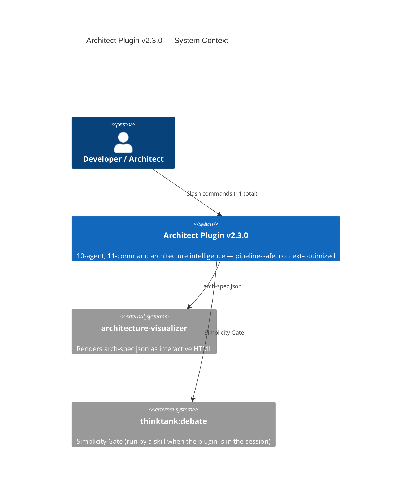
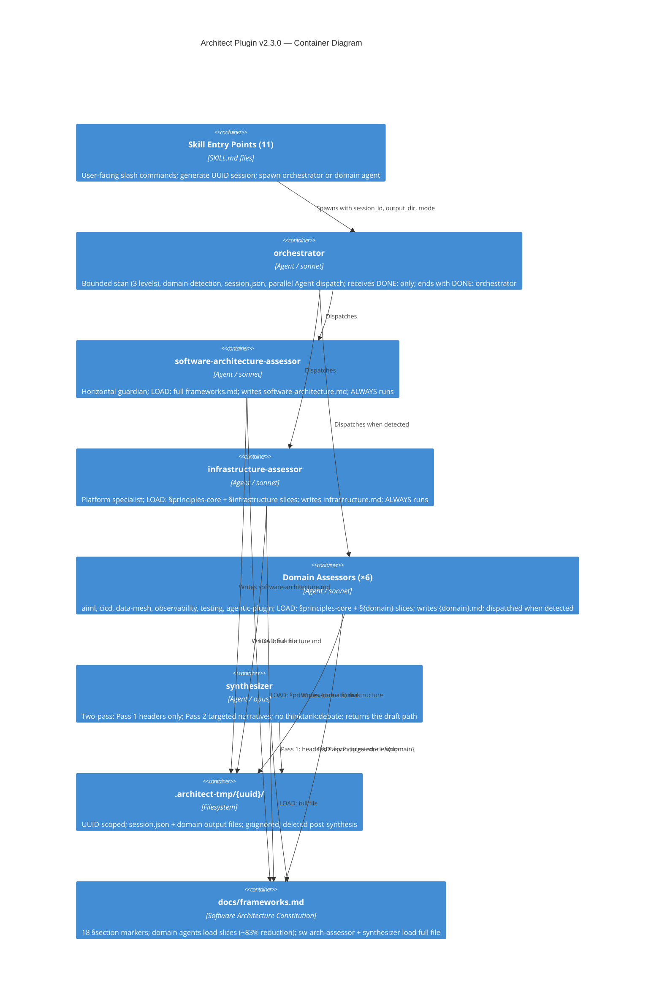

# ADR-004: Architect Plugin v2.2.0–v2.3.0 — Agentic Plugin Domain and Pipeline-Safe Orchestration

**Status:** Accepted
**Date:** 2026-03-02
**Extends:** ADR-003 (file-based inter-agent protocol and context window optimization)

---

## Context

Two sequential releases expanded the architect plugin after ADR-003:

### v2.2.0 — Agentic Plugin Architecture Domain

The marketplace of the authors had accumulated 9+ plugins, each requiring architecture review against the Agentic Plugin Principles (added as a distinct section in `docs/frameworks.md`). A new domain was needed that can score any project as `PLUGIN | BORDERLINE | TEMPLATE` — is this a genuinely differentiated AI plugin or a sophisticated prompt?

**Gap:** The architect plugin assessed software architecture but had no domain specialist for plugin/agent architecture itself. Plugin PRs were being reviewed against generic software architecture criteria rather than domain-specific plugin principles.

### v2.3.0 — Pipeline-Safe Orchestration

Post-ADR-003 analysis revealed three P0 blockers for running the pipeline without a person at the keyboard:

1. **Question inside an agent:** The orchestrator's Step 2 asked the person a question. That question blocks a run that has no person at the keyboard.

2. **Completion signal absent:** a caller needs a `DONE:` line and the path of the ADR draft. No completion signal existed.

3. **Gate propagation gap:** Even when the orchestrator did not ask, domain agents had their own interactive gates that blocked the run.

Additional context optimization opportunities identified:

- **P1:** frameworks.md loaded in full by 7 domain agents × ~600 lines = 4,200+ lines of redundant framework reads per run. Each domain agent uses only ~90-110 lines of the 600-line file.
- **P1:** Synthesizer's Simplicity Gate (`thinktank:debate`) dispatches 3 rounds × 4 agents = 12+ sub-agent calls in pipeline context — unbounded and inappropriate inside a pipeline.
- **P2:** Codebase scan had no depth bound — could produce O(n) Glob results on large monorepos.

---

## Decision Drivers

- **Architecture Principle #9:** Compose Skills into AI Agents — inter-agent contracts should be explicit and bounded
- **Architecture Principle #12:** Agents Orchestrate Agents — orchestrators coordinate, they do not accumulate
- **Architecture Principle #15:** Design for Resilience — pipelines that degrade under load are not resilient
- **Architecture Principle #18:** The Continuous Intelligence Loop — the loop cannot complete reliably if agents in the loop share contaminated context
- **Simplicity Principle:** The minimum change that eliminates the problem without breaking the external interface
- **Marketplace Coherence:** The architect plugin should be able to assess the architecture of any plugin in the marketplace, including itself

---

## Decisions

### v2.2.0 — Agentic Plugin Domain

**Add `agentic-plugin-assessor` as the 8th domain agent (Agentic Plugin Principles).**

**Detection signals:** `.claude-plugin/plugin.json`, `.claude-plugin/`, `agents/*.md`, `skills/SKILL.md`, `hooks.json`, `hooks-handlers/` — auto-detected by orchestrator in `/architecture-assess:assess`; also accessible as `/architecture-assess:agentic-plugin` standalone.

**Assessment phases (8):**
1. Real Data Integration (Principle 1) — external APIs, databases, live data
2. Compounding Value (Principle 2) — persistent memory, vector stores, session history
3. Artifact Delivery (Principle 3) — native format output vs. description
4. Context Isolation (Principle 4) — isolated background agent vs. inline execution
5. Quantification Engine (Principle 5) — domain-specific math vs. qualitative tiers
6. Cross-System Orchestration (Principle 6) — distinct authentication realms
7. Entity Intelligence (Principle 7) — entity-specific knowledge base
8. Outcome Tracking (Principle 8) — feedback loops, improvement over time

**Scoring:** `PLUGIN | BORDERLINE | TEMPLATE`
- `PLUGIN` — 2+ distinct authentication realms OR (persistent memory + native artifact generation + cross-system access)
- `BORDERLINE` — 1-2 external systems OR persistent memory without cross-system access
- `TEMPLATE` — no external integrations, no persistent memory, or single API without compounding value

**Note:** WebSearch as a standalone integration does NOT qualify for PLUGIN verdict — counts only when paired with persistent memory storage or multi-system orchestration.

**`constitution_check: indeterminate`** — new value for the case where Principle 1 verification needs the person, and the agent cannot ask. Synthesizer contract: exclude agentic-plugin domain verdict from ADR; the skill shows the value to the person.

**Cross-domain tension registry (agentic-plugin ↔ aiml):**
| Tension | Flag | agentic-plugin Phase | aiml Phase |
|---|---|---|---|
| Persistent memory and vector store architecture | `agentic-plugin-vs-aiml-persistent-memory` | Phase 2 | Phase 5 |
| Agentic orchestration and background dispatch | `agentic-plugin-vs-aiml-agentic-orchestration` | Phase 4 | Phase 7 |
| Outcome tracking and feedback loop design | `agentic-plugin-vs-aiml-outcome-tracking` | Phase 8 | Phase 9 |

### v2.3.0 — Pipeline-Safe Orchestration

**P0: No question inside an agent.** The orchestrator asks no question. It writes the domain plan into `session.json` and ends with `NEEDS-INPUT: orchestrator`. The skill shows the plan and asks the person to confirm it.

**P0: No gate in a domain agent.** Domain agents (including `agentic-plugin-assessor`) ask no question. They take the answer from the code, or they set `indeterminate`.

**P0: Completion signal contract.** The orchestrator ends with `DONE: orchestrator — adr_draft=<path>`. The synthesizer returns `DONE: synthesizer — adr_draft=<path>`, so the orchestrator can name the draft.

**P1: frameworks.md section markers.** 18 HTML comment anchors added (`<!-- §{slug}-start -->` / `<!-- §{slug}-end -->`) across 9 sections in `docs/frameworks.md`. Domain agents updated: LOAD instruction uses Grep to locate markers → Read with `offset`/`limit` to extract slice only. Fallback: if marker not found, read full file. Applies to 7 domain specialists; NOT to `software-architecture-assessor` (horizontal guardian, reads full constitution) or `synthesizer` (cross-cutting synthesis, reads full constitution).

**Context reduction from section markers:**
| Agent | Before | After |
|---|---|---|
| Per domain agent frameworks.md load | ~600 lines | ~90-110 lines |
| Total across 7 domain agents per run | ~4,200 lines | ~700 lines |
| Reduction | — | ~83% |

**P1: Simplicity Gate bounded.** The synthesizer does not dispatch `thinktank:debate`. It applies self-argumentation only. A skill runs `thinktank:debate` when the plugin is in the session.

**P2: Bounded codebase scan.** Orchestrator Step 1 caps at 3 directory levels; excludes `node_modules/`, `.venv/`, `dist/`, `build/`, `vendor/`, `.git/`.

---

## Component Changes

| Component | Before (v2.1.0) | After (v2.3.0) |
|---|---|---|
| Orchestrator | Asks the person; no completion signal; unbounded scan | No question; `NEEDS-INPUT` round trip; completion signal; bounded scan |
| Domain agents (×7) | Full frameworks.md LOAD (~600 lines) | §section-marker slice LOAD (~90-110 lines); fallback to full read |
| Synthesizer | Always invokes thinktank:debate; no path return | Applies self-argumentation only; returns the draft path in its `DONE:` line |
| `agentic-plugin-assessor` | — | New 8th domain: PLUGIN/BORDERLINE/TEMPLATE scoring; 8-phase assessment; `indeterminate` constitution_check when it cannot ask |
| `docs/frameworks.md` | Agentic Plugin Principles section (v2.2.0) | + 18 §section-marker HTML comments (v2.3.0) |
| Plugin version | 2.1.0 | 2.3.0 |
| Agent count | 9 | 10 |
| Command count | 10 | 11 |
| Domain count | 6 | 7 |

---

## Consequences

**What becomes easier:**
- A skill can run the pipeline as a first-class step — the agents ask no question, so a run needs no person inside the agents
- The `DONE:` line names the draft, so a caller finds the result with no extra file
- Each domain agent's context budget is more predictable — slice loading is bounded, fallback is explicit
- The architect plugin can assess its own marketplace siblings — and itself — with domain-appropriate criteria
- Adding new domain agents: add new `<!-- §{new-slug}-start/end -->` markers to frameworks.md

**What becomes harder:**
- `docs/frameworks.md` now has 18 HTML comment markers that must be maintained when sections are reorganized — marker drift would cause agents to fall back to full-file reads
- `constitution_check: indeterminate` introduces a new synthesizer contract — contributors must handle this case in the synthesizer's Pass 2
- The agentic-plugin domain's Principle 1 check needs the person — the agent cannot confirm it without production call-site detection

**When to revisit:**
- If Grep+Read slice pattern proves too brittle (marker drift) — consider a Python extraction script
- If `indeterminate` constitution_check proliferates — extract the Principle 1 verification into a shared sub-agent

---

## Diagrams

### C4 Level 1 — System Context (v2.3.0)

### C4 Level 2 — Container Diagram (v2.3.0)

---

## Simplicity Gate Verdict

**No question inside an agent:** The minimum change is to move each question into the skill. No new agent, no new infrastructure.

**Completion signal as a line:** The `DONE:` line with the draft path is consistent with the file-based inter-agent protocol established in ADR-003.

**Section markers over split files:** 18 HTML comments added to one file is simpler than splitting `docs/frameworks.md` into 9 files (which would require updating all import paths and agent LOAD instructions). Markers are invisible to readers (HTML comments) and gracefully fall back to full-file reads if missing.

**Eighth domain (agentic-plugin) vs. new plugin:** The agentic-plugin assessment shares the same file-based inter-agent protocol, Constitution Protocol, and synthesizer as all other domains. Adding it as a domain is strictly simpler than a new standalone plugin — zero new infrastructure, one new agent file and one new skill file.
