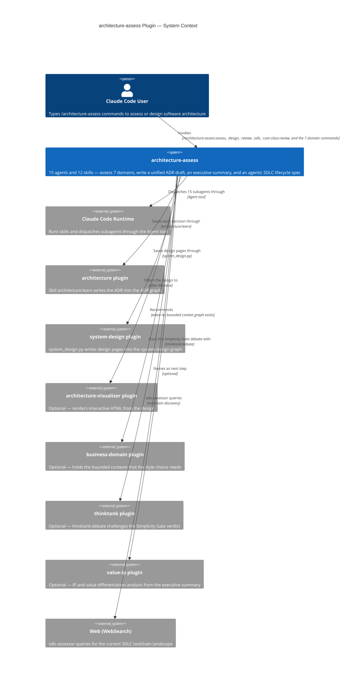

# architecture-assess — C4 Diagrams

## Level 1 — System Context



## Level 2 — Container Diagram

```mermaid
C4Container
    title architecture-assess Plugin — Containers

    Person(user, "Claude Code User")

    Container_Boundary(plugin, "architecture-assess plugin") {
        Container(skills, "12 skills", "SKILL.md files", "Run in the main conversation. Ask the person, dispatch agents, show the plan, write the plain files, and save through architecture:learn and system_design.py")

        Container(orchestrator, "orchestrator", "Sonnet agent", "Phase plan: scan, write the domain plan into session.json, end with NEEDS-INPUT. Phase run: dispatch the confirmed assessors, the sweep, the synthesizer, the executive summary and the SDLC chain")
        Container(wave_orch, "wave-orchestrator", "Sonnet agent", "Completion sweep, no team: reads each .done file, writes wave-timeout.json for missing domains, returns wave-complete or wave-partial")

        Container_Boundary(domain_assessors, "Domain Assessors (parallel, one message)") {
            Container(sw_arch, "software-architecture-assessor", "Sonnet", "23 Architecture Principles + Fowler + Uncle Bob + Evans DDD — always runs")
            Container(aiml, "aiml-assessor", "Sonnet", "Karpathy / Chip Huyen / Andrew Ng / Lilian Weng — dispatched when AI/ML signals detected")
            Container(data_mesh, "data-mesh-assessor", "Sonnet", "Zhamak Dehghani 4 principles + Reis/Housley lifecycle")
            Container(infra, "infrastructure-assessor", "Sonnet", "Serverless-first ladder + Cloud Well-Architected")
            Container(agentic, "agentic-plugin-assessor", "Sonnet", "Agentic Plugin Principles — dispatched when plugin/agent signals detected")
            Container(cicd, "cicd-assessor", "Haiku", "Jez Humble + Dave Farley + DORA 4 metrics — pattern-matching domain")
            Container(obs, "observability-assessor", "Haiku", "Charity Majors + Cindy Sridharan + OpenTelemetry — pattern-matching domain")
            Container(testing, "testing-assessor", "Haiku", "Kent Beck + Michael Feathers + Dave Farley TDD — pattern-matching domain")
        }

        Container(synthesizer, "synthesizer", "Opus agent", "Two-pass synthesis — reads YAML headers first, then full narratives for gap/conflict domains; resolves cross-domain tensions; applies Simplicity Gate; writes unified-adr.md and, in design mode, design-pages.json")
        Container(exec_summary, "executive-summary-agent", "Sonnet agent", "Translates the draft into a one-page CPO/board executive summary with health score table, top risks, and actions")

        Container_Boundary(sdlc_chain, "SDLC Chain (sequential)") {
            Container(sdlc_assessor, "sdlc-assessor", "Sonnet agent", "Constructive: maps codebase to 21-step agentic SDLC lifecycle, classifies Tier 0–4 maturity, discovers toolchain via WebSearch, writes sdlc-spec.md")
            Container(sdlc_challenger, "sdlc-challenger", "Sonnet agent", "Adversarial: stress-tests sdlc-spec.md across 7 dimensions, writes challenge-flags.json + sdlc-challenge-report.md")
        }

        Container(cost_gate, "cost-class-gate-agent", "Sonnet agent", "Standalone: classifies the cost class of a new agentic feature through cost_class_emitter.py and writes the status file")

        Container(sdlc_frameworks, "docs/sdlc-frameworks.md", "Reference doc", "14 section-marker-bounded sections — §chain, §zone-model, §discovery-tiers, §roles, §harness, §maturity, §pilot, §platform, §do-now, §feature-spec, §plugin-marketplace-maturity, §autonomy, §toolchain-sources, §lens")
        Container(tmp_folder, ".architect-tmp/id/", "Temp folder", "session.json, domain files, .done files, unified-adr.md, executive-summary.md, design-pages.json. session.py makes and deletes it")
    }

    Rel(user, skills, "Invokes")
    Rel(skills, orchestrator, "Dispatches twice: phase plan, then phase run")
    Rel(skills, cost_gate, "Dispatches")
    Rel(orchestrator, domain_assessors, "Dispatches the confirmed ones in one message")
    Rel(orchestrator, wave_orch, "Dispatches once after the assessors return")
    Rel(wave_orch, domain_assessors, "Checks .done files of")
    Rel(orchestrator, synthesizer, "Dispatches after the sweep")
    Rel(orchestrator, exec_summary, "Dispatches after the synthesizer")
    Rel(orchestrator, sdlc_assessor, "Dispatches with the executive summary")
    Rel(sdlc_assessor, sdlc_challenger, "sdlc-spec.md read by (dispatched by orchestrator)")
    Rel(sdlc_assessor, sdlc_frameworks, "Loads §lens, §maturity, §chain, §harness, §toolchain-sources via Grep")
    Rel(sdlc_challenger, sdlc_frameworks, "Loads §lens via Grep")
    Rel(domain_assessors, tmp_folder, "Write domain files to")
    Rel(synthesizer, tmp_folder, "Writes the draft to")
```
