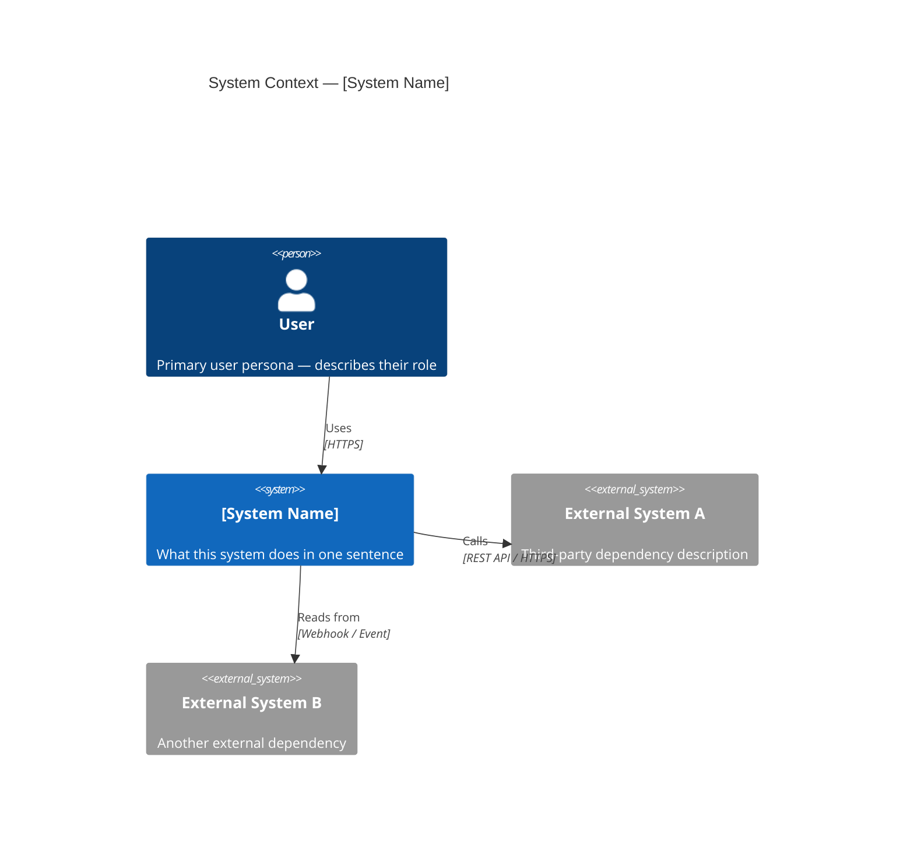
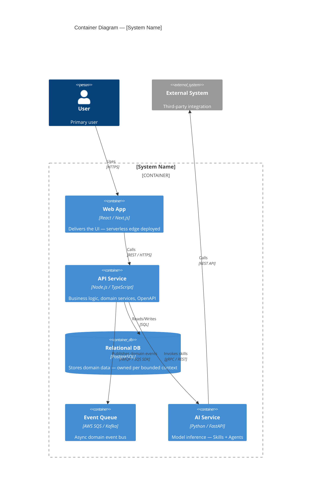
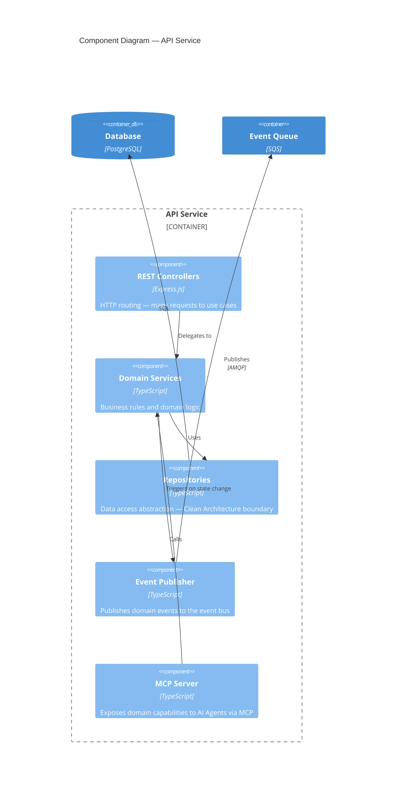
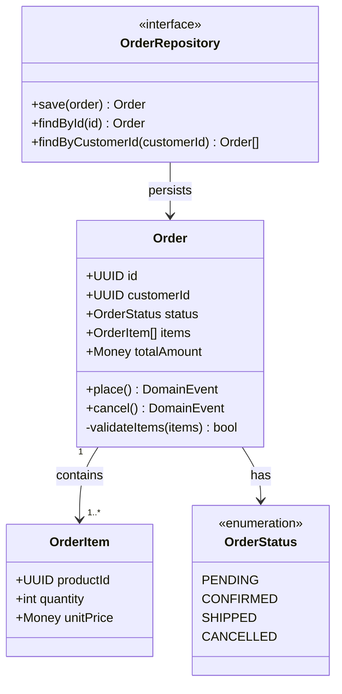

# Software Architecture Constitution — Horizontal, Cross-Cutting Foundational Methodology

> **This file is the Software Architecture Constitution.** Agents follow a three-tier loading strategy: (1) **Full-load** — synthesizer and software-architecture-assessor read the full file; (2) **Slice-load** — all other domain assessors load only their relevant section via Grep+Read markers; (3) **Anchor-only** — orchestrator uses an embedded ANCHOR block (per ADR-003, no file load). All agents embed domain-relevant principles in their prompt (ANCHOR) and gate output through a Constitution Check (VERIFY).

## The Constitution Protocol

All agents of this plugin follow a mandatory three-stage protocol:

| Stage | Action | Purpose |
|---|---|---|
| **LOAD** | Full file (synthesizer, software-architecture-assessor) · Domain slice via Grep+Read markers (domain assessors) · Embedded ANCHOR only (orchestrator, per ADR-003) | Loads constitution at the appropriate depth |
| **ANCHOR** | Domain-relevant Architecture Principles quoted directly in agent prompt | Dilution defense for long sessions |
| **VERIFY** | Constitution Check before output | Every recommendation grounded in constitution or flagged |

---

# Architecture Frameworks & Methodologies Reference

This document is the canonical reference for the frameworks and methodologies used by the `architecture-assess` plugin. Every assessment, design, and review decision is evaluated against these sources of truth — applied simultaneously as a unified methodology.

---

<!-- §principles-core-start -->
## The Architecture Principles (23)
### 23 Principles for Good Architecture in the Era of AI
*by Luis F. Amadeo*

1. **Evolutionary Architecture First.** An AI architecture, just like any software architecture, needs to be an EVOLUTIONARY ARCHITECTURE. It can start as simple as needed to solve a specific Job to Be Done, and evolve to more complexity as scale and more complex jobs are added.

2. **AI and ML Are from the Same Fabric.** Artificial Intelligence (AI) and Machine Learning (ML) are both from the same fabric: math, statistics, and using the right mathematical algorithm and structure against the correct model architecture and hardware infrastructure for the speed, accuracy, and cost acceptable by the business.

3. **Ground Yourself in the Fundamentals.** AI and ML — as well as Deep Learning and Reinforcement Learning — are based on the fundamentals of the Neuron, the Bellman Equation, Markov Decision Process, Temporal Difference, Deep Neural Networks, training, and fine-tuning in an endless loop of learning from results and adjusting models. All advances of AI stem from these fundamentals. These architectures and components will always be in motion and advancing against these fundamentals.

4. **AI Features Are Invisible — Outcomes Are Not.** AI features are architected and designed to maximize SPEED and ACCURACY of a Job to Be Done or a Problem to Be Solved. The end user does not need to know it is AI-architected. What matters is the EXPERIENCE — how AI ensures the end user can accomplish a JTBD or solve a problem with higher levels of speed and accuracy.

5. **Statistics and Probabilities Drive Speed and Accuracy.** AI and ML models increase the speed and accuracy of any job to be done using statistics and probabilities provided by AI models.

6. **Deep Neural Networks Are Worth the Cost — When It Matters.** Machine Learning models that do not involve Neural Networks are cheaper and can be good enough — but without a Deep Neural Network, ML models will never be as precise, accurate, and fast as a model with a DNN. Choose accordingly.

7. **AI Architectures Thrive in the Right Software Foundation.** AI architectures require a specific enabling software architecture to perform at their best:
   - **#7a (Decoupled Microservices):** that can scale and deploy independently the individual components that make the whole system
   - **#7b (Domain Driven Design):** with proper object/component/domain boundaries, responsibilities, and interfaces
   - **#7c (Bounded Context Session Isolation):** each bounded context in a multi-domain repository must have its own agent context file (e.g., `CLAUDE.md`) encoding its ubiquitous language, domain-specific constraints, and prior decisions. A single root context file for a multi-domain repository forces agents working in any bounded context to load context from all others — polluting sessions with irrelevant domain knowledge and degrading output quality. DDD's bounded context principle extends fully into the agent session layer.
   - **#7d (Event-Driven Architectures):** that enable Domain Services to publish Domain Events and listen to other Domain Events — ensuring the best possible reactive UX as well as triggers for training events and data pipelines
   - **#7e (OpenAPI-compliant APIs):** that are well-formed and discoverable — enabling MCP Servers to encapsulate interfaces, preventing data/business rule corruption, and allowing AI Agents to communicate via MCP in natural language
   - **#7f (CI/CD pipelines):** with feature flags, A/B canary testing, and an AIOps (MLOps, LLMOps) internal operational pipeline — enabling the system to react to changes, risks, vulnerabilities, and market threats faster through new trained or fine-tuned AI features
   - **#7g (Data pipelines):** from transactional data through event-sourced topics in Near-Real-Time (CDC included) into a Data Mesh — providing the foundation for Data Science training data sets and Ground Truth stores needed to create differentiated AI models
   - **#7h (Frontier Models first):** always test and use frontier models first, but not at the expense of value dilution disproportionate to cost. When frontier models are too expensive, insufficiently differentiating in speed/accuracy versus competitors, or cannot meet product speed/accuracy requirements — a new model must be developed
   - **#7i (Responsible AI):** Bias, ethics, and morality are at the core of any AI model and must be tested prior to deployment

8. **Encapsulate Models into AI Skills.** Models for AI and ML can be encapsulated into AI Skills.

9. **Compose Skills into AI Agents.** One or many AI Skills can be encapsulated into an AI Agent.

10. **Agents Achieve Outcomes.** One or many AI Agents can achieve an Outcome, with Speed, Accuracy, and Cost dependent on the Skills and Models used.

11. **Agents Use Tools.** AI Agents and AI Skills can use Tools to help perform a Skill or achieve an Outcome. Skills can be a separate program, API, or MCP Server — with the Tool acting as an MCP Client.

12. **Agents Orchestrate Agents.** An AI Agent can be an orchestrator of other AI Agents. When an AI Orchestrator orchestrates a full Job to Be Done involving many AI Agents in sequential and/or parallel orchestration, this becomes an Agentic Process or Agentic Workflow.

13. **Agentic Processes Often Need a Human in the Loop.** An Agentic Process or Workflow can — and many times SHOULD — have a human user in the loop to ensure the Agentic Process (AI Agents, Skills, Tools) is doing the job properly.

14. **The Human Is Always in Control.** When a human user is added to an Agentic Process or Experience, this is referred to as Human-in-the-Loop (HITL). The human is always in control — either through HITL UX front-ends, permissions configurations, or AI model hyperparameter configurations prior to enabling AI Agents or Agentic Processes to execute. How the end user configures and triggers AI is up to the requirements, unmet needs, and designs the product is targeting.

15. **Bias, Ethics, and Responsible AI Are Non-Negotiable.** Every AI model must be tested for bias, responsible use, ethical alignment, and moral integrity before deployment. This is not optional.

16. **Serverless and Usage-Based Infrastructure by Default.** AI solutions and products should always strive to run on infrastructure that is USAGE-BASED-PRICED with a PAY-AS-YOU-GO methodology to reduce compute and storage costs — ONLY WHEN IT DOES NOT IMPACT the speed and accuracy of the AI solutions. Therefore: Serverless Functions and Serverless Platforms are the preferred starting point for deployment. Language preferences follow this constraint: Front-End and business layer compute = JavaScript/TypeScript; AI and ML services = Python.

17. **The Economic Equation Is the Final Test.** The economics of AI in the architecture is simple: COST must be proportional to the SPEED and ACCURACY the model provides, at the PRICE POINT the customer is willing to pay, at the TIME they are willing to pay for it. This is at the core of how every system should be architected.

18. **The Continuous Intelligence Loop.** Software systems become MOST INTELLIGENT when they: OBSERVE what is happening in real time → ANALYZE the TRANSACTIONAL DATA and PERSISTED STATE → DERIVE a HYPOTHESIS for IMPROVEMENT → TEST that hypothesis → TRAIN the system and MODELS based on the results → DEPLOY FREQUENTLY the SOLUTION → TEST at runtime to VERIFY OUTCOMES → create a REINFORCEMENT LEARNING LOOP to CONTINUOUSLY IMPROVE THE SYSTEM. All of this must be done while keeping the HUMAN-IN-THE-LOOP of all AI and ML work. This is not a phase of development — it is a permanent operational cycle. Systems that do not implement this loop are not intelligent; they are static.

19. **Specs Are Agent Contracts, Not Just Human Documents.** A specification that will be executed by agents must include machine-readable agent directives alongside the human-readable narrative. Without explicit directives — which context files to load, which execution gates apply, what is out of scope — agent behavior varies by session, by model, and by context window state. The spec-to-agent execution bridge must be declarative: a versioned, structured block in every spec that makes agent behavior reproducible rather than inferred. A spec without agent directives is incomplete when the executor is an AI.
   - **Context loading is declared, not inferred** — the spec lists exactly which files agents must load before executing. Agents that infer context load different content across sessions.
   - **Gates are explicit, not narrative** — execution gates (simulate before plan, TDD guard, acceptance criteria verification) must be declared in the spec, not embedded in prose the agent may or may not re-read.
   - **Model assignments are intentional** — fast models for simulation, balanced models for implementation, strong models for autonomous diagnosis. The spec declares which model applies to which task.

20. **Context Investment Must Be Proportional to Decision Irreversibility.** The investment in discovery, specification, and design before engineering begins must be proportional to the irreversibility of the decision being made — not uniform across all change types. Applying full discovery to every change kills engineering velocity. Applying no discovery to irreversible product decisions produces agents that build the wrong thing with confidence. The question is not "did we complete the process?" — it is: **do agents have sufficient product context to execute this correctly?**
   - **Full** — new products or standalone offerings: Business Case + PRD + Technical Design before any implementation. Agents must not proceed without this context.
   - **Lightweight** — major new capability of an existing product: PRD delta + Technical Design referencing the existing Business Case.
   - **Minimal** — minor feature or enhancement: a PRD entry with acceptance criteria is sufficient.
   - **None** — bug fix, maintenance, performance: a ticket is sufficient. No spec required.

21. **Deterministic Operations Must Be Code, Not Prompts.** Any operation that must produce the same output given the same input — compliance calculations, eligibility rules, bid algorithms, scheduling logic, domain business rules — must be implemented as tested, version-controlled code, not delegated to an LLM prompt. LLMs are probabilistic by nature; business rules are not. Delegating deterministic operations to a language model introduces non-reproducibility, untestable behavior, and compliance risk. The architectural boundary is clear: JUDGMENT, SYNTHESIS, and INFERENCE belong in model space. CORRECTNESS-CRITICAL, DETERMINISTIC operations belong in code.
   - **Deterministic Tool Library** — domain functions and compliance calculations committed as typed, tested code callable as agent tools. Same input always produces same output. Testable. Auditable.
   - **The correctness boundary** — if incorrect output is occasionally acceptable, model space is appropriate. If incorrect output is never acceptable, code is required. This boundary must be identified at design time, not discovered at runtime.
   - **Testability is the signal** — if you cannot write a unit test that verifies the correct answer deterministically, the operation does not belong in a prompt.

22. **A Spec and a Plan Are Different Artifacts With Different Purposes.** A specification answers *what* and *why* — it defines requirements, acceptance criteria, scope boundaries, agent directives, and the product context agents need to execute correctly. A plan answers *how* and *in what order* — it defines the execution sequence, task decomposition, agent assignments, file targets, and verification steps. Conflating the two produces documents that fail at both jobs: too vague to execute from, too prescriptive to reason about intent. A spec without a plan leaves agents to infer execution strategy from narrative — they will infer differently each session. A plan without a spec executes the wrong thing correctly and with confidence. Both artifacts are required for agentic delivery. Neither substitutes for the other.
   - **The spec is stable across executions** — requirements, acceptance criteria, and out-of-scope boundaries do not change between runs. The plan may be revised after simulation, after dependency discovery, after task decomposition.
   - **The spec declares intent; the plan operationalizes it** — if the plan contradicts the spec, the spec wins. If the plan reveals the spec is ambiguous, the spec must be updated first.
   - **Task decomposition belongs in the plan, not the spec** — breaking work into parallel vs. sequential tasks, assigning models, and sequencing commits are execution decisions, not product decisions.

23. **Every Plan Must Be Simulated Before Execution Begins.** A plan that has not been simulated is a hypothesis. Simulation is the quality gate between plan authorship and agent execution — it validates structural feasibility before any implementation token is spent. Agentic plans fail in specific, predictable ways: tasks ordered sequentially that could run in parallel (wasting wall-clock time), tasks ordered in parallel that share mutable state (producing race conditions), context windows that exceed agent budget mid-task, dependencies that cannot be resolved in the target environment, and tool or library assumptions the agent cannot verify at runtime. Simulation catches these failures at plan cost, not at implementation cost. A plan that passes simulation has evidence of executability. A plan that skips simulation is an act of optimism.
   - **Parallelism must be validated, not assumed** — tasks appear independent until simulation reveals shared file targets, shared state, or ordering dependencies. Simulate before assigning parallel vs. sequential.
   - **Context window budgets are a hard constraint** — each agent in the plan has a finite context budget. Simulation models how much context each task consumes and flags tasks that will exceed budget before the agent fails mid-execution.
   - **Dependency resolution must be confirmed** — libraries, frameworks, MCP servers, and external APIs referenced in the plan must be verified reachable and installable in the target environment before execution begins. Agents that discover missing dependencies mid-task leave partial implementations.
   - **Simulation output is a plan amendment, not a pass/fail verdict** — the output of simulation is a revised plan with task ordering corrections, context budget annotations, dependency pre-flight steps, and flagged ambiguities that require resolution before execution begins.
<!-- §principles-core-end -->

---

## Martin Fowler — Key Contributions

**Evolutionary Architecture** *(with Neal Ford & Rebecca Parsons)*
Architecture should support incremental, guided change across multiple dimensions as a first principle. Fitness functions are used to ensure architectural characteristics are preserved as the system evolves.

**Microservices**
Small, independently deployable services organized around business capabilities. Key patterns: API Gateway, Service Mesh, Sidecar, Circuit Breaker, Bulkhead.

**Event Sourcing & CQRS**
Store state as a sequence of events rather than current state. Command Query Responsibility Segregation separates read and write models — enabling event-driven data pipelines and audit trails.

**Strangler Fig Pattern**
Incrementally replace legacy systems by routing functionality to new implementations. The old system is gradually strangled as new capabilities take over — enabling evolutionary migration without big-bang rewrites.

**Continuous Delivery** *(with Jez Humble)*
Every commit should be deployable to production. CI/CD pipelines, trunk-based development, and feature flags enable safe, frequent releases.

**Monolith First**
Start with a well-structured monolith before decomposing into microservices. Premature decomposition creates distributed monolith problems.

---

## Robert C. Martin ("Uncle Bob") — Key Contributions

**Clean Architecture**
The Dependency Rule: source code dependencies must point inward — toward higher-level policies, away from lower-level details. Entities → Use Cases → Interface Adapters → Frameworks & Drivers. Business logic is independent of frameworks, databases, and UIs.

**SOLID Principles**
- **S**ingle Responsibility: a class/module should have one reason to change
- **O**pen/Closed: open for extension, closed for modification
- **L**iskov Substitution: subtypes must be substitutable for their base types
- **I**nterface Segregation: many specific interfaces are better than one general interface
- **D**ependency Inversion: depend on abstractions, not concretions

**Component Principles**
Cohesion: REP (Reuse/Release Equivalence), CCP (Common Closure), CRP (Common Reuse).
Coupling: ADP (Acyclic Dependencies), SDP (Stable Dependencies), SAP (Stable Abstractions).

**Clean Code**
Code should read like well-written prose. Functions do one thing. Names reveal intent. No surprises.

---

## Eric Evans — Domain-Driven Design (DDD)

**Bounded Contexts**
The primary tool for decomposing large systems. Each bounded context has its own Ubiquitous Language, its own model, and its own team. Context boundaries are explicit, not assumed.

**Ubiquitous Language**
A common, rigorous language shared between developers and domain experts within a bounded context. Code and conversations use the same terms.

**Strategic Design**
Context Mapping defines relationships between bounded contexts:
- **Anti-Corruption Layer (ACL)** — translates between models, prevents upstream corruption
- **Published Language** — well-documented shared model for cross-context communication
- **Conformist** — downstream adopts upstream model as-is
- **Customer/Supplier** — upstream prioritizes downstream needs
- **Partnership** — mutual dependency, coordinated evolution

**Tactical Design**
- **Aggregates** — consistency boundaries, only one aggregate per transaction
- **Entities** — objects with identity that persists across time
- **Value Objects** — immutable, defined by attributes not identity
- **Domain Events** — something that happened in the domain that domain experts care about
- **Repositories** — collection-like abstractions over persistence

**Event Storming** *(Alberto Brandolini, DDD-aligned)*
Collaborative modeling technique to discover domain events, commands, aggregates, and bounded contexts. The starting point for any event-driven architecture design.

---

## Cloud Well-Architected Frameworks

### AWS Well-Architected Framework
Six pillars applied to every cloud architecture:
1. **Operational Excellence** — run and monitor systems to deliver business value
2. **Security** — protect information, systems, and assets
3. **Reliability** — recover from failures, meet demand
4. **Performance Efficiency** — use resources efficiently
5. **Cost Optimization** — avoid unnecessary cost
6. **Sustainability** — minimize environmental impact

### Google Cloud Architecture Framework
Equivalent pillars: Operational Excellence, Security/Privacy/Compliance, Reliability, Performance/Cost Optimization, each with GCP-specific guidance.

### Microsoft Azure Well-Architected Framework
Five pillars: Reliability, Security, Cost Optimization, Operational Excellence, Performance Efficiency — with Azure-specific implementation patterns.

### 12-Factor App
The foundational methodology for cloud-native SaaS: codebase, dependencies, config, backing services, build/release/run, processes, port binding, concurrency, disposability, dev/prod parity, logs, admin processes.

---

## Diagram Standards Used by This Plugin

### C4 Model *(Simon Brown)*
The primary diagramming standard — audience-adaptable, modern, widely adopted. All diagrams are text-based Mermaid syntax that renders natively in GitHub, GitLab, Notion, and VS Code.

#### Level 1 — System Context
Who uses the system; what external systems it interacts with. Audience: everyone, including executives.



#### Level 2 — Container
Major deployable units inside the system boundary. Audience: technical stakeholders and architects.



#### Level 3 — Component
Internal structure of a single container. Audience: engineers building or maintaining that container.



#### Level 4 — Code
Structural design within a component: domain aggregates, entities, value objects, and class relationships. Audience: engineers implementing that component. Use Mermaid `classDiagram` for structural view or `sequenceDiagram` for behavioral view.



**When to generate each level:**
- **L1** — always. Every output includes the System Context.
- **L2** — always. Every output includes the Container diagram.
- **L3** — when the assessment/design focuses on the internals of a specific container, or when a bounded context decomposition decision requires it.
- **L4** — when designing or reviewing domain model structure, aggregate boundaries, or Clean Architecture layer dependencies within a component.

### Mermaid Diagrams (Supporting)
In addition to C4, embedded in Markdown ADRs for specific architectural concerns:
- **Sequence diagrams** — API flows, event flows, AI agent orchestration, HITL interaction flows
- **Flowcharts** — event-driven pipelines, CI/CD + AIOps pipelines, data mesh data flows
- **ER diagrams** — data layer entity relationships, aggregate persistence schemas
- **State diagrams** — AI model lifecycle, feature flag states, order/workflow state machines

### Event Storming Notation
For DDD and event-driven architecture design:
- Orange: Domain Events
- Blue: Commands
- Yellow: Aggregates
- Pink: External Systems
- Purple: Policies/Reactions

### ADR Format *(Michael Nygard, extended)*
```
# ADR-NNN: [Decision Title]
Status: [Proposed | Accepted | Deprecated | Superseded]
Date: YYYY-MM-DD

## Context
## Decision Drivers
## Considered Options
## Decision Outcome
### Consequences
### Trade-offs
## Diagrams
## Evolution Roadmap
## Simplicity Gate Verdict
```

---

---

## Domain Frameworks — Specialist Methodology

The following frameworks govern the specialist domain agents. They complement the Software Architecture Constitution above — the horizontal principles always take precedence when there is a conflict.

---

<!-- §aiml-start -->
### AI/ML and Agentic AI

#### Andrej Karpathy — Software 2.0 + LLM OS

- **Software 2.0:** Neural networks replace handcrafted rules. ML code has its own lifecycle (train → eval → deploy) that is separate from and parallel to traditional software engineering. The data pipeline that feeds training is a first-class infrastructure concern.
- **LLM OS Analogy:** LLM as kernel, context window as RAM, tools/functions as system calls, multi-agent as multi-processing, files and databases as storage. Systems that host AI agents must expose machine-readable, MCP-friendly interfaces by design.
- **Scaling Laws:** Compute-optimal model selection (Chinchilla scaling laws). Model choice is an economics decision first: cost per token × quality × latency must be within the customer's WTP at the current business stage.
- **DNN + Transformer Architecture:** Attention mechanism, encoder vs. decoder vs. encoder-decoder trade-offs, context window implications — the architectural decision framework for model selection. Assessors must evaluate whether the chosen model architecture matches the actual task (classification vs. generation vs. reasoning).

#### Chip Huyen — ML Engineering Lifecycle (*Designing Machine Learning Systems, 2022*)

- **ML Engineering Lifecycle:** Problem framing → data engineering → feature engineering → model development → deployment → monitoring. Each stage has distinct failure modes and architectural implications.
- **Training/Serving Skew:** What you train on ≠ what you serve. The production → training data pipeline is a first-class architectural concern (Architecture Principle #7g (Data pipelines)). Closing the loop between production labels and training data is a competitive moat.
- **Model Monitoring:** Data drift, concept drift, prediction quality degradation — fundamentally different from operational monitoring; requires different tooling, different alert thresholds, and different runbooks.
- **Post-Training Pipeline:** SFT (Supervised Fine-Tuning) → RLHF (Reinforcement Learning from Human Feedback) → DPO (Direct Preference Optimization) — the standard pipeline for adapting a base model into a safe, useful product.
- **LoRA/QLoRA:** Parameter-efficient fine-tuning enabling custom model adaptation at a fraction of full fine-tuning cost. Evaluate before recommending full fine-tuning or training from scratch.

#### Andrew Ng — ML Project Lifecycle + Data-Centric AI (*MLOps Specialization; AI Transformation Playbook*)

- **ML Project Lifecycle:** Scoping → Data → Modeling → Deployment — a repeatable engineering cycle, not a one-time project. Assessors must determine which phase the team is in.
- **Data-Centric AI:** Model performance is bounded by data quality. Invest in data infrastructure, labeling pipelines, and ground truth engineering before optimizing model architecture.
- **RL Foundations:** Bellman Equation, Markov Decision Process, Temporal Difference Learning — the mathematical substrate of RLHF and agent reward modeling. Assessors must evaluate whether RL reward functions are correctly specified.

#### Lilian Weng — Agentic AI Taxonomy (*Lil'Log; "LLM Powered Autonomous Agents", 2023*)

- **Four-Component Agent Taxonomy:**
  1. **Planning** — ReAct (Reason+Act interleaved), Chain-of-Thought, Plan-and-Execute (long-horizon), Reflexion (self-critique loops)
  2. **Memory** — In-context (current window), External vector store (long-term retrieval), Episodic (past session summaries), Semantic (knowledge graph)
  3. **Tools** — Function calling, MCP tools, code execution, web search, external APIs
  4. **Self-Reflection** — Critique-and-revise loops; agents that can evaluate and correct their own outputs
- **Agent Design Patterns:** ReAct for interactive tasks; Reflexion for iterative improvement; Plan-and-Execute for multi-step autonomous tasks; multi-agent orchestration (orchestrator-worker, specialist teams, debate) for complex domains.
- **Memory Architecture Decisions:** In-context sufficient for tasks fitting within the context window. External vector stores required for cross-session memory, large knowledge bases, or retrieval over historical data. Episodic recall required for long-running autonomous agents.
- **What is an Agent vs. a Tool vs. a Skill:** A Tool is a single deterministic function call. A Skill is a composed, reusable capability with embedded methodology. An Agent is an autonomous reasoning loop with Planning + Memory + Tools + Self-Reflection — it can decide its next action based on context.
<!-- §aiml-end -->

<!-- §aiml-ops-start -->
### Agentic Pipeline Principles (*Luis F. Amadeo, 2025–2026*)

Six operational invariants for production agentic AI systems. Derived from building and operating multi-agent LLM pipelines at scale. These principles complement the theoretical frameworks above (Karpathy, Chip Huyen, Lilian Weng) — theoretical compliance is necessary but not sufficient. Pipelines that satisfy every academic framework can still fail in production on these six concerns.

**Attribution:** Luis F. Amadeo — compiled from empirical failure patterns observed across multi-agent Claude Code plugin development. These are not hypothetical — each principle corresponds to a class of production failures encountered during agentic plugin development (2025–2026).

#### AP-1 — Context Budget Architecture (Karpathy LLM OS)

The context window is RAM. Every agent in the pipeline competes for bounded context space. Pipelines that accumulate unbounded context fail mid-task via compaction — the model silently discards earlier context, corrupting output without an error signal.

Risk classification per agent (estimated input tokens):
- **LOW** (<40K) — safe for current generation models
- **MEDIUM** (40K–80K) — monitor; large framework reads push this to HIGH
- **HIGH** (80K–150K) — compaction risk; optimize before production scale
- **CRITICAL** (>150K) — compaction in mid-task execution is probable; output will be silently wrong

Assessment: estimate per agent from framework file sizes loaded + dispatch context passed from orchestrator + handoff files read.

#### AP-2 — Orchestrator Architecture Pattern (Thin vs. Thick)

An orchestrator that reads and re-injects full sub-agent output files into its own context grows unboundedly with each dispatched agent. This is the single most common production failure pattern in multi-agent AI systems.

- **Thin coordinator (correct):** Orchestrator receives only lightweight signals (DONE markers, status codes, session metadata). Full domain output files are read only by synthesis-role agents that are designed to handle large inputs.
- **Thick accumulator (anti-pattern):** Orchestrator reads sub-agent output files and re-injects them into its own context before dispatching the next agent. Context grows O(n) with agent count; 5+ agents → guaranteed CRITICAL risk.

Detection: grep orchestrator files for Read/Glob/Bash calls targeting session-dir output files other than session.json or completion-tracking state.

#### AP-3 — Model Tier Compliance (Architecture Principle #17)

Cost ∝ Speed × Accuracy at customer WTP. Using the wrong model tier in either direction is an economic miscalibration.

Role → required tier:
- **Synthesis/report role** (synthesizer, assembler, reporter) → **opus** — final user-facing output requires maximum quality; opus-level output is the justification for plugin overhead
- **Coordinator/routing role** (orchestrator) → **sonnet minimum** — routing and dispatch decisions require judgment; haiku risks dispatch errors and hallucinated routing
- **Data gathering/scanning role** (collector, gatherer, intake, scanner) → **haiku** — raw data collection and structural parsing do not require reasoning; opus/sonnet is pure cost waste

#### AP-4 — Deterministic Computation Delegation

LLMs must not perform numeric calculation inline. Agent files that contain arithmetic expressions, score formulas, or threshold comparisons as instructions introduce non-determinism: the same input produces different numbers across runs. Non-deterministic scores are worse than no scores — they create the illusion of rigor while producing unreproducible results.

- **Correct pattern:** All numeric computation is delegated to deterministic Python scripts (or equivalent code); the agent calls the script and reads the result
- **Anti-pattern:** Agent markdown contains inline formulas, weighted sums, or threshold comparisons (e.g., "score >= 0.7 → HIGH", "multiply each factor by its weight")

Detection: grep agent files for arithmetic operator patterns on numeric literals not inside a script invocation block.

#### AP-5 — Parallel Dispatch Architecture

Agents that have no data dependency on each other should be dispatched in parallel. Sequential dispatch of independent agents multiplies latency without benefit and reduces crash isolation: a slow agent blocks all subsequent agents.

- Dependency exists: Agent B reads output that Agent A writes → sequential dispatch is correct
- No dependency: Both agents read the same input but neither reads the other's output → parallel dispatch is required; sequential dispatch is a performance anti-pattern
- Each serialized agent adds ~30s median wall-clock time; 4 sequential agents with no dependency adds ~120s unnecessary latency

Detection: map dispatch topology from Task calls; identify sequential dispatches; trace output file reads to determine whether dependency actually exists.

#### AP-6 — Session Scoping and Crash Recovery

Production agentic pipelines must survive partial failures without full re-execution, and concurrent pipeline executions must not collide on shared file paths.

- **Session scoping:** Each pipeline execution uses a unique identifier (UUID or equivalent) to namespace all temporary files and handoff artifacts. Without scoping, two concurrent executions overwrite each other's work.
- **Completion tracking:** Each completed sub-agent marks itself done (checkpoint). On restart, only incomplete agents re-run — the pipeline resumes from the last checkpoint rather than re-running everything from scratch.

Detection: grep for UUID generation patterns (uuid, {uuid}, session_id, {session_id}, random/timestamp-based naming); grep for checkpoint patterns (mark_agent_complete, is_phase_complete, session.json, checkpoint).

#### AP-7 — Lazy Context Loading (Just-in-Time Enrichment)

Load data at the last possible moment before it is needed — not at pipeline startup. Eager loading at the start of a pipeline or session consumes context budget for data that may never be used: steps that get skipped, plans that change mid-run, domains that turn out to be inapplicable.

- **Correct pattern:** Each agent loads only the slice of data required for the decision it is currently making. Enrichment happens at the point of consumption.
- **Anti-pattern:** Orchestrator or dispatcher pre-loads all framework files, all handoff files, or full enriched plans at startup regardless of which subset the current step actually needs.
- **Practical test:** Remove one agent from a multi-step pipeline. Does the pipeline still load that agent's data on the remaining steps? If yes, eager loading is occurring.

Detection: find orchestrators or planners that read `frameworks.md` in full, load all handoff files at dispatch time, or enrich all work items at plan-write time rather than at point-of-execution.

#### AP-8 — Filesystem-First State Handoffs

Agents in a multi-step pipeline must communicate through structured writes to deterministic file paths — not through shared context, not through return-value injection into the parent's context. The file IS the artifact. The DONE signal means "the file is ready at this path." The consumer reads the file independently.

- **Correct pattern:** Sub-agent writes output to `{output_dir}/{slug}.md` (or equivalent deterministic path), then returns exactly `DONE: {slug}`. The orchestrator stores the path reference, not the content.
- **Anti-pattern:** Orchestrator reads the sub-agent output file and re-injects its content into its own context before dispatching the next agent. Context grows O(n) with agent count.
- **Why filesystem over in-context:** Files persist after context loss (interrupt, timeout, compaction). Files are accessible to any downstream agent with a path reference, not just the orchestrator. Files create an auditable artifact trail. Files allow heavy-synthesis agents (opus, large context) to run in isolation without contaminating the thin coordinator.

Detection: same as AP-2 (thick accumulator scan), but specifically check for return-value injection patterns — orchestrators that capture Task return values and pass them as prompt context to subsequent Task dispatches.

#### AP-9 — Explicit Capability Surface Declaration

Every agent's tool set must be explicitly declared in its `tools:` frontmatter and intentionally restricted to what the agent actually needs. The `tools:` list is the formal capability contract — auditable without executing the agent.

- **Haiku agents (fast/cheap):** must NOT have `Task` (spawning sub-agents multiplies cost unboundedly) or `AskUserQuestion` (blocking the pipeline on user input defeats autonomous execution). Typical haiku tools: `Read`, `Write`, `Bash`, `Glob`, `Grep`.
- **Sonnet orchestrators (thin coordinator):** `Task`, `Skill`, `Read`, `Write`, `Bash` — but reads constrained to snapshot/state files, never full artifact content.
- **Opus agents (high-stakes reasoning):** full tool access justified only for entry-point planning, mission-critical adaptation, or final synthesis roles.
- **Anti-pattern:** wildcard tool grants or missing `tools:` declarations. An agent whose capability surface cannot be determined without reading its full body is an architecture smell.

Detection: grep all agent files for `tools:` frontmatter; flag missing declarations; flag haiku agents with `Task` or `AskUserQuestion`; flag agents whose `tools:` list is more permissive than their role requires.

#### AP-10 — Failure Semantics Partitioning Before Dispatch

Quality gates, checks, and validators must be classified into advisory (non-blocking) and blocking before dispatch — not in response to failure. Advisory checks (skip / retry-once) run concurrently in background. Blocking checks (halt-step / halt-pipeline) run sequentially after all background work completes.

- **Correct pattern:** Before dispatching any set of checks, partition them: advisory → `run_in_background: true`; blocking → sequential after parallel group completes.
- **Anti-pattern:** A single sequential loop processes all checks regardless of failure semantics. Advisory checks block the pipeline unnecessarily; a slow advisory check adds ~30s of latency for zero correctness benefit.
- **Wall-clock impact:** N advisory checks serialized = N × median_check_latency unnecessary latency. For N=3 advisory checks at ~60s each: 180s of avoidable wait.
- **Context impact:** Sequential advisory checks also accumulate their output in the coordinator's context. Parallel background dispatch releases each check's context when it completes.

Detection: find check/gate dispatch loops; identify which failures are advisory vs. blocking; verify that advisory checks use background dispatch; calculate latency impact of any serialized advisory checks.

#### AP-11 — Checkpoint-First Durability (Write Before Act)

Every state transition must be committed to disk before the next action begins. The checkpoint file is the unit of recovery. Pipelines that record state after the action they describe are not durable — a crash between the action and the write loses the work and forces re-execution.

- **Correct pattern:** Write the checkpoint (state file, heartbeat, completion marker) as the first action of each step, not the last. On restart, read the checkpoint and resume forward from the last recorded state.
- **Anti-pattern:** Checkpoint written as the final act of a step. If the step completes but the write fails (context overflow, interrupt, timeout), the pipeline re-runs a step it already completed — potentially causing duplicate writes, double charges, or conflicting artifacts.
- **The DONE signal contract:** A sub-agent that writes `DONE: {slug}` as its last output line is asserting "checkpoint written, file at deterministic path, safe to proceed." The orchestrator must not proceed to the next step until this signal is received.
- **Interrupted pipeline recovery:** A stop hook or crash handler that writes an `interrupted` marker to disk enables the resume path to detect the last completed checkpoint and skip already-finished steps.

Detection: grep for checkpoint writes relative to the action they record; grep for DONE signal emission relative to artifact writes; check whether resume logic reads checkpoint files or re-discovers state from context.

#### AP-12 — Context Pruning at Lifecycle Boundaries

Context must be actively pruned at three lifecycle boundaries. Compaction is a failure mode — the model silently discards earlier context and produces corrupted output without an error signal. Architectures that rely on automatic compaction as a memory management strategy will produce silently incorrect results at scale.

**Boundary 1 — Session Start:**
Load only what the current task requires. Do not pre-load prior session history, full framework files, or previous run artifacts unless the specific task demands them. The context window at task start should contain: system role (~1–2K), task-specific state slice (~400–800 tokens per DPO or work unit), and tool declarations. Nothing else.

**Boundary 2 — Task Completion:**
When a sub-agent completes, it writes its output to disk and signals DONE. The parent must NOT re-inject the sub-agent's output content into its own context. The parent stores the file path reference only. Each completed sub-agent's context budget is released and does not compound into the parent.

**Boundary 3 — Session Resume:**
When a pipeline resumes after an interrupt, it must re-read current state from checkpoint files on disk — not from a stale in-context summary of what the state was before the interrupt. Context is not durable. Disk is. The resume path must treat in-context state as untrusted after any interruption.

Detection: check session-start behavior (what is loaded before first decision); check post-Task handling (does orchestrator read Task return value content vs. just the DONE signal); check resume paths (does resume re-read checkpoints or assume in-context state is valid).
<!-- §aiml-ops-end -->

---

<!-- §cicd-start -->
### CI/CD Pipeline and Delivery

#### Jez Humble + Dave Farley (*Continuous Delivery, 2010*)

- **Deployment Pipeline:** Every commit triggers an automated sequence: unit tests → integration tests → acceptance tests → performance tests → production. The pipeline is the only path to production. Any manual step is a failure mode.
- **Trunk-Based Development:** Integrate to main at least daily. Feature flags decouple deployment from release. Long-lived feature branches are the enemy of continuous delivery — they accumulate merge debt.
- **Deploy vs. Release:** Deploying (code running in production) and releasing (feature live for users) are separate architectural concerns. Dark launching, feature flags, and ring-based rollouts are the patterns.
- **Zero-Downtime Deployments:** Blue-green, rolling update, canary — deployment is a non-event, not a ceremony. Failure to achieve zero-downtime deployments is a reliability architectural debt.

#### Gene Kim + Nicole Forsgren + Jez Humble (*Accelerate, 2018; DevOps Handbook*)

- **Three Ways of DevOps:**
  1. **Flow** — optimize the left-to-right value stream from Dev → Ops → Customer; eliminate handoffs and wait time
  2. **Feedback** — amplify right-to-left signals; fast feedback from production to development
  3. **Continual Learning** — experiment, learn from failures, improve systemically
- **DORA Four Key Metrics** (empirically proven predictors of business performance):
  1. **Deployment Frequency** — Elite: multiple times per day
  2. **Lead Time for Changes** — Elite: < 1 hour from commit to production
  3. **Mean Time to Restore** — Elite: < 1 hour to restore service after incident
  4. **Change Failure Rate** — Elite: 0–15% of deployments require hotfix
- **Value Stream Mapping:** Wait time between pipeline stages is typically 80%+ of total lead time. Every manual approval, handoff, or environment queue is waste. Map the pipeline to find the constraint.
<!-- §cicd-end -->

---

<!-- §data-mesh-start -->
### Data Pipeline, Data Mesh, and Predictive Intelligence

#### Zhamak Dehghani (*Data Mesh, 2022*)

- **Four Data Mesh Principles:**
  1. **Domain Ownership** — The business domain that produces data owns, maintains, and serves it as a product. Central data teams create bottlenecks and misaligned priorities.
  2. **Data as a Product** — Analytical data must have quality SLAs, discoverability, documentation, and versioning. It is a product with consumers, not a byproduct of operations.
  3. **Self-Serve Data Infrastructure** — A platform team enables domains to produce and consume data without central coordination. Infrastructure is a product too.
  4. **Federated Computational Governance** — Global interoperability rules (schemas, lineage, privacy) with local domain autonomy. Central enforcement of standards, local implementation.
- **Analytical Data Product:** The unit of data mesh architecture. Distinct from operational/transactional data. Designed for cross-domain consumption, ML training, and business intelligence.

#### Joe Reis + Matt Housley (*Fundamentals of Data Engineering, 2022*)

- **Data Engineering Lifecycle:** Generation → Storage → Ingestion → Transformation → Serving. Each stage has distinct technology choices, failure modes, and scalability concerns.
- **Undercurrents** (cross-cutting at every lifecycle stage): Security, data management, DataOps (CI/CD for data pipelines), orchestration (Airflow/Dagster/Prefect), software engineering best practices.
- **Feature Stores + Ground Truth Engineering:**
  - **Online feature store** (low-latency, for inference): Redis, DynamoDB, Feast
  - **Offline feature store** (for training): data lake / warehouse
  - Designing production systems to capture labeled outcomes (ground truth) closes the production → training feedback loop — Architecture Principle #7g (Data pipelines) and #18 made concrete.
<!-- §data-mesh-end -->

---

<!-- §observability-start -->
### Monitoring and Observability

#### Charity Majors (*Observability Engineering, 2022*)

- **Core Definition:** Observability is the ability to infer the internal state of a system from its external outputs — without having to ship new code to answer a new question. Distributed systems require asking arbitrary questions of production.
- **Structured Events over Metrics:** Derive metrics from structured events; you cannot recover events from metrics. An event is a wide, arbitrarily structured row with all context at the moment of execution.
- **High Cardinality + High Dimensionality:** Both required to debug distributed systems efficiently. Cardinality = unique values per field (e.g., user_id). Dimensionality = number of fields per event.
- **Observability-Driven Development (ODD):** Instrument before deploying. Instrumentation is a design-time architectural concern, not a post-incident patch. ODD is the OBSERVE stage of Architecture Principle #18 made operational.

#### Cindy Sridharan (*Distributed Systems Observability, O'Reilly 2018*)

- **Three Pillars:**
  1. **Logs** — discrete events; best for debugging specific known-unknown failures
  2. **Metrics** — time-series numerics; best for alerting and trending
  3. **Traces** — request lifecycle across service boundaries; best for latency attribution in distributed systems
  All three are required; none replaces the others. The absence of any pillar creates blind spots.
- **Testing in Production:** Feature flags, canary releases, and chaos engineering are complements to observability — not alternatives.

#### Ben Sigelman + Google SRE (*OpenTelemetry; Dapper, 2010; SRE Book*)

- **OpenTelemetry:** Vendor-neutral, standardized telemetry instrumentation. Instrument once, export anywhere. Avoid observability vendor lock-in — the instrumentation SDK is a strategic asset.
- **Distributed Tracing Standard:** Trace ID / Span ID / parent-child span relationships. W3C TraceContext for cross-service propagation.
- **Semantic Conventions:** Standardized attribute naming enables cross-service and cross-team analysis.
- **SLI + SLO + Error Budgets:**
  - SLI (Service Level Indicator): what you measure (latency P99, error rate, availability)
  - SLO (Service Level Objective): the target (99.9% availability)
  - Error Budget = 1 − SLO. When budget consumed, slow deployments. Reliability and velocity are in explicit, quantified tension.
- **Toil Elimination:** Manual, repetitive, scalable operational work is the enemy of engineering velocity. Automate or eliminate it.
<!-- §observability-end -->

---

<!-- §testing-start -->
### Testing at Design Time and Runtime

#### Kent Beck (*Test-Driven Development: By Example, 2002*)

- **TDD Cycle:** Red → Green → Refactor. Tests drive design, not just verify it. Write the test first; if you can't write the test, the design is wrong.
- **Tests as Design Tools:** Hard-to-test code signals a design problem. Testability is a measurable signal of design quality.
- **Testing Triangle:** Unit (fast, isolated, many) → Integration (moderate) → System/E2E (slow, expensive, few). The ratio matters: invert the pyramid and your suite becomes slow and flaky.

#### Michael Feathers (*Working Effectively with Legacy Code, 2004*)

- **Legacy Code Defined:** Code without tests — regardless of age. All new code starts as legacy if shipped without test coverage.
- **Seams:** Places where behavior can be changed without editing existing code. Prerequisite for making untested code testable. Seam identification is an architectural skill.
- **Characterization Tests:** Document what code actually does (not what it should do) before refactoring. Foundation for safe architectural change without regression.

#### Dave Farley (*Modern Software Engineering, 2021; Continuous Delivery*)

- **FIRST Principles:** Tests must be Fast, Isolated, Repeatable, Self-validating, Timely.
- **Test Automation Pyramid:** Unit tests at base (fast, cheap, many), integration in middle, E2E at peak (slow, expensive, few). Deviation from this ratio is a design smell.
- **Contract Testing (Pact):** Consumers define expected API contracts; providers verify against them. Eliminates the need for shared integration environments.
- **Architecture Fitness Functions** *(with Fowler/Ford, Building Evolutionary Architectures)*: Automated tests for architectural invariants. Examples: "no service imports another's database schema directly", "no circular dependencies between modules", "no AI model endpoint without a rate limit." Design-time testing of architecture itself. Fitness functions are automated enforcement of the VERIFY stage of Architecture Principle #18.

#### Chaos Engineering (*Netflix Simian Army; Rosenthal et al.*)

- **Controlled Production Failure Injection:** Deliberately introduce failures (instance termination, network partition, latency injection) to discover weaknesses before customers do.
- **Steady-State Hypothesis:** Define what normal looks like before injecting failures. Run chaos experiments against the hypothesis, not randomly.
- **Game Days:** Structured failure simulation exercises — teams rehearse their incident response.
- **Runtime Testing Discipline:** Production is the only environment that fully replicates production. Test in production safely using blast-radius control.
<!-- §testing-end -->

---

<!-- §infrastructure-start -->
### Platform Decision Framework (Principles)

> The detailed Serverless-First Ladder, platform selection matrix, and stage-calibrated recommendations live in the `architecture-assess:infrastructure-assessor` agent. This section records the governing principles only.

- **Architecture Principle #16 — Serverless-First:** Infrastructure must be usage-based / pay-as-you-go by default. Start with serverless functions and managed services. Escalate to containers (ECS Fargate, Cloud Run, Render) when concurrency or runtime constraints justify it. Escalate to VMs/Kubernetes only when container constraints are proven. Every escalation step requires explicit justification.
- **Architecture Principle #17 — Economic Test:** Cost must be proportional to the Speed × Reliability the platform provides, at the current business stage, at the price customers will pay. Overprovisioning for future scale is waste.
- **Architecture Principle #18 — Continuous Intelligence Loop:** Infrastructure must support the full OBSERVE → ANALYZE → TRAIN → DEPLOY → VERIFY loop. This means observability tooling, data pipeline infrastructure, model serving infrastructure, and CI/CD pipelines for frequent deployment are all first-class infrastructure concerns — not afterthoughts.
- **Cloud Well-Architected (Six Pillars):** Every platform decision is evaluated against Operational Excellence, Security, Reliability, Performance Efficiency, Cost Optimization, and Sustainability.
- **Existing Footprint Rule:** If the organization already runs on GCP or Azure, default to that ecosystem. Migration cost is architectural debt. Only recommend switching providers for a specific, named capability gap that cannot be addressed on the existing provider.
- **Vercel/Render for pre-PMF frontends and APIs; AWS/GCP/Azure for growth+ backends; multi-cloud only when justified by specific resilience or compliance requirements.**
<!-- §infrastructure-end -->

---

*This document is maintained alongside the `architecture-assess` plugin. When the Architecture Principles or methodology evolves, update this file and bump the plugin version.*

---

<!-- §agentic-plugin-start -->
## Agentic Plugin Principles — Architecture for AI Agents & Plugins
*by Luis F. Amadeo*

*Source version for ANCHOR citations: see `plugin.json` version field. When editing this section, notify all assessor agents that cite Plugin Principles by number to verify their ANCHOR blocks remain accurate.*

The following principles apply to AI Agents architected to be bundled as a PLUGIN (or similar) that can work for any of the frontier model ecosystems and platforms, or any other way to package and deploy AI agents.

### Platform Target Taxonomy

These principles apply across all target platforms, including but not limited to: Claude Code, Claude CoWork, Anthropic Agent SDK, OpenAI, Cursor, n8n, Zapier, Windsurf, Gemini, Cline, and any PaaS or SaaS platform that allows AI Agents or packaged plugins to be added as custom AI agents.

---

### The Core Test

If the plugin's output is replicable with a good system prompt and no external integrations, it's a template, not a plugin. The bar for a plugin to justify its overhead is: **it must do something the base model natively cannot do regardless of how good the prompt is.**

---

### Principle 1 — Real Data Beats Trained Reasoning

Plugins must integrate with authoritative external data sources — APIs, live databases, domain-specific knowledge bases. If the plugin reasons from the model's training data, a good prompt does the same thing. The differentiator is fetching what the model doesn't know: current statute text, live market benchmarks, post-cutoff information, private enterprise data.

*A tech-contracts plugin without a legal database is just a prompt. With Westlaw, it's irreplaceable.*

### Principle 2 — Value Must Compound

A plugin used the tenth time should produce meaningfully better output than the first time. This requires persistent memory (vector store, structured history) that accumulates specific context — prior deals, codebase patterns, team decisions. If every invocation starts from zero, you're paying plugin overhead for static advice.

### Principle 3 — Deliver the Actual Artifact

Output must be the final deliverable in the native format — not markdown describing what the deliverable should look like. DOCX with tracked changes, not "here are suggested redlines." A real test file, not "here's what the test should test." An actual API call, not "you should call this endpoint." If the user still has to convert the output to use it, the plugin didn't finish the job.

### Principle 4 — Isolate Context, Don't Consume It

Plugins that run inline bloat the main context window with intermediate reasoning the user never needed to see. Plugins must run as isolated background agents, returning only the summarized result. The measure: does invoking the plugin make the remaining session worse? If yes, it's net negative.

### Principle 5 — Quantify, Don't Categorize

"Critical risk" is a category. "The blank Schedule 1 creates $2.1M in unprotected IP exposure given estimated ARR and the assignment clause scope" is a quantified output. Plugins must take specific inputs (asset values, deal parameters, codebase metrics) and produce specific numbers. Qualitative tiers are what the model does natively — quantification requires domain logic the plugin encodes.

### Principle 6 — Cross System Boundaries

The most defensible plugins span multiple external systems requiring authentication and real-world access: read from Jira, cross-reference with GitHub history, write to Confluence, send a DocuSign envelope, update a CRM. Any plugin confined to reading files in the repo and generating text is operating in territory where a prompt competes directly with it.

### Principle 7 — Carry Entity-Specific Intelligence

Generic advice is the model's default. A plugin that knows the specific counterparty (their legal team's typical posture, their prior concessions), the specific codebase (its historical patterns, its debt concentration, its test coverage trajectory), or the specific team (their velocity, their failure modes) produces advice the model cannot produce without that data. This requires external data sources or persistent memory, not just good prompting.

### Principle 8 — Learn from Outcomes

The highest bar: a plugin that tracks whether its recommendations worked. Did the negotiation close? Did the code pass review? Did the refactor hold up? Feedback loops that tighten recommendations over time make the plugin genuinely adaptive — the opposite of a static prompt template.

---

### Key Features Required to Differentiate

| Feature | Why It's Necessary |
|---|---|
| External API / database integration | Replaces trained knowledge with authoritative live data |
| Persistent vector memory (Pinecone, pgvector) | Enables compounding value across sessions |
| Native document generation (DOCX, PDF, real code) | Produces deliverable-ready artifacts |
| Background agent execution | Isolates context, prevents session degradation |
| Entity/counterparty knowledge base | Moves from generic to specific advice |
| Quantification engine (domain-specific math) | Converts qualitative risk to dollar-value exposure |
| Multi-system orchestration with credentials | Crosses boundaries the base model cannot reach |
| Outcome tracking + feedback loop | Enables the plugin to improve from real-world results |

---

### The Failure Mode to Design Against

A plugin that is just a structured prompt with better formatting will consistently underperform native Claude Code for users who know how to prompt. Those users will abandon it, tell others, and the plugin reputation drags down the ecosystem.

**The design question for every plugin feature:** does this require external data, persistent state, native artifact generation, or cross-system access? If the answer to all four is no, it belongs in a CLAUDE.md file, not a plugin.

---

### The Virtuous Loop

Plugins that get this right create their own moat: external integrations require maintained infrastructure → persistent memory gets better with every use → users become dependent on the accumulated context → switching cost compounds. That's the architecture worth building toward.

---

## Agent Output Protocol

*This section defines the canonical output contract for all domain assessor agents in the architecture-assess plugin. Agents write output to `{output_dir}/{slug}.md` using this YAML header schema.*

### YAML Output Schema

Every domain assessor output file must begin with this YAML front matter:

```yaml
---
domain: {slug}                     # e.g., agentic-plugin, aiml, software-architecture
status: complete                   # always "complete" on successful assessment
top_risks: {N}                     # integer count of top risks surfaced
principles_applied: [{list}]       # e.g., [Plugin-1, Plugin-3] or [Architecture Principle #9, Architecture Principle #12]
constitution_check: {value}        # see Constitution Check Values below
tension_flags: [{list}]            # kebab-case cross-domain tension strings, or []
inapplicable_note: "{string}"      # optional — emit only when domain is inapplicable
---
```

### Constitution Check Values

Set `constitution_check` to one of:

- `pass` — all findings are grounded in the relevant Architecture Principles; no principle violations
- `partial` — 1–3 findings lack explicit principle reference by name; majority are grounded
- `fail` — 4+ findings contradict the Principles, or findings violate the Constitution; the skill shows the failure to the person before it asks to save the ADR
- `indeterminate` — the agent cannot ask the person, so it could not confirm the primary principle; exclude this domain from the ADR verdict; the skill shows the value to the person

### Tension Flag Format

Tension flags use kebab-case compound strings: `{domain-a}-vs-{domain-b}-{topic}`. Be specific. See the "Cross-Domain Tension Registry" section in each assessor agent for pre-registered canonical strings for that domain pair.

### Return Signal

After writing the output file: **Do not return the assessment content as your response.** Write it to the file, then return exactly: `DONE: {slug}`

### Schema Governance

Any new YAML field or status value must be co-located in this `frameworks.md` Agent Output Protocol section in the same PR that introduces the field. Do not distribute schema definitions across individual agent files. If any PR would push this file past 1,000 lines, D7 (selective section loading per domain) becomes a pre-merge prerequisite for that PR.
<!-- §agentic-plugin-end -->
