# business-case — C4 Container

One command, 3 skills, the agents, two hook handlers (the judge guard with three modes and
the runner guard with four), the brain hook, one CLI, the case
files, and the case graph with its save code. Every file in a case folder is written by code, except two replies:
the judge's and each analyst's. The hooks guard both. The figures reach the review
through `finance.json`: code reads `figures.jsonl`, computes, and writes
`finance.json`, and the brief names both files.

```mermaid
%%{init: {'theme':'neutral'}}%%
graph TB
    subgraph prose["Prose layer"]
        build["commands/build.md<br/>the coach; runs inline<br/>agent: judge, no context: fork"]
        judgeagent["agents/judge.md<br/>business-case:judge<br/>tools: Read, Write"]
        extractor["agents/figure-extractor.md<br/>business-case:figure-extractor<br/>tools: Read; proposes figures, judges nothing"]
        pricinganalyst["agents/case-pricing-analyst.md<br/>business-case:case-pricing-analyst<br/>tools: Read, Glob, Grep, WebSearch, WebFetch, Write; no shell; one reply"]
        jobanalyst["agents/case-job-analyst.md<br/>business-case:case-job-analyst<br/>tools: Read, Glob, Grep, WebSearch, WebFetch, Write; no shell; one reply"]
        marketanalyst["agents/case-market-analyst.md<br/>business-case:case-market-analyst<br/>tools: Read, Glob, Grep, WebSearch, WebFetch, Write; no shell; one reply"]
        competitionanalyst["agents/case-competition-analyst.md<br/>business-case:case-competition-analyst<br/>tools: Read, Glob, Grep, WebSearch, WebFetch, Write; no shell; one reply"]
        financeanalyst["agents/case-finance-analyst.md<br/>business-case:case-finance-analyst<br/>tools: Read, Glob, Grep, WebSearch, WebFetch, Write; no shell; one reply"]
        gtmanalyst["agents/case-gtm-analyst.md<br/>business-case:case-gtm-analyst<br/>tools: Read, Glob, Grep, WebSearch, WebFetch, Write; no shell; one reply"]
        strategyanalyst["agents/case-strategy-analyst.md<br/>business-case:case-strategy-analyst<br/>tools: Read, Glob, Grep, WebSearch, WebFetch, Write; no shell; one reply"]
        baselineanalyst["agents/case-baseline-analyst.md<br/>business-case:case-baseline-analyst<br/>tools: Read, Glob, Grep, WebSearch, WebFetch, Write; no shell; one reply"]
    end

    subgraph hooklayer["Hooks"]
        hooksjson["hooks/hooks.json"]
        prewrite["PreToolUse, pre-write<br/>Write · Edit · MultiEdit · NotebookEdit<br/>onFailure: block"]
        predispatch["PreToolUse, pre-dispatch<br/>Agent · Task<br/>onFailure: block"]
        postwrite["PostToolUse, post-write<br/>Write"]
        handler["hooks-handlers/judge_guard.py<br/>one handler, three modes"]
        prebash["PreToolUse, pre-bash<br/>Bash"]
        prewriterunner["PreToolUse, pre-write<br/>Write · Edit"]
        prereadrunner["PreToolUse, pre-read<br/>Read"]
        postbash["PostToolUse, post-bash<br/>Bash"]
        runnerguard["hooks-handlers/runner_guard.py<br/>the runner guard, ADR-016<br/>allows only exact script calls in a marked session"]
        brainhook["hooks/brain-hook.sh<br/>PostToolUse · Write · Edit · Bash<br/>regen and the 2 checks after a write to the bundle; blocks nothing"]
    end

    subgraph graphcode["scripts/ (Python 3.11, pyyaml, jsonschema)"]
        bcgraph["bc_graph.py · bclib/<br/>the save code of the case graph: publish, verify-case, regen, check"]
        skills["skills/setup · learn · ask<br/>write pages only through bc_graph.py; ask writes nothing"]
    end

    subgraph graphs["Knowledge graphs of the repository"]
        bundle["docs/business-case/<br/>the pages of each case: a copy for a reader, never a judge input"]
        upstream["docs/jtbd/ · docs/competitive-intelligence/<br/>the graphs of 2 other plugins, read through their save scripts"]
    end

    subgraph code["lib/ (stdlib only, Python 3.9-safe)"]
        bc["bc.py<br/>the CLI; the only writer the coach calls"]
        casefiles["case_files.py<br/>init, scope, originals, change, sessions"]
        casedoc["case_doc.py<br/>sections and paragraphs"]
        ledger["ledger.py<br/>item ledger"]
        evidence["evidence.py<br/>evidence pages"]
        evfromresultpy["evidence_from_result.py<br/>a page from a result file or a checked reply; the grade ceiling from its sources; imported by bc.py only"]
        brief["judge_brief.py<br/>fixed-template brief; counts the run"]
        receipt["judge_receipt.py<br/>guard decisions; receipts"]
        report["judge_report.py<br/>validates the reply; finding IDs; saves the report"]
        decisions["decision_record.py<br/>the only writer of decisions"]
        loopend["loop_end.py<br/>item states, loop status, budget"]
        handoff["handoff.py<br/>business-case-handoff.json"]
        rubricpy["rubric.py<br/>load and check a rubric"]
        digest["digest.py<br/>sha256, manifest, currency"]
        chainedlog["chained_log.py<br/>append-only JSONL with a sha256 chain"]
        registerpy["register.py<br/>register entries, confirmations, notes; status derived"]
        conditionspy["conditions.py<br/>conditions and marks; status and orphaned derived"]
        basispy["basis.py<br/>the five basis lines, the month grid, the Decimal context"]
        amountspy["amounts.py<br/>the sentence splitter, written amounts, the money scan"]
        figurespy["figures.py<br/>figures.jsonl: twelve checks at record time, status derived, the grade"]
        settlepy["settle.py<br/>which figures count, which are settled, which amounts no figure covers"]
        financepy["finance.py<br/>NPV, payback, ROI, revenue growth, grade shares and the verdict ceiling;<br/>compute reads the case through settle; writes finance.json"]
        rubricmovepy["rubric_move.py<br/>moves a case to a newer rubric; the funder's decision last"]
        viewpy["strategy_view.py<br/>writes strategy-view.md from the register; never a judge input"]
        financeviewpy["finance_view.py<br/>writes finance-view.md for the funder, in plain words; never a judge input"]
        plugresultpy["plugin_result.py<br/>loads the copied plugin result checker from schemas/; the one door to it"]
        pluginmappy["plugin_map.py<br/>reads plugin-map/plugin-map-1.0.0.json: which producer command serves each item"]
        teamfilespy["team_files.py<br/>the team folder: briefs, the run budget, cancel and expiry, and the card, answer and run file shapes"]
        teamguardpy["team_guard.py<br/>the analyst guards: dispatch on an exact open brief, one reply Write, the receipt"]
        teamreplypy["team_reply.py<br/>the reply check: an analyst reply against its brief, its receipt and every file it cites"]
        teamrecordpy["team_record.py<br/>the card record and the answers file: merges checked plans, records card answers, makes conflict cards"]
        teamrunspy["team_runs.py<br/>the run list: run_ids, invocation blocks, person-run entries, and team-run's done, fail and status"]
        brainreadpy["brain_read.py<br/>the read of a run of a plugin that has a graph: starts the save script of that plugin,<br/>and writes the snapshot of the run into team/upstream/"]
        installcheckpy["install_check.py<br/>the install check: each map plugin's state and install path, from installed_plugins.json and the settings files"]
        teambriefpy["team_brief.py<br/>team-brief: an analyst's items in the order of work, and its plan or results brief"]
        paths["paths.py<br/>every case file name"]
        clock["clock.py<br/>today"]
    end

    subgraph shipped["Shipped data"]
        rubricjson["rubric/rubric-1.0.0.json · rubric-1.1.0.json"]
        template["templates/business-case.md"]
    end

    subgraph casefolder["Case folder: business-cases/{slug}/"]
        written["case.json · scope.json · rubric.json<br/>inputs/ · changelog.jsonl · business-case.md<br/>evidence/EV-NNN.json · ledger.json · decisions.jsonl<br/>strategy-view.md · finance-view.md · figure-refusals.json<br/>funding/finance-report-NNN.json · business-case-handoff.json"]
        teamfolder["team/brief-NNN.txt · brief-NNN.cancelled.json · reply-NNN.json · reply-NNN.receipt.json<br/>cards-NNN.json · answers-NNN.json · runs.json<br/>upstream/: 1 snapshot for each ended run of a plugin that has a graph<br/>never a judge input"]
        strategyfiles["register.jsonl · conditions.jsonl · notes.jsonl<br/>hash-chained; judge inputs"]
        figuresfile["figures.jsonl<br/>the financial figures file; hash-chained; a judge input"]
        financejson["finance.json<br/>the numbers and the ceiling; written only by bc.py brief; a judge input, never an input to the arithmetic"]
        briefs["judge/brief-NNN.txt"]
        reply["judge/reply-NNN.json<br/>written by the judge only"]
        receipts["judge/reply-NNN.receipt.json<br/>written by the post-write hook"]
        reports["judge/report-NNN.json<br/>written_by: judge or coach-copy"]
    end

    build -->|"uv run bc.py ..."| bc
    build -->|"Agent: the brief's text only"| judgeagent
    build -->|"Agent: case folder, page paths, live figures"| extractor
    build -->|"Agent: a team brief's text only"| pricinganalyst & jobanalyst & marketanalyst & competitionanalyst & financeanalyst & gtmanalyst & strategyanalyst & baselineanalyst
    pricinganalyst & jobanalyst & marketanalyst & competitionanalyst & financeanalyst & gtmanalyst & strategyanalyst & baselineanalyst -->|"Write, once; allowed by pre-write"| teamfolder
    extractor -.->|"reads business-case.md, scope.json, the pages"| written
    hooksjson --> prewrite & predispatch & postwrite & brainhook
    build -->|"uv run bc_graph.py publish, after each handoff"| bcgraph
    skills --> bcgraph
    brainhook -->|"regen, check"| bcgraph
    bcgraph -->|"reads through lib/, changes no file"| written
    bcgraph -->|"writes"| bundle
    bundle -.->|"source_results"| upstream
    brainreadpy -->|"pages Run, results, pages Result"| upstream
    prewrite & predispatch & postwrite --> handler
    hooksjson --> prebash & prewriterunner & prereadrunner & postbash
    prebash & prewriterunner & prereadrunner & postbash --> runnerguard
    handler --> receipt
    receipt -->|"an analyst's call first"| teamguardpy
    teamguardpy --> teamfilespy
    teamrecordpy --> teamreplypy & teamfilespy
    teamrunspy --> teamrecordpy & teamreplypy & teamfilespy & brainreadpy
    teamreplypy --> brainreadpy
    brainreadpy --> pluginmappy & plugresultpy & teamfilespy
    brainreadpy -->|"writes a snapshot one time"| teamfolder
    bc --> installcheckpy
    installcheckpy --> pluginmappy & plugresultpy
    bc --> teambriefpy
    teambriefpy --> teamrunspy & teamrecordpy & teamreplypy & teamfilespy & installcheckpy & pluginmappy
    bc --> evfromresultpy
    evfromresultpy --> evidence & teamreplypy & teamguardpy & pluginmappy

    bc --> casefiles & ledger & evidence & brief & report & decisions & loopend & handoff
    bc --> figurespy & financepy & financeviewpy & rubricmovepy
    casefiles --> rubricpy & casedoc & digest & clock & paths
    brief --> digest
    receipt --> brief
    report --> receipt & casedoc
    decisions --> report
    loopend --> decisions & report & receipt
    handoff --> loopend
    registerpy --> chainedlog & evidence & casefiles
    conditionspy --> registerpy & chainedlog & evidence & casefiles
    viewpy --> registerpy & casefiles
    basispy --> casedoc & paths
    amountspy --> basispy & casedoc
    figurespy --> amountspy & basispy & chainedlog & registerpy & evidence & casefiles
    settlepy --> figurespy & amountspy & basispy & casedoc & loopend
    financepy --> basispy & figurespy & settlepy
    report --> financepy
    rubricmovepy --> rubricpy & casefiles & ledger & decisions & chainedlog
    financeviewpy --> financepy & settlepy & loopend & casefiles

    rubricpy --> rubricjson
    casefiles --> template

    casefiles & ledger & evidence & decisions & handoff & viewpy & financeviewpy --> written
    registerpy & conditionspy --> strategyfiles
    figurespy --> figuresfile
    figuresfile -.->|"read through settle"| financepy
    financepy -->|"bc.py brief only"| financejson
    strategyfiles -->|"named in the manifest"| brief
    figuresfile -->|"named in the manifest"| brief
    financejson -->|"named in the manifest"| brief
    brief --> briefs
    judgeagent -.->|reads the files the brief names| written
    judgeagent -.->|reads the files the brief names| strategyfiles
    judgeagent -.->|reads the files the brief names| figuresfile
    judgeagent -.->|reads the files the brief names| financejson
    judgeagent -->|"Write, once; allowed by pre-write"| reply
    postwrite -.->|records| receipts
    report -->|reads| reply & receipts
    report --> reports
```

The arrows between `lib` modules show the main dependencies only. What each
hook does, and what it does not see, is in ADR-006. The case
folder's file list is in ADR-000.
