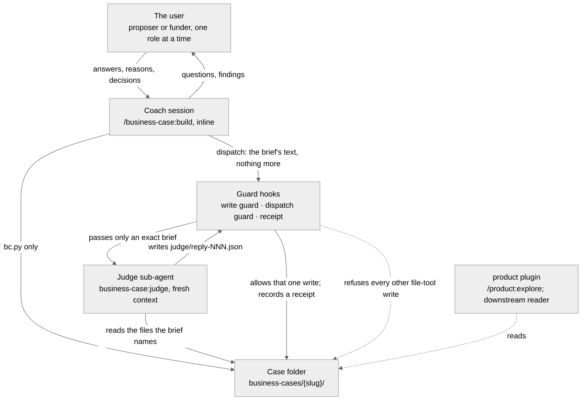

# business-case — C4 Context

Who the plugin serves and what it touches. One person plays both parts, the
proposer and the funder. The coach runs in that person's session. The judge
runs in a fresh context and is given only a brief that names its input files. The guard hooks stand between
both of them and the case folder.

The coach and the judge never share a context. Code writes every file in the
case folder: `bc.py`, and the receipt hook. The judge's reply and the
analysts' replies are the exceptions. ADR-000 is the overview; ADR-006 lists the routes the hooks do
not see.
