# competitive-intelligence - C4 Container

This diagram shows the inside of the plugin: the skills that ask the person, the agents that do the work, the lens skills, the scripts, and the files that the plugin writes. The Context diagram (competitive-intelligence-c4-context.md) shows the plugin and the systems around it.

```mermaid
%%{init: {'theme': 'neutral'}}%%
C4Container
    title Container - competitive-intelligence

    Person(analyst, "Analyst")
    System_Ext(coach, "business-case coach", "Calls the skills discover and analyze with a plugin-run block, and reads the result files")

    Container_Boundary(ci, "competitive-intelligence") {
        Container(fullRun, "Skill competitive-intelligence", "SKILL.md, main conversation", "Runs the six phases, asks the questions, shows each checkpoint, and starts the phase agents with the Agent tool")
        Container(entrySkills, "Skills discover, analyze, monitor, respond, validate", "SKILL.md, main conversation", "Ask the questions of one entry point, then start the agents or follow the lens skills. In a plugin run, discover and analyze take every answer from the plugin-run block, ask nothing, and write the result file")
        Container(vendorSkill, "Skill vendor-archetype-classify", "SKILL.md, main conversation", "Asks for the vendor and its pricing page, starts the classifier agent, and runs the emitter")
        Container(phase1, "context-analyst (phase 1)", "Claude Sonnet / .md", "Writes the context configuration from the answers in its dispatch")
        Container(phase2, "ecosystem-mapper (phase 2)", "Claude Sonnet / .md", "Classifies competitors on six dimensions")
        Container(phase3, "intelligence-gatherer (phase 3)", "Claude Sonnet / .md", "Collects, scores, and compares competitive data")
        Container(phase4, "lens-executor (phase 4)", "Claude Sonnet / .md", "Reads each lens skill and follows it, one layer after the other")
        Container(lenses, "Lens skills (6)", "SKILL.md, not user-invocable", "lenses-jtbd-performance, lenses-forces-analysis, lenses-economic-value, lenses-strategic-positioning, lenses-technology-disruption, lenses-loss-churn")
        Container(phase5, "synthesizer (phase 5)", "Claude Opus / .md", "Writes the SWOT, the implications, and the recommendations")
        Container(phase6, "deliverable-generator (phase 6)", "Claude Sonnet / .md", "Writes the chosen deliverables and the rules of the result file")
        Container(vendor, "vendor-archetype-classifier-agent", "Claude Sonnet / .md", "Extracts the pricing signals of one vendor and writes the input file. It has no shell")
        Container(scripts, "Python scripts", "Python 3.11", "Result file name, vendor archetype pipeline, and the library modules for scoring, comparison, and schema checks")
        Container(brainSkills, "Skills setup, learn, ask", "SKILL.md, main conversation", "Make the graph and its router block, confirm the pages of a run, and answer a question from the graph")
        Container(saveCode, "Save code ci_graph.py", "Python 3.11", "The only writer of the graph: ingest, view, results, pages, regen, and check")
        Container(hook, "Hook brain-hook.sh", "PostToolUse, bash", "Runs regen and both checks after a write to the bundle or a call of ci_graph.py")
        ContainerDb(session, "Session folder", "JSON", ".competitive-intelligence/<session>/ - session.json, a summary file for each phase, and the full data files")
        ContainerDb(results, "Result file", "JSON", ".competitive-intelligence/<session>/result.json - one plugin-result/1 file for each run of discover or analyze; ingest reads it")
        ContainerDb(graph, "Graph", "OKF pages", "docs/competitive-intelligence/ - one page for each run, competitor, offer, source, finding, and result")
        ContainerDb(vendorFiles, "Vendor archetype files", "JSON", ".competitive-intelligence/vendor-archetype-handoff.json")
    }

    Rel(analyst, fullRun, "Starts")
    Rel(analyst, entrySkills, "Starts")
    Rel(analyst, vendorSkill, "Starts")
    Rel(coach, entrySkills, "Calls discover or analyze with the Skill tool")
    Rel(fullRun, phase1, "Starts with the Agent tool")
    Rel(fullRun, phase2, "Starts with the Agent tool")
    Rel(fullRun, phase3, "Starts with the Agent tool")
    Rel(fullRun, phase4, "Starts with the Agent tool")
    Rel(fullRun, phase5, "Starts with the Agent tool")
    Rel(fullRun, phase6, "Starts with the Agent tool")
    Rel(entrySkills, phase1, "Starts with the Agent tool")
    Rel(entrySkills, phase2, "Starts with the Agent tool")
    Rel(entrySkills, phase3, "Starts with the Agent tool")
    Rel(entrySkills, lenses, "Reads and follows (analyze)")
    Rel(entrySkills, results, "Writes")
    Rel(phase4, lenses, "Reads and follows each lens skill")
    Rel(phase4, session, "Reads six lens summary files for the cross-check")
    Rel(fullRun, session, "Reads the summary file of each phase at a checkpoint")
    Rel(vendorSkill, vendor, "Starts with the Agent tool")
    Rel(vendorSkill, scripts, "Runs the emitter with uv run")
    Rel(scripts, vendorFiles, "Writes")
    Rel(entrySkills, scripts, "Runs result_name.py with uv run")
    Rel(entrySkills, saveCode, "Runs ingest and view")
    Rel(fullRun, saveCode, "Runs ingest and view")
    Rel(vendorSkill, saveCode, "Runs ingest")
    Rel(analyst, brainSkills, "Starts")
    Rel(brainSkills, saveCode, "Runs")
    Rel(saveCode, graph, "Writes")
    Rel(saveCode, session, "Reads, then removes the ingested files")
    Rel(hook, saveCode, "Runs regen and check")
```

