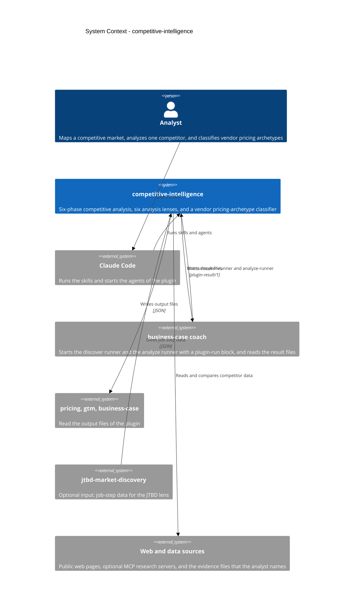

# competitive-intelligence - C4 System Context

This diagram shows who uses the plugin and which other systems it uses. The Container diagram (competitive-intelligence-c4-container.md) shows the inside of the plugin.

