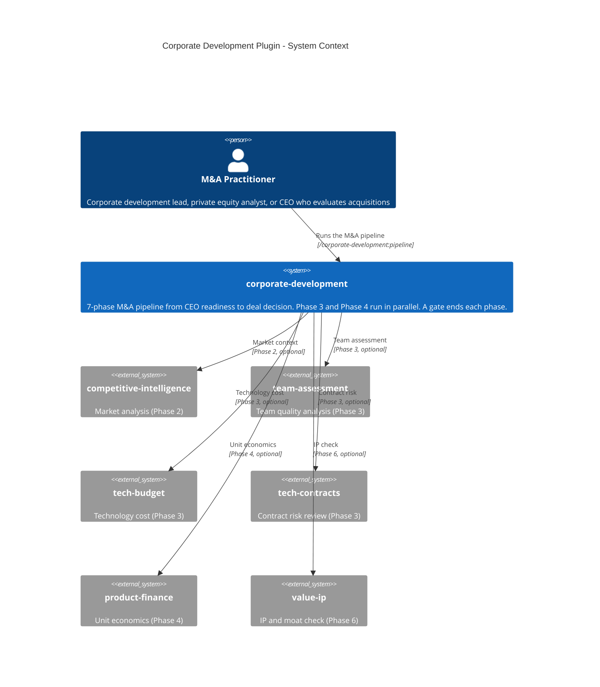
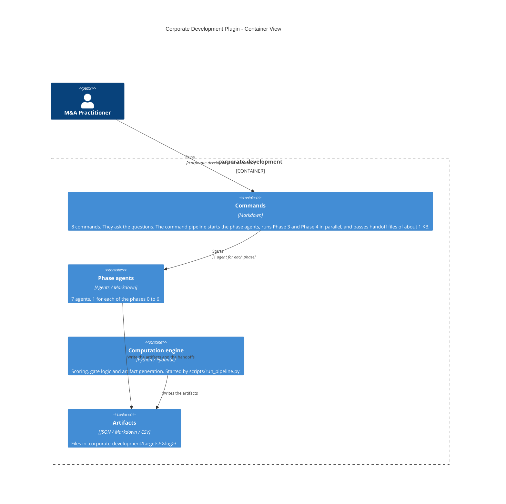

# corporate-development

Run an M&A deal from the readiness of the buyer to the final recommendation. The plugin has 7 phases. Each phase ends with a gate: GO, CONDITIONAL or NO_GO.

The method follows "Buy then Build" (Walker Deibel) and "Innovation and Entrepreneurship" (Peter F. Drucker).

## Install

```bash
claude plugin install corporate-development@cc-plugins
```

The engine of the plugin runs with `uv`. Install `uv` before you use the engine command line.

## Quick start

Run all 7 phases for one target:

```bash
/corporate-development:pipeline
```

The command asks the intake questions, 1 phase at a time. It writes the answers to `.corporate-development/targets/<slug>/pipeline_inputs.json`. Then it starts the phase agents, in the main conversation. Each phase runs in its own agent. Phase 3 and Phase 4 run in parallel. The command shows one summary with the gates, the scores and the paths of the artifacts.

If the inputs are ready in a folder, run:

```bash
/corporate-development:pipeline --data-dir <folder>
```

The command asks nothing. It reads `<folder>/pipeline_inputs.json`. That file holds 1 object for each phase: `{"phase_0": {...}, "phase_1": {...}, ..., "phase_6": {...}}`, with the fields of `docs/pipeline-inputs.md`. The file `tests/fixtures/pipeline_inputs.json` is an example.

To run one phase alone, use the command of the phase:

| Command | Phase | Purpose |
|---|---|---|
| `/corporate-development:pipeline` | 0 to 6 | Run all 7 phases for one target |
| `/corporate-development:readiness` | 0 | Check if the buyer is ready to acquire |
| `/corporate-development:discover` | 1 | Find and rank acquisition targets |
| `/corporate-development:assess` | 2 | Score the strategic fit of one target |
| `/corporate-development:audit` | 3 | Do the operational due diligence |
| `/corporate-development:analyze` | 4 | Do the financial due diligence |
| `/corporate-development:plan` | 5 | Write the 100-day integration plan |
| `/corporate-development:recommend` | 6 | Write the GO, CONDITIONAL or NO_GO recommendation |

A command that runs alone runs in the main conversation and asks you the questions.

## The phases and the gates

| Phase | Name | Agent |
|---|---|---|
| 0 | Acquisition Readiness | `readiness-assessor` |
| 1 | Deal Sourcing | `deal-sourcer` |
| 2 | Target Assessment | `target-assessor` |
| 3 | Operational Due Diligence | `operational-auditor` |
| 4 | Financial Due Diligence | `financial-analyst` |
| 5 | Integration Planning | `integration-planner` |
| 6 | Deal Decision | `deal-advisor` |

| Gate | Action |
|---|---|
| GO | Go on to the next phase. |
| CONDITIONAL | Go on, and write down the conditions. |
| NO_GO | Stop. The summary names the phase in `stopped_at`. |

The thresholds of each gate are in `docs/methodologies/gate-thresholds.md`.

### Phase 0: Acquisition Readiness

Phase 0 checks 5 dimensions. Each dimension gets a score from 0 to 100.

| Dimension | Weight |
|---|---|
| CEO readiness (the 3 A's: attitude, aptitude, action) | 30% |
| Strategic clarity | 20% |
| Organizational capacity | 25% |
| Financial readiness | 15% |
| Governance framework | 10% |

A hard requirement that is not met gives NO_GO for any score: a CEO average below 7.0, no strategic target, or no committed capital. Else a score of 80 or more is GO, 65 to 79 is CONDITIONAL, and below 65 is NO_GO. Phase 0 writes `readiness_assessment.json`, `readiness_summary.md` and `acquisition_playbook.md`.

### Phase 3: Operational Due Diligence

Phase 3 scores 5 dimensions: team (25%), technology (25%), product (20%), operations (20%) and market position (10%). A score of 70 or more is GO. A score from 50 to 69 is CONDITIONAL. A lower score is NO_GO.

### Phase 5: Integration Planning

Phase 5 writes a plan for the first 100 days in 6 domains: team, technology, product, customers, operations and finance. It writes `playbook.md`, `timeline.json`, `action_tracker.csv`, `risk_mitigation.md` and `success_metrics.json`.

### Phase 6: Deal Decision

Phase 6 combines the scores: operational 30%, financial 25%, strategic fit 20%, integration 15% and readiness 10%. It also checks 7 qualitative dimensions. GO needs a score of 75 or more and no critical blocker. NO_GO is a score below 60, or a critical blocker. CONDITIONAL is a score from 60 to 74 with concerns that the buyer can address. Phase 6 writes `executive_summary.md`, `deal_scorecard.json` and `risk_register.csv`. The recommendation memo is a Markdown file.

## Questions

The agents ask the person nothing. Only the commands ask.

If a phase agent needs an answer, it writes `handoffs/phase_<N>_questions.md` and no handoff. The command `pipeline` starts no later phase. It reads the questions file of the phase that stopped (and of the other parallel phase when Phase 3 and Phase 4 both asked), asks the questions, adds the answers to `pipeline_inputs.json`, and runs the phases again. It skips each phase that has a handoff file. The command builds the path of each questions file from the slug and the phase number, and reads no path that an agent returns. When an agent returns another path, the command stops and shows the 2 paths.

To run all phases again, delete the folder `.corporate-development/targets/<slug>/handoffs/` and run the command.

The input fields of each phase are in `docs/pipeline-inputs.md`.

## Skills

The plugin has 12 skills. Each skill is in `skills/<group>-<name>/SKILL.md`.

| Group | Skills |
|---|---|
| discovery | `discovery-deal-sourcing`, `discovery-target-assessment` |
| due diligence | `due-diligence-customer-dd`, `due-diligence-financial-dd`, `due-diligence-legal-dd`, `due-diligence-operational-dd`, `due-diligence-product-dd` |
| evaluation | `evaluation-ceo-readiness`, `evaluation-target-definition` |
| execution | `execution-deal-recommendation`, `execution-integration-planning`, `execution-pipeline` |

## Output files

All files are in `.corporate-development/targets/<slug>/`:

| Path | Holds |
|---|---|
| `pipeline_inputs.json` | The inputs of all phases. |
| `phase_0_readiness/` | The readiness assessment, the summary and the playbook. |
| `phase_1_sourcing/` | The target pipeline and the ranking. |
| `phase_2_assessment/` | The assessment of the target. |
| `phase_3_operational_dd/` | `summary.md`, `results.json`, the dimension reports and the risk analysis. |
| `phase_4_financial_dd/` | The financial report and the unit economics. |
| `phase_5_integration/` | The integration playbook and the tracking files. |
| `phase_6_decision/` | The recommendation memo, the scorecard and the risk register. |
| `handoffs/phase_<N>_handoff.json` | The handoff of phase N (about 1 KB). |
| `handoffs/phase_<N>_questions.md` | The questions of phase N, when an input is missing. |

Keep the folder `.corporate-development/` out of a public repository. It holds deal data.

## Optional plugins

A phase uses an optional plugin only when Claude Code has it. If the plugin is not there, the phase goes on without it, and its report says which plugin it did not use.

| Plugin | Phase | Use |
|---|---|---|
| `competitive-intelligence` | 1, 2 | Market context and competitive analysis |
| `team-assessment` | 3 | Team depth and quality |
| `tech-budget` | 3, 4, 5 | Technology cost |
| `tech-contracts` | 3, 6 | Contract risk review |
| `product-finance` | 4 | Unit economics and synergy tracking |
| `value-ip` | 6 | IP and moat check |
| `jtbd-market-discovery` | 3 | Customer job validation |
| `ux-hci-design` | 3 | Product design quality |
| `product` | 3 | Roadmap and process documents |

## Security and privacy

- The engine makes no network call.
- `WebSearch` in `deal-sourcer` and `target-assessor` can send the name of the target to a search service.
- `Skill` in `operational-auditor` and `deal-advisor` hands deal data to an optional plugin. The limit is a rule in the text of the agent: `operational-auditor` starts only `tech-contracts:review`, and `deal-advisor` starts only `tech-contracts:review` and `tech-contracts:audit`. Claude Code gives no way to limit `Skill` to named skills in a subagent, so the rule is a prompt rule only. A document of the target could still make an agent start another skill. This risk is accepted.
- No agent has `Bash`, `Agent` or `WebFetch`. No agent starts an agent. The command `pipeline` starts the phase agents.
- The files in `.corporate-development/` can hold financial and personal data of the target. Do not commit them to a public repository.

## Architecture

### C4 L1 - System context



### C4 L2 - Containers



## Engine command line

The scripts run the engine with the full input in one JSON file. The input of a script is 1 flat object with the fields of all phases and no `phase_N` key. It is not the shape of `pipeline_inputs.json`. To make it from a `pipeline_inputs.json`, take the object of `phase_0` with no `company_name`, and add the objects of `phase_1` to `phase_6` to it. The engine then reads the `company_name` of the target. The scripts need `uv`:

```bash
uv run ${CLAUDE_PLUGIN_ROOT}/scripts/run_pipeline.py <input_file.json>
uv run ${CLAUDE_PLUGIN_ROOT}/scripts/run_investigation.py <input_file.json>
```

Each script prints the `PipelineResult.to_summary()` JSON. The two scripts call the same engine function, and `uv` installs `pydantic` and `pandas` for them. The slash commands do not call the scripts.

The Python package is in `corporate_development/`. Its parts:

| Folder | Purpose |
|---|---|
| `core/` | Phase base classes and the sequential orchestrator |
| `pipeline/` | The parallel orchestrator, `PhaseHandoff` and `PipelineResult` |
| `phases/` | The 7 phase implementations |
| `readiness_assessment/`, `evaluation/`, `operational_dd/`, `financial_dd/`, `integration_planning/`, `decision_framework/` | The domain modules of the phases |
| `artifacts/` | Artifact builder and target folder manager |

## Tests

```bash
cd plugins/corporate-development
pip install -r requirements-dev.txt
pytest tests/ -q
```

The tests run in a temporary folder. They write nothing to the plugin folder.

## Methodology

- Buy then Build (Walker Deibel): the acquisition framework
- Innovation and Entrepreneurship (Peter F. Drucker): the principles of strategic evaluation
- Gartner M&A due diligence: the industry practice
- 16 Decisions: the deal decision framework

## Architecture decision

`docs/adr/ADR-001-corporate-development-plugin-architecture.md` records why the plugin has 2 layers: Markdown for the agents and the commands, and Python for the computation.
