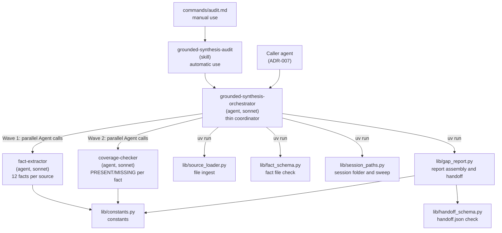

# C4 Level 2 — Container diagram

## Containers

## Design rules

- The orchestrator is a **thin coordinator**. It never reads the output files of the sub-agents.
- The library modules are plain Python. They do not import agents.
- The sub-agents get the absolute `session_dir_absolute` in their dispatch context. They never read environment variables.
- The orchestrator runs each script as `uv run ${CLAUDE_PLUGIN_ROOT}/lib/<file>.py`. Each script has a PEP 723 header that lists its packages.
