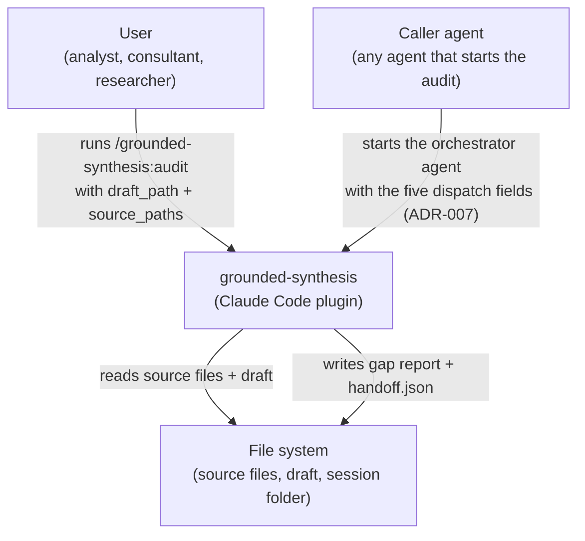

# C4 Level 1 — Context diagram

## System context

grounded-synthesis is a Claude Code plugin. A user or a caller agent starts it. It audits a draft against primary source files.

## Actors

- **User** — runs the command by hand, or asks for the skill.
- **Caller agent** — starts the orchestrator agent and reads `handoff.json`.
- **File system** — holds the source files, the draft, the session folder, and the gap report.
