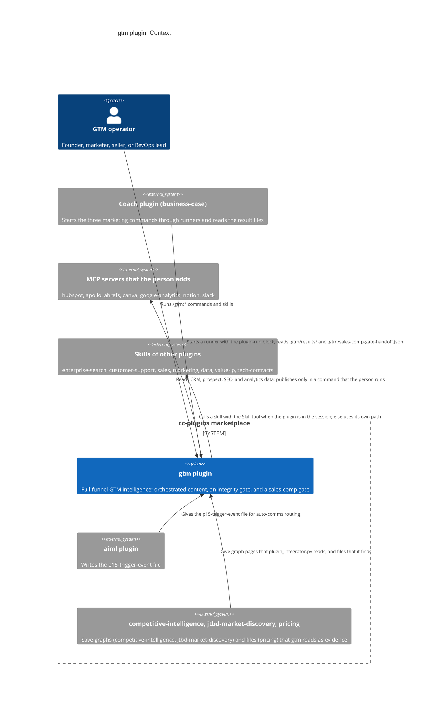
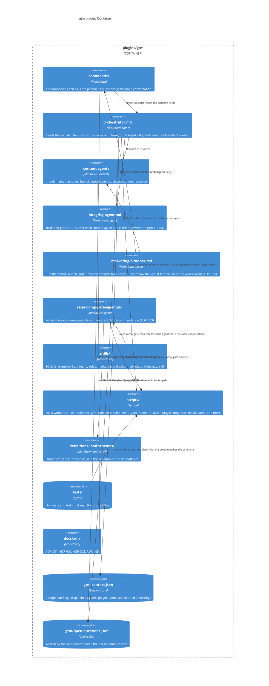

# gtm plugin: C4 diagrams

These diagrams show the plugin in its context and its parts. Each outside system in the diagrams is optional. The person adds it.

## C4 Context

## C4 Container

## Notes

- The orchestrator is a thin coordinator. It reads only `completion_flags` and one short `completion_log` line of each agent. It never reads artifact content.
- The integrity agent is the only writer to `gtm-output/`. It gates each artifact on the band that `truth_tier_validator.py` writes. The floor is 0.60 and the target is 0.85. Both values come from `gtm_constants`.
- The deepest chain of agents is `/gtm:run`, then `gtm:orchestrator`, then a content agent or the integrity agent. That is two layers below the main conversation.
- No agent asks the person a question. The commands and the skills ask.
- The three runners dispatch no agent and publish nothing. A person's run of a marketing command writes the same result file as a coach's run.
- The sales-comp gate has one entry for a person (the skill `sales-comp-gate-review`) and one for a dispatched run (the agent with preconditions from the dispatch fields). Both write `.gtm/sales-comp-gate-handoff.json` and end with the line `DONE: gtm`.
- The plugin has no `.mcp.json` file. It starts no outside service.
