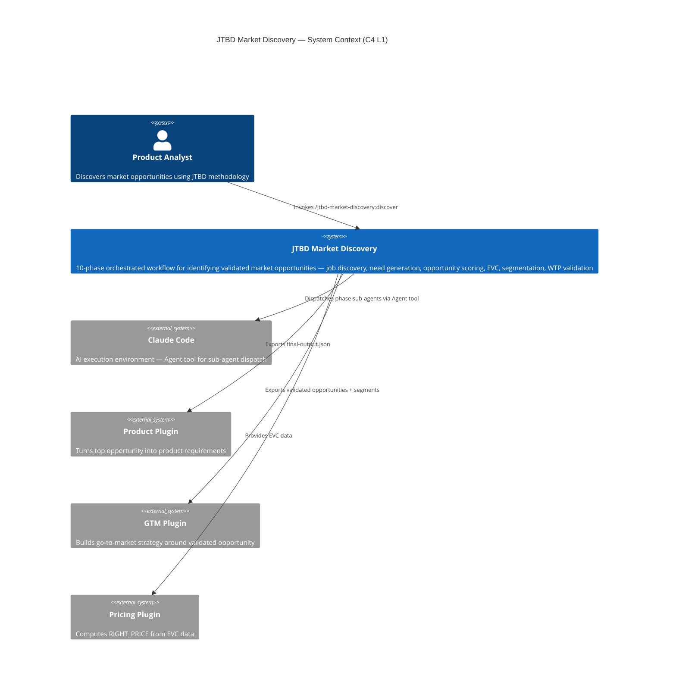
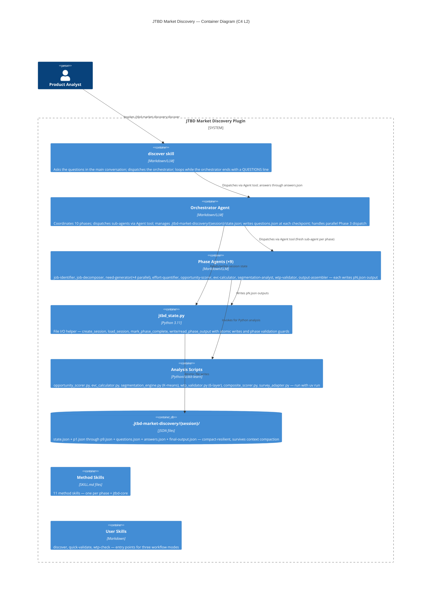

# JTBD Market Discovery — C4 Architecture Diagrams

Standalone diagram file for tooling and index generators.
Source of truth — README.md references these diagrams inline.

## C4 Level 1 — System Context

## C4 Level 2 — Container

