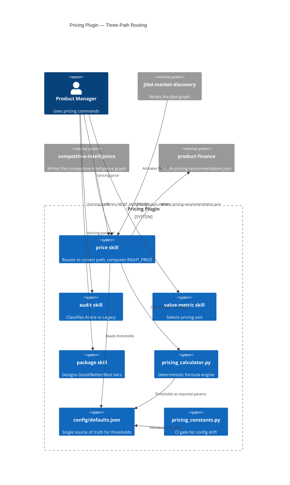

# ADR-001: Pricing Plugin Architecture

**Status:** Accepted
**Date:** 2026-02-26
**Version:** 1.2.0
**Deciders:** the maintainers of the plugin

---

## Context

A pricing intelligence plugin for Claude Code needed to handle the full pricing lifecycle for AI-era SaaS products — from feature classification through right-price computation to tier packaging. The design had to address a unique challenge: AI-era features have fundamentally different pricing economics than legacy features, and the gap between perceived value (VALUE_SIGNAL) and what the market will accept (WTP_max) can be extreme. Callers needed structured, type-safe results — not bare floats — to avoid re-implementing threshold logic.

Key constraints:
- No external dependencies at install time — all Python scripts in stdlib + dataclasses
- Formulas must be deterministic Python functions; LLM agents call them as tools
- Config-governed thresholds must be impossible to silently ignore at call sites
- The plugin must work standalone (Path B) and upgrade automatically when upstream plugins (jtbd-market-discovery, competitive-intelligence) produce data files
- Agentic AI features (Autonomous, Fully Agentic) require entirely different pricing models than traditional SaaS features

---

## Decision

### Three-Path Pricing Architecture

The plugin routes every new offering through three pricing paths, selected automatically based on data availability and feature classification:



### Path A — EVC-Validated (confidence: `validated`)

Activates when the price gate accepts a jtbd result from the jtbd graph (ADR-011). Uses Economic Value to Customer as the ceiling, not WTP_max:

```
RIGHT_PRICE = max(MARGIN_FLOOR, min(EVC, REFERENCE_PRICE + AI_VALUE_DELTA + MOAT_VALUE_DELTA))
segment_signal populated when additive_sum > wtp_max
```

### Path B — Multiplicative Estimated (confidence: `estimated`)

Activates when no JTBD data is available. Uses three multiplied components against a WTP ceiling:

```
VALUE_SIGNAL = BASE × AI_MULTIPLIER × MOAT_MULTIPLIER  [unconstrained]
RIGHT_PRICE  = max(MARGIN_FLOOR, min(WTP_max, VALUE_SIGNAL))
segment_signal populated when VALUE_SIGNAL > WTP_max
```

**AI_MULTIPLIER** (`v1.2.0: returns AiMultiplierResult, not float`):
- Formula: `1.0 + (speed_improvement × accuracy_improvement)`
- Fear signal: when `accuracy_improvement < accuracy_fear_signal_threshold (0.8)` → multiplier = 1.0, `fear_signal_triggered = True`

**MOAT_MULTIPLIER**: Helmer 7 Powers score [1.0–2.5]. Scale Economy moat → locked at 1.0 + penetration pricing advisory.

### Path C — Agentic Pricing

Path C handles features where AI is not merely augmenting human work — it is replacing or autonomously executing it. Two sub-paths based on the degree of autonomy:

**C-Autonomous** (human-in-the-loop, confidence: `estimated`):
```
value_per_task   = time_saved_per_task × hourly_cost_of_human
RIGHT_PRICE      = max(margin_floor, min(wtp_max_per_task, value_per_task × value_capture_rate))
pricing_unit     = "per task"
```

**C-Fully Agentic** (no human review, confidence: `estimated`):
```
replacement_cost = annual_salary × (1 + overhead_rate)
RIGHT_PRICE      = max(margin_floor, min(wtp_max_annual, replacement_cost × automation_rate × value_share))
pricing_unit     = "per agent per year"
```

`compute_path_c_fully_agentic()` returns a **discriminated union** (`v1.2.0`):
- `PathCFullyAgenticPriced` — when `automation_rate ≥ automation_rate_fear_signal_threshold`
- `PathCFullyAgenticReclassified` — when `automation_rate < threshold`; formula never runs; includes `recovery_inputs_required` list

### Config Governance Architecture

All threshold values live in one place: `config/defaults.json`. The calculator never reads this file directly — it is a pure function library. The LLM agent reads config at Step 0 and passes thresholds as **required parameters** (no defaults).

```
config/defaults.json
    └── formulas.path_b.accuracy_fear_signal_threshold: 0.8
    └── formulas.path_c_fully_agentic.automation_rate_fear_signal_threshold: 0.80

scripts/pricing_constants.py   ← loads config at import time → exports named constants
tests/conftest.py              ← pricing_defaults session fixture (session-scoped, loads once)
tests/test_pricing_constants.py ← CI gate: asserts constants == config values
```

**Governance principle:** A threshold that can silently use a stale default is not governed — it is advisory. Required parameters without defaults force a `TypeError` at every call site if the config changes without updating callers.

### Structured Return Types (v1.2.0)

The calculator returns dataclasses, not raw floats, for all multi-field results:

| Type | Fields |
|------|--------|
| `AiMultiplierResult` | `multiplier: float`, `fear_signal_triggered: bool` |
| `PathAResult` | `right_price`, `evc`, `confidence_tier`, `margin_floor`, `segment_signal` |
| `PathBResult` | `right_price`, `value_signal`, `confidence_tier`, `margin_floor`, `moat_advisory`, `segment_signal` |
| `PathCAutonomousResult` | `right_price`, `value_per_task`, `value_capture_rate`, `confidence_tier`, `margin_floor`, `pricing_unit` |
| `PathCFullyAgenticPriced` | `right_price`, `replacement_cost`, `automation_rate`, `value_share`, `confidence_tier`, `margin_floor`, `pricing_unit`, `risk_advisory` |
| `PathCFullyAgenticReclassified` | `reclassification_path`, `recovery_inputs_required`, `risk_advisory`, `confidence_tier`, `pricing_unit` |

### Segment Signal Architecture

When value delivered exceeds market WTP, the plugin surfaces a `segment_signal` rather than silently capping the price. This signals market-readiness gap without losing the strategic information:

```json
{
  "wtf_gap": 4800.0,
  "interpretation": "Value signal ($5000) exceeds WTP ceiling ($200) by $4800 — market not yet ready for value-justified price. Consider running jtbd-market-discovery:wtp-check to validate or find early-adopter segments."
}
```

- **Path A trigger:** `additive_sum > wtp_max` (mathematical impossibility for `right_price > wtp_max` since the formula bounds it)
- **Path B trigger:** `value_signal > wtp_max`

---

## Considered Options

### Option A: Single-File Skill (rejected)

All pricing logic embedded in one large SKILL.md prompt.

**Why rejected:** Skills with hundreds of lines of conditional logic are unmaintainable and untestable. Every formula change requires LLM reasoning over the entire prompt. There is no CI to catch formula errors.

### Option B: Python Calculator + Skill Orchestration (chosen)

Deterministic formulas in `pricing_calculator.py`. Skills call the calculator with typed parameters and interpret structured results.

**Why chosen:** Formulas are unit-tested (186 tests at v1.2.0). The LLM handles Socratic elicitation and output formatting; the Python layer handles arithmetic. This division of labor eliminates an entire class of pricing errors.

### Option C: Agent-Based Architecture (deferred)

Dedicated formula agents for each path.

**Why deferred:** The pricing calculator is simple enough (534 lines) that agent dispatch overhead is not justified. Agents are the right pattern when the work requires parallel execution or an outside orchestrator. Path C reclassification decisions require LLM judgment, but the formula execution does not.

---

## Key Architectural Decisions

**Why `pricing_calculator.py` does not read `defaults.json`:** The calculator is a pure function library. Making it read config at import time would couple the formula layer to the config layer and prevent the session fixture pattern from working correctly in tests. Config reading is the agent's responsibility (Step 0 of the skill prompt).

**Why the discriminated union (not `Optional[float]`):** A flat struct with `right_price: Optional[float] = None` has an implicit invariant (`reclassify_to_autonomous = True` implies `right_price is None`) discoverable only from the docstring. With the discriminated union, the invariant is encoded in the type — arithmetic on `result.right_price` in the reclassified case raises `AttributeError`, not a silent `None` propagation. The type system enforces the routing decision.

**Why `automation_rate_fear_signal_threshold` is a required parameter (not a default):** A default allows call sites to silently use stale values when the config changes. Required parameters propagate config changes to `TypeError` at every affected call site — which is exactly what CI should catch before production.

**Why `margin_floor > wtp_max` guard is deferred to v1.3:** `compute_margin_floor()` does not receive `wtp_max`. Adding it would change the function signature and the caller contract. The formula callers already handle this correctly via `max(margin_floor, min(wtp_max, ...))` — when `margin_floor > wtp_max`, `right_price = margin_floor`, which is the correct behavior (cost floor takes precedence over market ceiling). The guard is informational, not corrective.

---

## Consequences

**Positive:**
- 186 unit tests give high confidence in formula correctness
- Config changes propagate as `TypeError` at call sites — cannot silently break
- Structured return types eliminate caller-side threshold re-implementation
- Segment signal preserves strategic value information even when price is capped
- Plugin upgrades automatically (Path A activates when JTBD data file appears)

**Negative / Accepted trade-offs:**
- v1.2 carries significant breaking-change mass (signature changes, new dataclasses)
- Skill agents must read config at Step 0 before calling the calculator — this responsibility cannot be delegated to the Python layer
- `margin_floor > wtp_max` guard deferred — callers must handle this edge case correctly (current callers do)

---

## Amended 2026-11-02

A decision of the maintainers, after a recorded run priced a seat at 515 USD a month against a willingness to pay of 35 to 60. The Path A contract changes in four ways.

1. **The cap.** A Path A price never exceeds WTP_max, the willingness to pay jtbd measured for the segment: `RIGHT_PRICE = min(WTP_max, max(MARGIN_FLOOR, min(EVC, REFERENCE_PRICE + AI_VALUE_DELTA + MOAT_VALUE_DELTA)))`. `compute_path_a` applies it in code. A null `wtp_max` leaves the price uncapped.
2. **The headroom.** The `PathAResult` field `value_signal` is the price before the cap. Its excess over the price is headroom, shown and never charged, and never called a market gap. Path A's `segment_signal` says so in its own wording.
3. **The floor advisory.** In Path A the cap wins over the margin floor, which is the opposite of Path B. When the margin floor is above WTP_max, the price is WTP_max and the `PathAResult` field `floor_advisory` says the offering does not clear its margin floor at this willingness to pay. The advisory reaches `pricing-recommendation.json`, the report and the result file's `method`. This replaces the deferral above that left the `margin_floor > wtp_max` guard to callers.
4. **The period rule.** Path A works in the period of the jtbd `willingness_to_pay` result: that is the price's period. Every other jtbd money value is converted to it (a year value divided by 12 for a monthly price, a month value multiplied by 12 for a yearly price). When AI_VALUE_DELTA comes from a customer value, it is EVC minus REFERENCE_PRICE in that period. A value with no period, or any other period, is refused with a gap and never guessed. When only the customer value has no period, the customer value counts as absent and Path A goes on. When the answers set a `pricing_unit` in another period, `compute_path_a` takes `price_period` and `unit_period` and converts the capped price, the headroom and the floor after the cap; any other period is refused with a gap.

One consequence: once a customer value sets AI_VALUE_DELTA, `REFERENCE_PRICE + AI_VALUE_DELTA + MOAT_VALUE_DELTA` is at least EVC, so MOAT_VALUE_DELTA no longer moves the price.

---

## Version History

| Version | Date | Change |
|---------|------|--------|
| 1.0.0 | 2026-02-xx | Initial release — Path A + Path B |
| 1.1.0 | 2026-02-xx | Path C — Autonomous + Fully Agentic |
| 1.2.0 | 2026-02-26 | Discriminated union, AiMultiplierResult, required threshold params, segment_signal, config governance, conftest fixture, pricing_constants CI gate |
