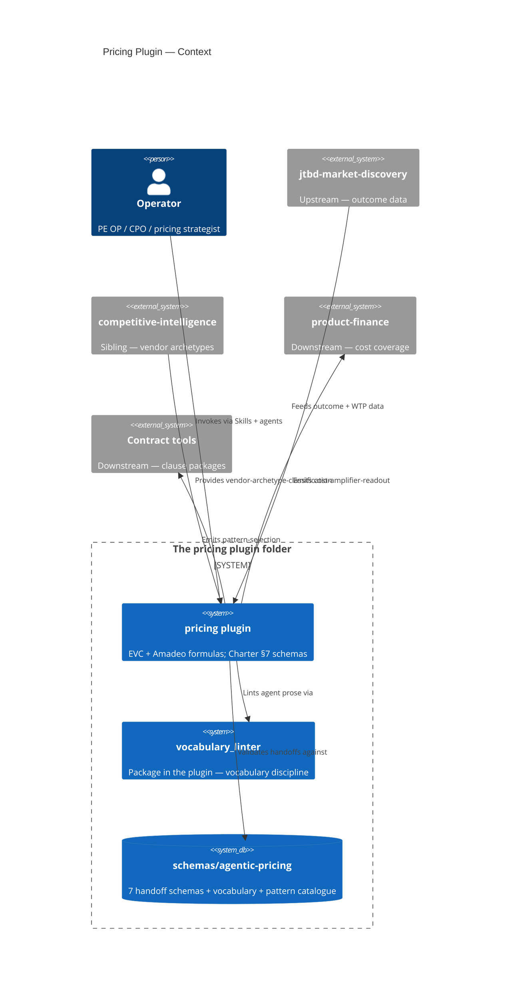
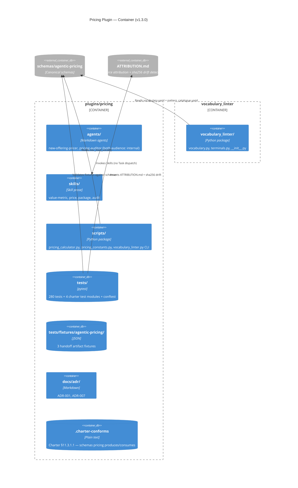

# Pricing Plugin — C4 Diagrams

> Charter §13 acceptance criterion — every plugin with >1 agent OR a Python package needs a Context + Container diagram.

## C4 Context

## C4 Container

## Notes

- pricing v1.3.0 (Charter PR) ships the federation infrastructure. Canonical math (amplifier_composer, value_metric_tree, etc.) lands in pricing v1.4.0 sub-spec.
- `audience: internal` on both agents — outputs are operator-facing diagnostics, not customer-facing artifacts.
- The `.charter-conforms` sentinel makes pricing the bootstrap conforming plugin for `test_charter_cross_plugin.py`.
