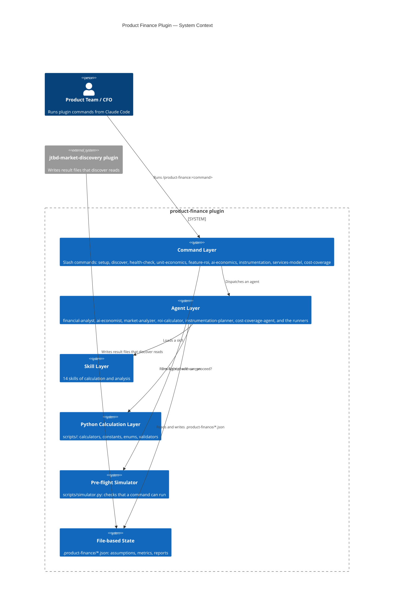

# ADR-001: Product Finance Plugin Architecture

**Status:** Accepted
**Date:** 2026-03-03
**Plugin Version:** v0.3.0, amended in v0.4.0 and v0.11.0

---

## Context

Product teams need CFO-level financial analysis in their daily work, not as a review after the fact by a separate finance team. The plugin must support:

- SaaS metrics (CAC, LTV, Rule of 40, Magic Number, NRR/GRR)
- AI economics: cost tracking and ROI for AI feature investments
- Financial instrumentation planning at design time
- Runs with no person present, when another plugin dispatches a command
- Math that stays exact when the context window fills during a long session

A model that does arithmetic in its context can make an error. A script cannot. The plugin therefore puts each formula in a script, and the model reads the script output.

A command that asks a question with `AskUserQuestion` cannot run with no person present. A subagent has no such tool at all (see the amendment of v0.11.0).

---

## Architecture Diagram

---

## Decision

### Decision 1: Commands, agents and skills

The plugin has three tiers:

1. **Commands** (`commands/*.md`) are the entry points. Each command holds the questions and decides which agent to dispatch.
2. **Agents** (`agents/*.md`) are domain specialists. Each agent uses the skill tier.
3. **Skills** (`skills/<group>-<folder>/SKILL.md`) are small units of financial reasoning.

This copies the way a finance team works: the CFO (command) gives work to department heads (agents), who use specialist analysts (skills). A skill is used by many agents with no copy.

**Rejected alternative:** one large command with all the calculation inline. `health-check` and `unit-economics` both need LTV:CAC, so the text would be in two places.

### Decision 2: Scripts do the arithmetic

Each formula is in a Python script. The model runs it as `uv run ${CLAUDE_PLUGIN_ROOT}/scripts/<file>.py` and reads the output (ADR-006, decision 5). A script cannot make an arithmetic error where a model can.

Version 0.3.0 put the formulas in a server that Claude Code started for the plugin. Version 0.11.0 removed the server: no prompt file called it, and Claude Code did not start it from the plugin files. The scripts stay the only place of each formula.

### Decision 3: Auto mode for runs with no person present

When `.product-finance/auto-config.json` exists with `enabled: true`, a command reads each answer from the `question_keys` map and asks nothing. The module `scripts/utils/auto_config.py` has three functions:

- `load_auto_config()` returns the config, or `None`
- `get_auto_answer(key)` returns the mapped answer, or `None`
- `is_auto_mode()` returns `bool`

`templates/auto-config.template.json` has each key with a default. The person copies it to `.product-finance/auto-config.json` and sets `enabled: true`.

**Rejected alternative:** a command-line flag for each command. It changes the call of each command and does not pass through the agent tier.

### Decision 4: Pre-flight simulator

`scripts/simulator.py` has `simulate_command(command_name)`. It returns `{can_proceed: bool, missing: [str], warnings: [str]}`. A command that gets `can_proceed: False` stops and shows a message.

- A command other than `discover` needs `assumptions.json`. A missing or damaged file is a blocking `missing` entry.
- A missing required section (`pricing`, `costs`) is a blocking `missing` entry.
- A suspect value (negative COGS, an implausible price) is a non-blocking `warnings` entry.
- An unknown command has no constraint.

**Rationale:** without the check, a command can use many tokens before it finds that an input is absent.

### Decision 5: File-based state between agents

Agents pass state through `.product-finance/*.json` files under the git root:

| File | Written by | Read by |
|---|---|---|
| `assumptions.json` | `setup` command | All other commands |
| `metrics.json` | The person, or an outside import | `health-check`, `unit-economics` |
| `auto-config.json` | The person (from the template) | All commands (auto mode) |
| `discovery-report.json` | `discover` / market-analyzer | `feature-roi` |
| `reports/health-check-{date}.json` | financial-analyst | Other agents |
| `reports/unit-economics-{date}.json` | financial-analyst | Other agents |
| `reports/feature-roi-{feature}-{date}.json` | roi-calculator | Other agents |
| `reports/ai-economics-{date}.json` | ai-economist | Other agents |
| `instrumentation-plan.json` | instrumentation-planner | Implementation agents |

**Path rule:** each `.product-finance/` path is under the git root (`git rev-parse --show-toplevel`). With no git repository, it is under the working folder.

**Rationale:** a file stays when the context window resets. A person can read it. A variable in memory cannot pass between agents that are separate processes.

**Failure:** when `assumptions.json` is absent, a command that needs it shows "No assumptions found. Run `/product-finance:setup` first." and stops.

### Decision 6: One calculation layer

`scripts/utils/` has the one copy of each formula:

| Module | Responsibility |
|---|---|
| `calculators.py` | Pure math: `calculate_channel_economics`, `calculate_rule_of_40`, `safe_divide` |
| `constants.py` | Threshold tables: `LTV_CAC_THRESHOLDS`, `RULE_OF_40_THRESHOLDS`, `MAGIC_NUMBER_THRESHOLDS` |
| `enums.py` | `MetricHealth`: `excellent`, `good`, `warning`, `critical`, `unknown`; also `GrowthStage` and `AIProvider` |
| `validators.py` | Input checks and bounds |
| `auto_config.py` | Auto mode: `load_auto_config`, `get_auto_answer`, `is_auto_mode` |

**LTV:CAC thresholds** (`constants.py::LTV_CAC_THRESHOLDS`):
- Excellent: more than 5:1
- Good: 3:1 to 5:1 (3:1 included)
- Warning: 1:1 to 3:1
- Critical: less than 1:1

**Magic Number:** `(Quarterly Net New ARR * 4) / Prior Quarter S&M Spend`. The formula uses the prior quarter because spend takes time to give revenue. ADR-005 gives the one place of this formula.

**Rationale:** one place for each formula stops two paths from giving two answers. A correction is made once.

### Decision 7: Tests

A pytest suite covers `scripts/`. It runs in the continuous integration job `product-finance` of the repository, with no skipped test. Each pure function of `scripts/utils/` has its own test. Edge cases (churn of 0, negative COGS, SOM above TAM) have a test each.

---

## Consequences

### Positive

- **Accuracy:** a script gives an exact LTV:CAC ratio, Rule of 40 score or payback period.
- **Tokens:** a command does not carry the calculation text in its context.
- **Composability:** a new command is made from existing skills.
- **Durability:** file state stays through context resets and restarts.
- **Visibility:** each intermediate result is a file that a person can read.
- **One source of formulas:** a correction in `scripts/utils/constants.py` applies everywhere.

### Negative

- **File system:** the state needs a writeable folder at the git root. A read-only place breaks it.
- **Auto mode can go stale:** a command that adds a `question_key` that an old `auto-config.json` lacks gets `None` from `get_auto_answer`. The command then uses its stated default, or records a gap.

### Risks

- **Assumptions drift:** `assumptions.json` is written by `setup` and read by all other commands. A new required field makes an old file invalid. The simulator finds a missing section, not a missing field.
- **Parallel writes:** two agents that write the same `.product-finance/*.json` file at the same time lose one result. The design needs one agent for each command run.
- **A test count is not coverage:** the edge cases need their own tests.

---

## Related Documents

- `README.md`: plugin overview, commands, data model
- `docs/METHODOLOGY.md`: the SaaS metrics method and its sources
- `docs/KPI_DEFINITIONS.md`: the KPI definitions
- `docs/INTEGRATION_GUIDE.md`: the integration patterns
- `docs/diagrams/product-finance-c4-context.md`: the current C4 view
- `ADR-002-charter-cost-coverage.md`: the cost-coverage decision

---

## Amendment (v0.4.0): cost-coverage

Version 0.4.0 added:

- **The agent `cost-coverage-agent`**: it asks nothing, and it writes the `cost-coverage-readout` of the pricing Charter.
- **The commands `cost-coverage` and `services-model`.**
- **Three scripts**: `cost_coverage_readout.py`, `bootstrap_cost_coverage_schema_hash.py`, and the fixture script `tests/support/generate_cost_coverage_fixture.py`.
- **The file `.charter-conforms`**: it says that the plugin produces `cost-coverage-readout` and consumes `cost-amplifier-readout`.
- **Test gates**: drift gates for the schema, the math, the gross margin path, the compression, the round trip, and the vocabulary.

ADR-002 gives the decision on the Charter re-implementation.

## Amendment (v0.11.0): the port

The plugin moved into this repository. ADR-006 gives the decisions of the port. In short: no outside server, no handoff file, no agent that asks a question, scripts run through `uv run`, and no read of a path outside the plugin folder.
