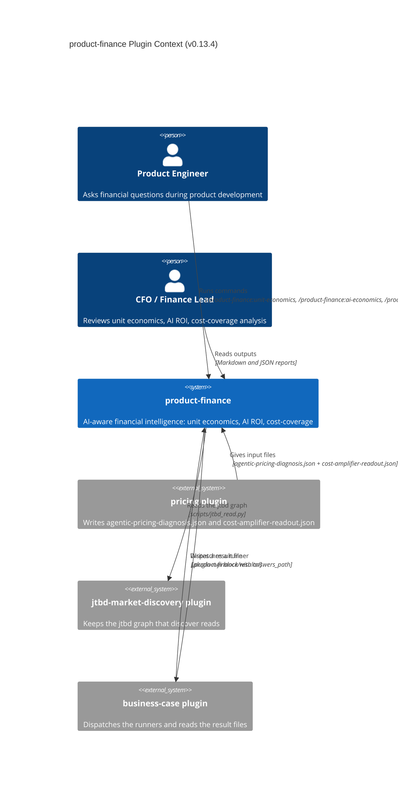
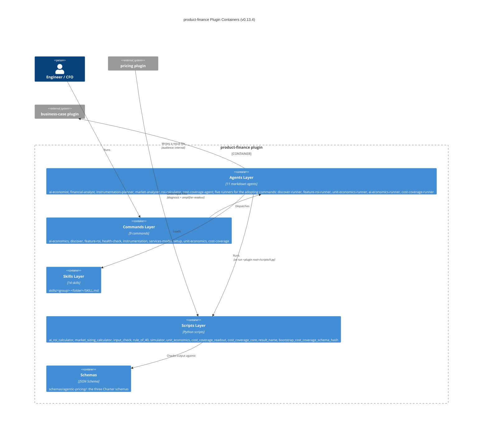

# product-finance — C4 Context and Container Diagrams

**Plugin:** product-finance v0.13.4

## C4 Context

## C4 Container

## Cost-coverage

The cost-coverage command (v0.4.0) has these parts:
- `cost-coverage-agent`
- `scripts/cost_coverage_readout.py`: the Charter §6.3 re-implementation of S1-S5, the gross margin path, and the multiple compression signals
- `scripts/bootstrap_cost_coverage_schema_hash.py`: the pin of the schema hash
- `.charter-conforms`: it says that the plugin produces `cost-coverage-readout` and consumes `cost-amplifier-readout`
- ADR-002

See `../adr/ADR-002-charter-cost-coverage.md` for the §6.3 re-implementation decision and the source of the +7 step of the vertical archetype.

## Result file (v0.8.0)

Version 0.8.0 adopted the repository result file (ADR-006):
- five runners, `agents/<command>-runner.md`, one for each adopting command: `discover`, `feature-roi`, `unit-economics`, `ai-economics` and `cost-coverage`
- `scripts/cost_coverage_core.py`: the cost-coverage math, with only the standard library
- `result-file.json`, `questions/<command>.json` and the result file in `.product-finance/results/`

## The port (v0.11.0)

Version 0.11.0 moved the plugin into this repository (ADR-006, amendment of v0.11.0). The plugin starts no outside server. No agent asks the person a question. No file reads a path outside the plugin folder.
