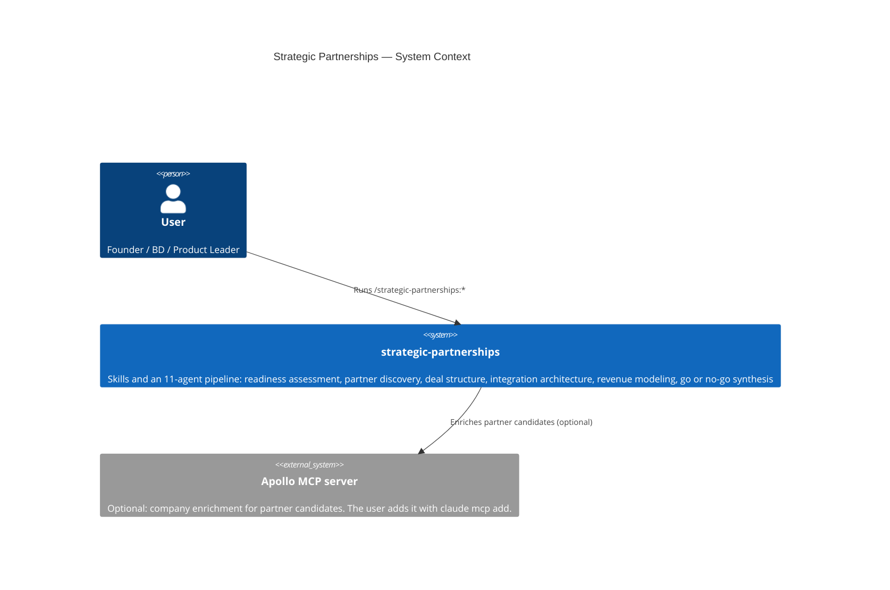
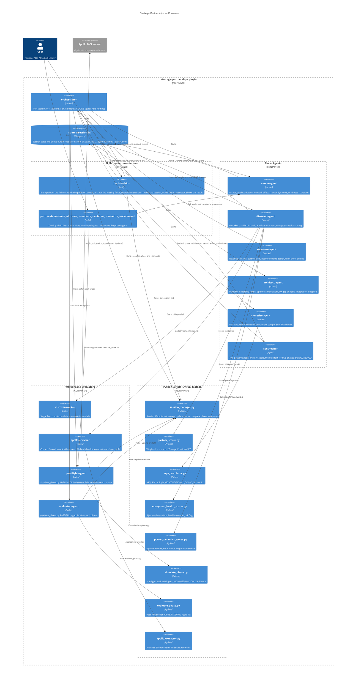

# Strategic Partnerships — C4 Architecture Diagrams

## C4 Level 1 — System Context



---

## C4 Level 2 — Container



---

## Agent Model Assignment

| Agent | Model | Rationale |
|---|---|---|
| `orchestrator` | sonnet | Thin coordinator: no framework loading, no synthesis |
| `assess-agent` | sonnet | Framework judgment and qualitative text |
| `discover-agent` | sonnet | Merge and ecosystem scoring logic |
| `structure-agent` | sonnet | Deal design and network effects analysis |
| `architect-agent` | sonnet | Platform strategy and integration blueprint |
| `monetize-agent` | sonnet | Financial interpretation and Forrester benchmarking |
| `synthesizer` | opus | Step with the most judgment: 5-phase integration and quantified GO/NO-GO |
| `discover-worker` | haiku | Structured scan against a single Popp model: extraction task |
| `apollo-enricher` | haiku | Structured extraction and field filtering: no judgment |
| `pre-flight-agent` | haiku | Deterministic confidence class: no judgment |
| `evaluator-agent` | haiku | Deterministic rubric check: no judgment |

---

## Session Folder Protocol

Each run writes to `.sp-tmp/<session_id>/` in the current folder of the person:

```
.sp-tmp/
└── a1b2c3d4/
    ├── session.json            # Run state: phases_complete, preflight_scores, evaluator_scores, completed_at
    ├── assess.md               # assess-agent output
    ├── discover-model-<n>.md   # discover-worker output (n = 1 to 6), with a .json file of the candidates
    ├── candidates.json         # merged candidates, input of partner_scorer.py
    ├── ecosystem-health.json   # input of ecosystem_health_scorer.py
    ├── power-dynamics.json     # input of power_dynamics_scorer.py
    ├── apollo-raw.json         # raw Apollo answer (only when Apollo answered)
    ├── apollo-enrichment.md    # compact Apollo table, or the fallback notice
    ├── discover.md             # discover-agent output
    ├── structure.md            # structure-agent output
    ├── architect.md            # architect-agent output
    ├── npv-input.json          # input of npv_calculator.py
    ├── monetize.md             # monetize-agent output
    └── synthesize.md           # synthesizer output
```

**Sweep:** the skill `partnerships` runs `session_manager.py --sweep` before it makes a session. The sweep removes folders in `.sp-tmp/` that are older than 60 minutes and have no `completed_at`. A complete session stays until the person deletes it.
