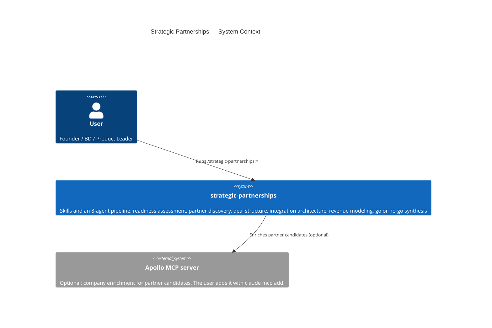
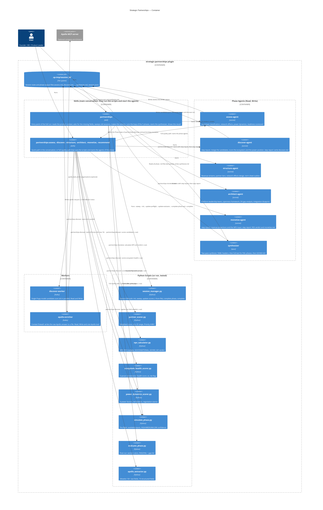

# Strategic Partnerships — C4 Architecture Diagrams

## C4 Level 1 — System Context



---

## C4 Level 2 — Container



---

## Agent Model Assignment

| Agent | Model | Rationale |
|---|---|---|
| `assess-agent` | sonnet | Framework judgment and qualitative text |
| `discover-agent` | sonnet | Merge and ecosystem scoring logic, and the report |
| `structure-agent` | sonnet | Deal design and network effects analysis |
| `architect-agent` | sonnet | Platform strategy and integration blueprint |
| `monetize-agent` | sonnet | Financial interpretation and Forrester benchmarking |
| `synthesizer` | opus | Step with the most judgment: 5-phase integration and quantified GO/NO-GO |
| `discover-worker` | haiku | Structured scan against a single Popp model: extraction task |
| `apollo-enricher` | haiku | Absorbs the raw Apollo answer into a file: no judgment |

---

## Tool Grants

No agent has `Bash`, `Agent` or `Skill`. The skills run each script and start each agent. The test `tests/unit/test_agent_grants.py` checks this.

| Agent | Tools |
|---|---|
| `assess-agent`, `discover-agent`, `structure-agent`, `architect-agent`, `monetize-agent`, `synthesizer`, `discover-worker` | `Read`, `Write` |
| `apollo-enricher` | `Read`, `Write`, `mcp__apollo__apollo_bulk_enrich_organizations` |

---

## Session Folder Protocol

Each run writes to `.sp-tmp/<session_id>/` in the current folder of the person:

```
.sp-tmp/
└── a1b2c3d4/
    ├── session.json            # Run state: phases_complete, preflight_scores, evaluator_scores, completed_at
    ├── preflight-<phase>.json  # result of simulate_phase.py (--out), input of --update-preflight --from-file
    ├── evaluator-<phase>.json  # result of evaluate_phase.py (--out), input of --update-evaluator --from-file
    ├── assess.md               # assess-agent output
    ├── discover-model-<n>.md   # discover-worker output (n = 1 to 6), with a .json file of the candidates
    ├── candidates.json         # merged candidates, input of partner_scorer.py
    ├── ecosystem-health.json   # input of ecosystem_health_scorer.py
    ├── power-dynamics.json     # input of power_dynamics_scorer.py
    ├── partner-scores.json     # result of partner_scorer.py
    ├── ecosystem-health-result.json  # result of ecosystem_health_scorer.py
    ├── power-dynamics-result.json    # result of power_dynamics_scorer.py
    ├── apollo-raw.json         # raw Apollo answer (only when Apollo answered)
    ├── apollo-enrichment.md    # compact Apollo table, or the fallback notice
    ├── discover.md             # discover-agent output
    ├── structure.md            # structure-agent output
    ├── architect.md            # architect-agent output
    ├── npv-input.json          # input of npv_calculator.py
    ├── monetize-notes.md       # projections of the monetize-agent (step inputs)
    ├── npv-result.json         # result of npv_calculator.py
    ├── monetize.md             # monetize-agent output
    └── synthesize.md           # synthesizer output
```

**Sweep:** the skill `partnerships` runs `session_manager.py --sweep` before it makes a session. The sweep removes folders in `.sp-tmp/` that are older than 60 minutes and have no `completed_at`. A complete session stays until the person deletes it.
