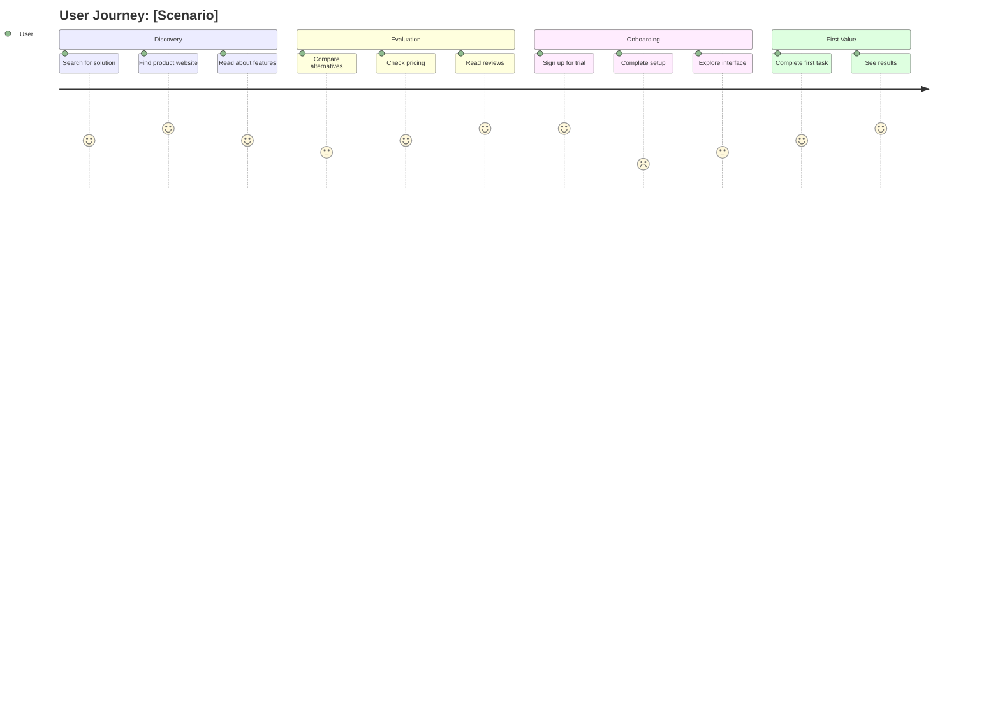
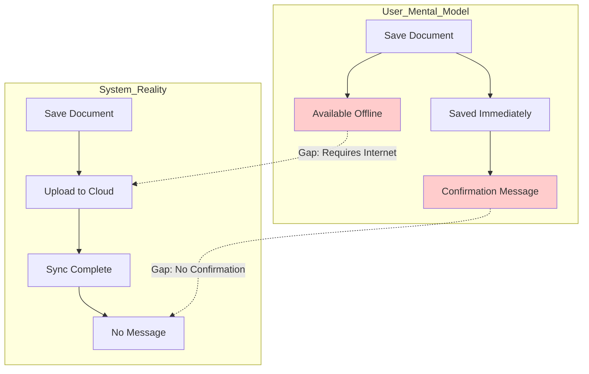

# DEFINE Phase Skill

## Purpose

Synthesize research findings into actionable UX artifacts that guide design decisions. Transform raw insights into structured personas, journey maps, and mental models.

## Theoretical Foundation

This skill draws from foundational UX synthesis methodologies:

- **Alan Cooper**: Goal-directed persona methodology - "Personas are not real people, but they represent real people throughout the design process" (Cooper, 2004)
- **Jesse James Garrett**: Elements of User Experience - layered model of user experience design (Garrett, 2002)

These foundational approaches inform how we synthesize research into personas and map the user journey across experience layers.

## Synthesis Process

### 1. Data Aggregation

Collect all inputs:
- the research findings of the `inputs` list, from the EMPATHIZE phase
- JTBD opportunity data (if available)
- PRD requirements (if available)
- Existing analytics/metrics
- Stakeholder inputs

### 2. Pattern Identification

```markdown
## Pattern Analysis Steps

1. **Review all findings** - Read through research systematically
2. **Identify clusters** - Group similar observations
3. **Name patterns** - Create descriptive labels
4. **Validate patterns** - Check across multiple participants
5. **Prioritize** - Rank by frequency and impact
```

### 3. Segmentation

Identify distinct user groups based on:
- Behavioral patterns
- Goals and motivations
- Pain points and frustrations
- Context and constraints
- Accessibility needs
- AI interaction preferences

## Persona Generation

### Persona Types

| Type | Description | When to Create |
|------|-------------|----------------|
| Primary | Core target user | Always (1-2) |
| Secondary | Important but not core | When distinct needs exist |
| Supplemental | Edge case representation | When accessibility critical |
| Anti-Persona | The group that the product does not serve | When scope clarity needed |

### Generation Protocol

```markdown
## Step 1: Behavioral Variable Identification

Identify 3-5 behavioral axes:
- Frequency of use (daily ↔ monthly)
- Technical sophistication (novice ↔ expert)
- Motivation (efficiency ↔ exploration)
- Risk tolerance (cautious ↔ adventurous)
- AI comfort (skeptical ↔ embracing)

## Step 2: Cluster Users on Axes

Map research participants to behavioral axes
Identify natural clusters

## Step 3: Define Persona Skeleton

For each cluster:
- Name (descriptive, memorable)
- Tagline (one-line essence)
- Demographics (age, role, context)
- Quote (captures attitude)

## Step 4: Populate Details

For each persona:
- Goals (from research findings)
- Pain points (from pain_points[])
- Behaviors (from observations)
- Needs (functional and emotional)
- Context (environment, devices, constraints)

## Step 5: Add Cross-Cutting Concerns

- Accessibility needs
- AI interaction preferences
- JTBD integration (if applicable)
```

### Persona Quality Checklist

- [ ] Based on research, not assumptions
- [ ] Specific and memorable, not generic
- [ ] Goals are actionable
- [ ] Pain points are prioritized
- [ ] Accessibility needs included
- [ ] AI preferences documented
- [ ] Validates against schema

## Journey Map Generation

### Journey Map Types

| Type | Purpose | When to Use |
|------|---------|-------------|
| Current State | Document existing experience | Understanding problems |
| Future State | Envision improved experience | Design planning |
| Ideal State | Perfect experience vision | North star alignment |
| Service Blueprint | Include backend processes | Service design |
| Day in Life | Full context beyond product | Context understanding |

### Generation Protocol

```markdown
## Step 1: Define Journey Scope

- Select persona
- Define scenario (specific use case)
- Set goal (what user is trying to accomplish)
- Determine journey type
- Set time scope

## Step 2: Identify Stages

Typical stages:
1. Awareness/Discovery
2. Consideration/Research
3. Decision/Selection
4. Onboarding/Setup
5. First Use
6. Regular Use
7. Advanced Use
8. Problem/Support
9. Renewal/Exit

## Step 3: Map Each Stage

For each stage document:
- User goals at this stage
- Actions taken
- Touchpoints (digital, physical, human)
- Emotions felt
- Thoughts/questions
- Pain points
- Opportunities

## Step 4: Calculate Experience Scores

Rate each stage 1-10 based on:
- Task completion ease
- Emotional state
- Pain point severity
- Delight moments

## Step 5: Identify Patterns

- Emotional journey peaks and valleys
- Critical pain points
- Moments of truth
- Drop-off risks
- Opportunity hotspots
```

### Mermaid Journey Diagram



### Journey Map Quality Checklist

- [ ] Tied to specific persona
- [ ] Clear scenario and goal
- [ ] All touchpoints documented
- [ ] Emotional journey captured
- [ ] Pain points identified
- [ ] Opportunities noted
- [ ] Experience scores assigned
- [ ] Validates against schema

## Mental Model Generation

### Mental Model Components

1. **User Concepts**: How users think about the domain
2. **Expected Behaviors**: What users expect to happen
3. **System Reality**: What actually happens
4. **Gaps**: Mismatches between expectation and reality

### Generation Protocol

```markdown
## Step 1: Extract Concepts

From research findings:
- Domain vocabulary users employ
- Metaphors and analogies used
- Categorization patterns

## Step 2: Map Relationships

- How concepts connect in user's mind
- Cause-effect expectations
- Hierarchies and groupings

## Step 3: Document Expectations

- "When I do X, I expect Y"
- "Feature A should work like Feature B"
- "This should be found under..."

## Step 4: Identify Gaps

Compare user mental model to:
- Current system behavior
- Planned system behavior
- Industry conventions
```

### Mermaid Mental Model Diagram



## JTBD Integration

When JTBD data is available, enrich artifacts:

### Job Statement → Design Goals

```
JTBD: "When [situation], I want to [motivation], so I can [outcome]"
         ↓
Persona Goal: {
  "description": "[outcome-focused goal]",
  "context": "[situation]",
  "success_criteria": "[measurable outcome]"
}
```

### Job Steps → Journey Stages

```
JTBD Job Steps:
1. Define the problem
2. Locate resources
3. Prepare to execute
4. Execute the task
5. Monitor results
6. Modify as needed

Journey Map Stages:
1. Discovery → Define the problem
2. Research → Locate resources
3. Setup → Prepare to execute
4. Use → Execute the task
5. Review → Monitor results
6. Iterate → Modify as needed
```

### Customer Needs → Persona Needs

```
JTBD Customer Need: "Minimize time spent on X"
         ↓
Persona Need: {
  "description": "Complete X quickly without wasted effort",
  "type": "functional",
  "priority": "must_have"
}
```

## Accessibility Artifact Integration

### Persona Accessibility Section

Every persona must include:

```json
"accessibility_needs": [
  {
    "category": "visual|auditory|motor|cognitive|situational",
    "description": "Specific need from research",
    "severity": "critical|high|moderate|low",
    "assistive_technology": ["Tools they use"]
  }
]
```

### Journey Map Accessibility

For each stage, consider:
- Keyboard navigation barriers
- Screen reader compatibility
- Color contrast issues
- Cognitive load concerns
- Motor control challenges

## AI-HCI Artifact Integration

### Persona AI Preferences

Every persona must include:

```json
"ai_interaction_preferences": {
  "comfort_level": "very_comfortable|comfortable|neutral|uncomfortable",
  "trust_level": "high_trust|moderate_trust|low_trust",
  "transparency_needs": "minimal|moderate|high|complete",
  "control_preferences": "full_automation|mostly_automated|balanced|mostly_manual",
  "concerns": ["Privacy", "Accuracy", "Loss of control"]
}
```

### Journey Map AI Touchpoints

For AI-heavy products, document:
- AI-powered touchpoints
- User trust moments
- Transparency requirements
- Override/correction points
- Learning moments

## Output Validation

All artifacts must validate against schemas:

| Artifact | Schema | Location |
|----------|--------|----------|
| Persona | persona-schema.json | ${CLAUDE_PLUGIN_ROOT}/schemas/outputs/ |
| Journey Map | journey-map-schema.json | ${CLAUDE_PLUGIN_ROOT}/schemas/outputs/ |
| Mental Model | mental-model-schema.json | ${CLAUDE_PLUGIN_ROOT}/schemas/outputs/ |

## Handoff to IDEATE Phase

DEFINE phase outputs enable:

1. **ux-concept-designer**: Uses personas to generate concepts with Rams constraints
2. **prd-bridge**: Transforms requirements using journey context
3. **Design team**: Makes informed design decisions

### Handoff Checklist

- [ ] Primary personas created (1-2)
- [ ] Secondary personas created (as needed)
- [ ] Journey maps for key scenarios
- [ ] Mental models documented
- [ ] All artifacts validate against schemas
- [ ] Accessibility needs included
- [ ] AI-HCI preferences documented
- [ ] Priority recommendations summarized

---

**Previous Phase**: EMPATHIZE (the research findings of the `inputs` list)
**Next Phase**: IDEATE (design concepts)
**Agent**: ux-artifact-generator
**Outputs**: personas.json, journey_maps.json, mental_models.mmd
