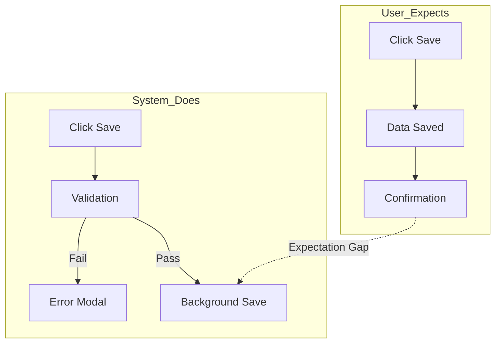

# EMPATHIZE Phase Skill

## Purpose

Guide comprehensive user research to discover needs, behaviors, mental models, and pain points. This phase establishes the empathetic foundation for all subsequent design decisions.

## Theoretical Foundation

This skill draws from foundational UX research methodologies:

- **Don Norman**: Emotional design principles and human-centered design (Norman, 2004)
- **Alan Cooper**: Goal-directed design and persona methodology (Cooper, 2004)
- **Bill Moggridge**: Design ethnography and contextual research (Moggridge, 2007)

These foundational approaches inform how we structure interviews, observe users, and synthesize findings into actionable insights.

## Research Methodologies

### 1. User Interviews

**Structured Interview Protocol**

```markdown
## Pre-Interview Preparation
1. Define research objectives (3-5 specific questions to answer)
2. Identify participant criteria
3. Prepare interview guide with:
   - Warm-up questions (5 min)
   - Core exploration (25-35 min)
   - Scenario walkthroughs (15 min)
   - Closing questions (5 min)
4. Set up recording/note-taking

## Interview Flow

### Opening (5 min)
- Introduce yourself and explain purpose
- Get consent for recording
- Establish rapport with easy questions

### Core Exploration (25-35 min)
Use the "5 Whys" technique to dig deeper:
- Start broad: "Tell me about your experience with [topic]"
- Follow emotional cues: "You mentioned frustration - tell me more"
- Probe specifics: "Walk me through the last time you did that"

### Scenario Walkthrough (15 min)
- Ask participant to demonstrate a typical task
- Observe without interrupting
- Note gaps between what they say and do
- Ask "What were you thinking at that moment?"

### Closing (5 min)
- "What haven't I asked that I should have?"
- "If you could change one thing, what would it be?"
- Thank them and explain next steps
```

### 2. Contextual Inquiry

**In-Situ Observation Protocol**

```markdown
## Observation Framework

### Environment Documentation
- Physical space layout
- Tools and artifacts present
- Social dynamics
- Environmental factors (noise, lighting, interruptions)

### Workflow Mapping
1. Document task sequence
2. Note decision points
3. Identify interruptions and context switches
4. Time critical steps

### Artifact Analysis
- What documents/tools do they reference?
- What workarounds have they created?
- What's taped to their monitor?
- What browser tabs are open?

### Master-Apprentice Technique
- Ask: "Teach me how you do this"
- Follow their lead, don't direct
- Ask "why" at each step
- Note assumptions they take for granted
```

### 3. Mental Model Mapping

**Framework for Understanding User Cognition**

```markdown
## Mental Model Discovery

### Concept Elicitation
- "How would you explain [feature] to a colleague?"
- "What do you think happens when you click [button]?"
- "Draw me a diagram of how this works"

### Expectation Mapping
- "What did you expect to happen?"
- "Where would you look for [functionality]?"
- "What would surprise you about this?"

### Gap Identification
- Document expected vs. actual behavior
- Note terminology mismatches
- Identify conceptual misunderstandings

### Output Format (Mermaid)


## Research Question Templates

### Goal Discovery
- "What are you trying to accomplish?"
- "What does success look like for you?"
- "If this worked perfectly, what would be different?"

### Pain Point Identification
- "What's the most frustrating part of this process?"
- "Where do you waste the most time?"
- "What makes you want to give up?"

### Behavior Understanding
- "Walk me through your typical day"
- "When do you usually do this task?"
- "What triggers you to start this activity?"

### Context Exploration
- "Where are you when you do this?"
- "Who else is involved in this process?"
- "What other tools do you use alongside this?"

## Accessibility Research Integration

### Questions to Include
- "Do you use any assistive technologies?"
- "Are there situations where you can't see/hear/use your hands?"
- "What accessibility features do you rely on?"
- "When do you use voice commands or keyboard navigation?"

### Observation Checklist
- [ ] Assistive technology usage
- [ ] Font size/zoom preferences
- [ ] Color contrast needs
- [ ] Motor control observations
- [ ] Cognitive load indicators
- [ ] Situational impairments

### WCAG 2.2 Categories to Explore
| Category | Research Focus |
|----------|----------------|
| Visual | Screen reader usage, zoom levels, color preferences |
| Auditory | Closed caption needs, visual alerts preference |
| Motor | Keyboard navigation, touch target needs |
| Cognitive | Complexity tolerance, memory aids, reading level |

## AI-HCI Research Integration

### Mental Model Questions
- "How do you think AI/automation works in this product?"
- "What do you expect the system to do automatically?"
- "How much do you trust automated decisions?"

### Transparency Needs
- "When do you want to know why a decision was made?"
- "How much explanation is too much?"
- "What information would help you trust the system?"

### Control Preferences
- "What should you always be able to override?"
- "What's ok for the system to do without asking?"
- "How do you want to be notified about automated actions?"

### Microsoft 18 Guidelines Categories
| Category | Research Focus |
|----------|----------------|
| Initially | First impressions of AI capabilities |
| During Interaction | Real-time feedback expectations |
| When Wrong | Error recovery and correction preferences |
| Over Time | Learning and adaptation expectations |

## Research Synthesis

### Affinity Mapping Process

1. **Capture**: Write each observation on a note
2. **Cluster**: Group related notes together
3. **Theme**: Name each cluster
4. **Insight**: Derive insight from each theme
5. **Prioritize**: Rank by frequency and severity

### Finding Severity Scale

| Level | Description | Criteria |
|-------|-------------|----------|
| Critical | Showstopper | All users, every time |
| High | Major issue | Most users, frequently |
| Medium | Significant | Some users, sometimes |
| Low | Minor | Few users, rarely |

### Evidence Quality

| Level | Description |
|-------|-------------|
| Direct Quote | User's exact words |
| Observation | Witnessed behavior |
| Inference | Reasonable conclusion |
| Hypothesis | Needs validation |

## Output Generation

Generate structured research findings in JSON format (`research_findings.json`) containing:

1. **Research Summary**: Methodology, participants, confidence
2. **Key Findings**: Categorized by type with evidence
3. **Mental Models**: User conceptual frameworks
4. **User Segments**: Distinct user groups identified
5. **Pain Points**: Prioritized by severity and frequency
6. **Opportunities**: Design opportunities identified
7. **Accessibility Findings**: WCAG-relevant discoveries
8. **AI-HCI Findings**: AI interaction preferences

## Handoff Checklist

Before transitioning to DEFINE phase:

- [ ] All interview recordings processed
- [ ] Observations documented and themed
- [ ] Pain points prioritized
- [ ] User segments defined
- [ ] Mental models mapped
- [ ] Accessibility needs captured
- [ ] AI-HCI preferences documented
- [ ] research_findings.json generated and validated
- [ ] Key insights summarized for stakeholders

## Quality Criteria

Research is complete when:

1. **Saturation**: New interviews reveal no new insights
2. **Diversity**: Multiple user types represented
3. **Depth**: Root causes identified, not just symptoms
4. **Evidence**: All findings supported by data
5. **Accessibility**: Inclusive research conducted
6. **AI-HCI**: AI interaction patterns explored

---

**Next Phase**: DEFINE — ux-artifact-generator synthesizes research into personas and journey maps
**Agent**: ux-researcher (this phase only)
**Output**: .ux-artifacts/research_findings.json
