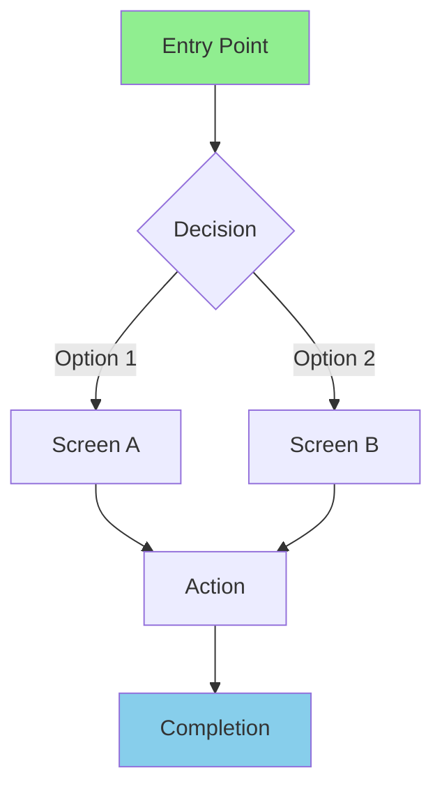

# PROTOTYPE Phase Skill

## Purpose

Transform design concepts into structured wireframe specifications and interaction patterns. Generate accessibility-annotated component definitions with AI interaction behaviors fully specified. All wireframes must support keyboard navigation, screen reader compatibility, and WCAG 2.2 Level AA conformance.

## Theoretical Foundation

This skill draws from foundational prototyping methodologies:

- **Bill Buxton**: Sketching User Experiences - fidelity progression
- **Dan Saffer**: Microinteractions - triggers, rules, feedback, loops
- **Luke Wroblewski**: Mobile First - progressive enhancement
- **Brad Frost**: Atomic Design - atoms → molecules → organisms → templates → pages

## Wireframe Fidelity Levels

### Low Fidelity
- Focus on layout and flow
- Placeholder content
- No visual design
- Quick iteration

### Medium Fidelity
- Component specifications
- Real content structure
- Basic interactions
- Accessibility annotations

### High Fidelity
- Visual design applied
- Full interactions
- Realistic content
- Near-production

## Layout System

### Grid Definition

```markdown
## Standard Grid Systems

### 12-Column Grid (Web)
- Columns: 12
- Gutter: 24px
- Margins: 64px (desktop), 32px (tablet), 16px (mobile)

### Breakpoints
| Name | Width | Columns |
|------|-------|---------|
| Mobile | <768px | 4 |
| Tablet | 768-1024px | 8 |
| Desktop | 1024-1440px | 12 |
| Wide | >1440px | 12 |
```

### Region Definition

```json
{
  "region_id": "R-001",
  "name": "header",
  "semantic_role": "banner",
  "position": {
    "row_start": 1,
    "row_end": 1,
    "col_start": 1,
    "col_end": 12,
    "sticky": true
  },
  "components": ["C-001", "C-002", "C-003"]
}
```

### ARIA Landmark Mapping

| Region | ARIA Role | HTML Element |
|--------|-----------|--------------|
| Header | banner | header |
| Navigation | navigation | nav |
| Main Content | main | main |
| Sidebar | complementary | aside |
| Footer | contentinfo | footer |
| Search | search | form[role=search] |

## Component Specification

### Component Structure

```json
{
  "component_id": "C-001",
  "type": "button",
  "label": "Submit",
  "description": "Primary action button for form submission",
  "region_id": "R-003",
  "state": "default",
  "content": {
    "text": "Submit Review",
    "helper_text": "Submit your feedback"
  },
  "interaction": {
    "clickable": true,
    "focusable": true,
    "action": "submit",
    "navigation_target": null,
    "keyboard_shortcut": "Ctrl+Enter"
  },
  "accessibility": {
    "role": "button",
    "aria_label": "Submit your code review",
    "contrast_requirement": "4.5:1",
    "focus_indicator": "2px solid, 3:1 contrast",
    "touch_target_size": "44x44px"
  }
}
```

### Component State Documentation

| State | Visual | ARIA | Use Case |
|-------|--------|------|----------|
| default | Normal appearance | None | Standard state |
| hover | Highlight | None | Mouse over (not relied upon) |
| focus | Focus ring | None | Keyboard focus |
| active | Pressed appearance | aria-pressed | During activation |
| disabled | Dimmed | aria-disabled="true" | Not available |
| loading | Spinner | aria-busy="true" | Processing |
| error | Error styling | aria-invalid="true" | Validation failed |
| success | Success indicator | aria-live="polite" | Completed |

## Accessibility-First Component Design

### Every Component Must Have

```markdown
## Accessibility Checklist

### Perceivable
- [ ] Sufficient color contrast (4.5:1 text, 3:1 UI)
- [ ] Not color-alone for meaning
- [ ] Text alternatives for images
- [ ] Visible focus indicators

### Operable
- [ ] Keyboard accessible
- [ ] No keyboard traps
- [ ] Adequate touch targets (44x44px)
- [ ] Respects reduced motion preference

### Understandable
- [ ] Clear labels
- [ ] Predictable behavior
- [ ] Error identification and suggestions
- [ ] Consistent navigation

### Robust
- [ ] Valid HTML/ARIA
- [ ] Works with assistive technology
- [ ] Graceful degradation
```

### Focus Management

```markdown
## Focus Management Rules

### Modal Dialogs
1. Focus moves to first focusable element in modal
2. Focus is trapped within modal
3. Escape closes modal
4. Focus returns to trigger on close

### Page Navigation
1. Focus moves to main content (skip link)
2. Heading hierarchy preserved
3. Tab order follows visual order

### Dynamic Content
1. New content announced via aria-live
2. Focus moved to new content if appropriate
3. Loading states communicated
```

## Interaction Pattern Documentation

### Pattern Structure

```json
{
  "pattern_id": "IP-001",
  "name": "Inline Validation",
  "category": "feedback",
  "description": "Provides immediate feedback on form input validity",
  "trigger": {
    "type": "blur",
    "target_element": "text_input"
  },
  "behavior": {
    "steps": [
      {"step_number": 1, "action": "validate", "description": "Check input against rules"},
      {"step_number": 2, "action": "display_feedback", "description": "Show error or success"}
    ]
  },
  "accessibility": {
    "keyboard_support": {
      "fully_operable": true
    },
    "screen_reader_support": {
      "announcements": [
        {"event": "error", "announcement": "Error: [message]", "politeness": "assertive"}
      ],
      "aria_attributes": [
        {"attribute": "aria-invalid", "value": "true", "purpose": "Indicate error state"}
      ]
    }
  }
}
```

### Common Interaction Patterns

| Pattern | Trigger | Accessibility Notes |
|---------|---------|---------------------|
| Progressive Disclosure | Click/Enter | aria-expanded, focus management |
| Inline Validation | Blur | aria-invalid, error description |
| Autocomplete | Input | aria-autocomplete, list navigation |
| Modal Dialog | Click | Focus trap, Escape to close |
| Accordion | Click/Enter | aria-expanded, heading structure |
| Tabs | Click/Arrow keys | tablist, tab, tabpanel roles |
| Dropdown Menu | Click/Arrow keys | menu, menuitem roles |
| Toast Notification | System event | aria-live, auto-dismiss timing |

## AI Component Patterns

### AI Suggestion Component

```json
{
  "component_id": "C-AI-001",
  "type": "ai_suggestion",
  "label": "AI Summary",
  "ai_behavior": {
    "ai_powered": true,
    "suggestion_source": "Code analysis",
    "confidence_display": true,
    "override_mechanism": "Edit or dismiss button",
    "explanation_available": true
  },
  "accessibility": {
    "role": "region",
    "aria_label": "AI-generated summary",
    "aria_live": "polite",
    "screen_reader_notes": "Announce when AI content loads"
  }
}
```

### AI Interaction Patterns

| Pattern | Transparency | User Control |
|---------|--------------|--------------|
| AI Suggestion | "AI-generated" label | Dismiss, Edit, Accept |
| AI Autocomplete | Confidence indicator | Accept, Ignore, Modify |
| AI Analysis | Explanation available | Override, Provide feedback |
| AI Decision | Full reasoning shown | Approve, Reject, Request review |

## Responsive Design Specification

### Breakpoint Behavior

```markdown
## Responsive Documentation

### Navigation
- Desktop: Side panel (240px)
- Tablet: Top bar with hamburger
- Mobile: Bottom navigation bar

### Content Layout
- Desktop: 3-column (sidebar, main, detail)
- Tablet: 2-column (main, detail slide-over)
- Mobile: Single column (full-screen views)

### Hidden Elements
- Mobile: Advanced filters (move to modal)
- Mobile: Secondary actions (move to menu)
- Tablet: Detailed metadata (progressive disclosure)
```

## User Flow Documentation

### Flow Diagram (Mermaid)



### Flow Documentation

```markdown
## Flow: [Name]

### Entry Points
- Direct URL
- Navigation link
- Deep link

### Happy Path
1. User arrives at screen A
2. User performs action X
3. System responds with Y
4. User completes at screen B

### Error Paths
- Invalid input → Error state → Correction
- Network failure → Retry → Cached fallback

### Exit Points
- Task completion
- Abandonment
- Navigation to other section
```

## Output Generation

### Wireframe JSON

Generate `wireframe.json` following wireframe-schema.json:

```json
{
  "schema_version": "1.0",
  "wireframe": {
    "wireframe_id": "WF-001",
    "screen_name": "Main View",
    "purpose": "Primary workspace",
    "fidelity": "medium",
    "platform": "web_responsive",
    "layout": {
      "type": "three_column",
      "regions": [...]
    },
    "components": [...],
    "interactions": [...],
    "error_states": [...],
    "loading_states": [...]
  },
  "metadata": {...}
}
```

### Interaction Pattern Library

Generate `interaction_patterns.json`:

```json
{
  "patterns": [
    {
      "schema_version": "1.0",
      "pattern": {...}
    }
  ]
}
```

## Handoff Checklist

Before transitioning to TEST phase:

- [ ] All key screens documented
- [ ] Component specifications complete
- [ ] Accessibility annotations added
- [ ] Interaction patterns documented
- [ ] AI behaviors specified
- [ ] Responsive notes included
- [ ] User flows diagrammed
- [ ] Error/loading states defined
- [ ] wireframes.json validated
- [ ] interaction_patterns.json validated

## Quality Criteria

Prototypes are ready for evaluation when:

1. **Complete**: All screens for key user flows
2. **Accessible**: Full WCAG annotations
3. **Consistent**: Reusable component patterns
4. **Responsive**: Breakpoint behavior documented
5. **AI-Specified**: AI interactions fully detailed
6. **Validated**: All outputs pass schema validation

---

**Previous Phase**: IDEATE (design concepts)
**Next Phase**: TEST (evaluation)
**Helper skill**: ux-prototype-builder
**Outputs**: wireframes.json, interaction_patterns.json, user_flows.mmd

---

## Tailwind Plus Integration

When the project has `.ux-config.json` with `tailwind_plus: true`, the prototype builder
calls `/tailwind-plus:advise` for each wireframe region to get specific Tailwind Plus component
recommendations. Fallback regions are annotated `[FALLBACK: raw Tailwind]` and listed in
the handoff summary. Optional: the paid tailwind-plus plugin, not in this marketplace.
