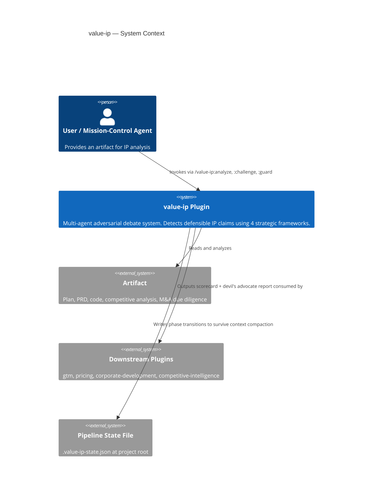
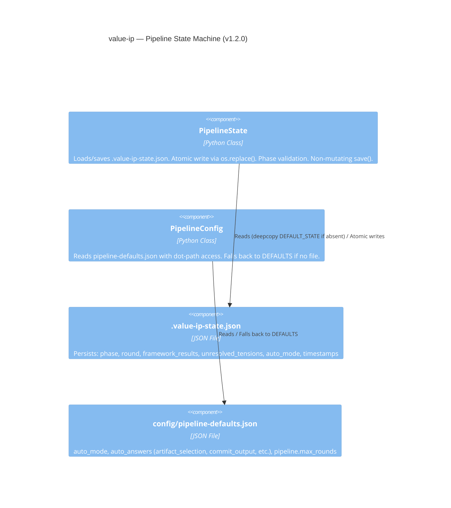
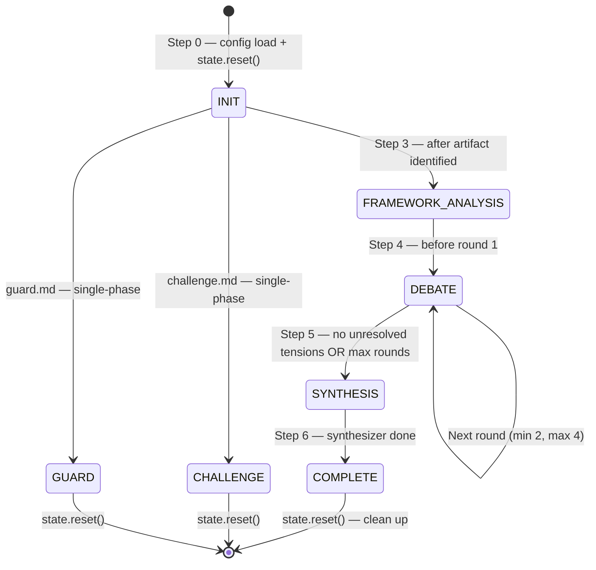

# ADR-001: value-ip Plugin — Architecture Decisions

**Status:** Accepted
**Date Created:** 2026-03-03
**Last Modified:** 2026-03-03
**Plugin:** value-ip v1.2.0
**Authors:** Luis F. Amadeo
**Decision Makers:** Luis F. Amadeo

---

## Context

The LFA Claude Code marketplace lacked a rigorous, adversarial tool for detecting whether an artifact — a plan, PRD, codebase, competitive analysis, or M&A due diligence document — contains genuinely defensible differentiating value. The alternatives were:

- **Single-agent assessment**: One Claude instance evaluates the artifact. Prone to hallucination, sycophancy, and confirmation bias — it will find value if asked to find value.
- **Framework checklist**: A human or agent checks boxes against Helmer, Blue Ocean, etc. sequentially. No adversarial pressure; findings accumulate without cross-validation.
- **Consultant report**: Human expert + hours. Expensive, inconsistent, cannot run as an automated pipeline step.

The gap was a plugin that:

1. Evaluates through multiple independent analytical lenses simultaneously (no lens can "see" another lens's conclusions during analysis)
2. Applies adversarial debate — framework agents challenge each other's findings through a structured coordinator
3. Only surfaces IP claims that survive **all four frameworks** (not any one of them)
4. Produces dual output: a structured scorecard (machine-readable + human-readable) and a Devil's Advocate Report
5. Runs in both interactive and fully automated (YOLO) modes, suitable for mission-control team dispatch

**v1.0.0** established the core multi-agent debate architecture. **v1.1.0** applied peer-review fixes: resolved 7 contradictions (scoring boundary bugs, competing verdict systems, agent context failures) and 7 ambiguities (per-framework thresholds, silent truncation, debate termination conditions). **v1.2.0** added durable pipeline state and YOLO/auto mode for compaction safety and automation.

---

## System Context (C4 Level 1)

---

## Container Architecture (C4 Level 2)

```mermaid
C4Container
  title value-ip — Container Architecture

  Person(user, "User / Mission-Control Agent")

  Container(analyze, "analyze.md", "Command", "Orchestrates full 5-phase pipeline: artifact detection → framework analysis → debate → synthesis → output")
  Container(challenge, "challenge.md", "Command", "Quick devil's advocate: framework analyses inline, 1-round debate")
  Container(guard, "guard.md", "Command", "Proactive guardian: GREEN/YELLOW/RED pre-completion verdict")

  Container(helmer, "helmer-agent", "Agent", "Helmer 7 Powers lens: identifies structural competitive barriers")
  Container(blueocean, "blue-ocean-agent", "Agent", "Blue Ocean ERRC lens: identifies new value curve creation")
  Container(christensen, "christensen-agent", "Agent", "Christensen Disruption lens: disruptive vs sustaining classification")
  Container(moore, "moore-agent", "Agent", "Moore Core vs Context lens: core/context classification with % split")
  Container(coordinator, "debate-coordinator", "Agent", "Socratic coordinator: dispatches challenges, aggregates tensions, advisory verdict")
  Container(synthesizer, "synthesizer", "Agent", "Authoritative synthesizer: scores → IP claims → PASS/CONDITIONAL/FAIL verdict")

  Container(detector, "artifact_detector.py", "Script", "Detects artifact from conversation context or filesystem")
  Container(integrator, "plugin_integrator.py", "Script", "Integrates outputs from upstream plugins (competitive-intelligence, pricing, etc.)")
  Container(extractor, "ip_extractor.py", "Script", "Extracts IP claims: requires score >= 3 in ALL 4 frameworks")
  Container(scorecard, "scorecard_generator.py", "Script", "Renders scorecard markdown + devil's advocate markdown from structured data")
  Container(pipeline, "pipeline_state.py", "Script", "PipelineState: durable JSON phase tracker. PipelineConfig: dot-path config reader")

  Container(state_file, ".value-ip-state.json", "Runtime File", "Persists phase/round/framework_results across context compactions")
  Container(config_file, "config/pipeline-defaults.json", "Config", "auto_mode flag + auto_answers + pipeline settings")

  Rel(user, analyze, "Invokes")
  Rel(user, challenge, "Invokes")
  Rel(user, guard, "Invokes")

  Rel(analyze, detector, "Auto-detects artifact")
  Rel(analyze, integrator, "Ingests upstream plugin outputs")
  Rel(analyze, helmer, "Dispatches")
  Rel(analyze, blueocean, "Dispatches")
  Rel(analyze, christensen, "Dispatches")
  Rel(analyze, moore, "Dispatches")
  Rel(analyze, coordinator, "Dispatches for debate rounds")
  Rel(analyze, synthesizer, "Dispatches for final synthesis")
  Rel(analyze, pipeline, "Reads/writes phase state")

  Rel(synthesizer, extractor, "Uses to extract IP claims")
  Rel(synthesizer, scorecard, "Uses to render output files")

  Rel(pipeline, state_file, "Atomically writes JSON")
  Rel(pipeline, config_file, "Reads auto_mode + auto_answers")
```

---

## Component: Pipeline State Machine (C4 Level 3)

**Phase transitions (analyze.md):**

---

## Considered Options

### Option A: Single-agent SKILL.md (one-shot assessment)

One Claude instance applies all four frameworks sequentially, produces scorecard.

**Pros:** Simplest implementation; zero coordination overhead
**Cons:** Confirmation bias — a single agent asked "find IP" will find IP. No adversarial challenge. Context window accumulates all four framework analyses before synthesis, causing degradation in long artifacts. Cannot be dispatched as mission-control team member without full context failure.
**Decision:** Rejected

### Option B: Parallel framework agents, no debate

Four framework agents run in parallel. Synthesizer merges outputs by averaging scores.

**Pros:** Independent analysis eliminates cross-contamination during framework phase
**Cons:** No adversarial pressure. Agents cannot challenge each other's assumptions. A claim that passes one framework leniently and fails another strictly would produce an averaged score that obscures the disagreement. IP claims that "survive" are just numerically averaged, not genuinely tested.
**Decision:** Rejected

### Option C: Multi-agent adversarial debate pipeline (chosen)

Four parallel framework agents → Socratic coordinator runs structured debate rounds → synthesizer with final authority.

**Pros:** True adversarial pressure via challenge/response rounds. Coordinator cannot have a position — it only surfaces tensions. Synthesizer is sole authority for PASS/CONDITIONAL/FAIL verdict. IP claims must survive all four frameworks (score ≥ 3 each). Scales to automated pipelines via YOLO mode.
**Cons:** More complex orchestration; 6+ agents per invocation; context window cost is higher than single-agent
**Decision:** Selected

---

## Decision Outcomes

### Decision 1: Six-Agent Pipeline (v1.0.0)

| Agent | Role | Authority |
|-------|------|-----------|
| `helmer-agent` | Identifies structural competitive barriers (7 Powers) | Scores 1–5; recommends STRONG/MODERATE/WEAK |
| `blue-ocean-agent` | Maps ERRC grid; identifies new value creation | Scores 1–5; identifies Create elements |
| `christensen-agent` | Classifies disruption type | Scores 1–5; labels DISRUPTIVE/SUSTAINING/NONE |
| `moore-agent` | Core vs. Context split | Scores 1–5; outputs core_percentage |
| `debate-coordinator` | Socratic facilitator; no analytical authority | Produces tensions list; advisory verdict only |
| `synthesizer` | **Sole authority** for PASS/CONDITIONAL/FAIL | Reads all framework outputs + debate transcripts |

**Rationale:** Separating the coordinator (who asks hard questions) from the synthesizer (who decides) prevents the coordinator's adversarial framing from biasing the final verdict. The synthesizer reads all debate transcripts but is instructed to evaluate claim strength, not count debate points.

### Decision 2: IP Claim Survival Rule — ALL Frameworks (v1.0.0)

An IP claim is only surfaced if it scores ≥ 3 in **every** framework (Helmer AND Blue Ocean AND Christensen AND Moore). Any single framework scoring < 3 eliminates the claim.

**Rationale:** IP claims that are structurally powerful (Helmer) but easily replicated (Blue Ocean) or sustaining (Christensen) are not defensible differentiators. The AND rule (not OR, not average) enforces genuine cross-framework survival. Implemented in `ip_extractor.py` via `require_all_frameworks=True`.

### Decision 3: Dual Output (Scorecard + Devil's Advocate) (v1.0.0)

Two output files, always produced together:
1. **Value & IP Scorecard** — structured verdicts, framework scores, confirmed IP claims, PASS/CONDITIONAL/FAIL
2. **Devil's Advocate Report** — unresolved challenges requiring team response, formatted as a checklist

**Rationale:** The scorecard answers "what is the IP?" The devil's advocate report answers "what can destroy it?" Both are required for a complete defensibility assessment. Separating them allows downstream consumers (e.g., corporate-development deal rooms) to attach each to the appropriate workflow step.

### Decision 4: Peer-Review Fix — Competing Verdict Systems (v1.1.0)

**Problem (C2/C5):** Helmer's internal SKILL.md used PASS/CONDITIONAL/FAIL labels with power-count logic. The synthesizer used the same labels with average-score logic. Two independent systems producing different verdicts with identical labels.

**Fix:** Renamed Helmer's internal verdicts to `STRONG/MODERATE/WEAK`. Designated `synthesizer.md` as sole authority for `PASS/CONDITIONAL/FAIL`. Debate coordinator's advisory verdict relabeled as `ADVISORY_VERDICT` (non-binding).

### Decision 5: Peer-Review Fix — Moore Boundary Off-by-One (v1.1.0)

**Problem (C3):** `SKILL.md` defined `CORE_DOMINANT` as `> 60%` (strict), but `ip_extractor.py` used `>= 60` (inclusive). Exactly 60% scored as CORE in code but BALANCED in documentation.

**Fix:** Changed `ip_extractor.py` to `> 60` to match the documented definition. Boundary is now consistent: 60% = BALANCED, 61%+ = CORE.

### Decision 6: Durable Pipeline State Machine (v1.2.0)

**Problem:** The `analyze` command runs a 5-step pipeline consuming 40–80K context tokens. Claude Code's context compaction can occur mid-pipeline. After compaction, the orchestrating agent has no record of which framework agents have completed, what debate round is active, or which tensions remain unresolved.

**Solution:** `PipelineState` writes `.value-ip-state.json` at each phase transition. If compaction occurs, any agent can read the file to determine current phase without relying on conversation history.

**Key implementation decisions:**
- **Atomic write via `os.replace()`**: Prevents corrupt state file on process interruption (write-to-temp-then-rename)
- **Non-mutating `save()`**: Uses dict spread `{**state, "updated_at": ...}` — caller's dict is never modified
- **Phase validation in `update()`**: Raises `ValueError` for phases not in `PHASES` constant — catches typos at pipeline definition time
- **CHALLENGE + GUARD in PHASES**: `challenge.md` and `guard.md` write these phase labels; both must be in the constant to prevent false `ValueError`

### Decision 7: YOLO/Auto Mode via Config File (v1.2.0)

**Problem:** The pipeline requires human input at two points (artifact selection, commit question). This makes it incompatible with unattended mission-control team dispatch.

**Solution:** `PipelineConfig` reads `config/pipeline-defaults.json`. When `auto_mode: true`, all `AskUserQuestion` calls in `analyze.md`, `challenge.md`, and `guard.md` are bypassed. The `auto_answers` values govern behavior instead.

**Design principle:** Config file, not environment variable or command flag. This allows the config to be committed per-project (for teams that always run in YOLO mode) or kept at default (for interactive use). The state file (`.value-ip-state.json`) is always gitignored; the config file is not.

---

## Consequences

### Positive
- Four-framework adversarial survival produces high-precision IP claims (false positives minimized)
- Context compaction no longer degrades pipeline accuracy — state file provides ground truth
- YOLO mode enables mission-control team dispatch without human checkpoints
- Dual output (scorecard + devil's advocate) consumable by downstream plugins and human workflows
- `webCompatible: true` — packagable as a ZIP for web deployment

### Negative / Trade-offs
- Six+ agents per invocation makes this plugin among the more expensive in the marketplace
- Pipeline state file requires gitignore discipline (handled: `.gitignore` entry added)
- `auto_mode: false` is the safe default — operators must explicitly opt into YOLO for automation

### Risks Mitigated
- **Verdict label collision (C2/C5):** Helmer internal verdicts renamed; synthesizer is sole authority
- **Scoring boundary inconsistency (C3):** Moore ≥60 vs >60 fixed to >60 everywhere
- **Agent context failure in challenge/guard (C6/C7):** Both commands now pass inline context to coordinator; no `debate-context/` file dependency
- **Silent truncation (A7/A8):** First-element selection for Helmer powers + Blue Ocean Create documented in code and agent instructions

---

## Version History

| Version | Date | Changes |
|---------|------|---------|
| 1.0.0 | 2026-03-03 | Initial release — 6-agent debate pipeline, dual output, 3 commands |
| 1.1.0 | 2026-03-03 | Peer-review fixes — 14 HIGH + 7 MEDIUM: verdict label collision, Moore boundary, coordinator context, ambiguity resolution |
| 1.2.0 | 2026-03-03 | Durable pipeline state machine (`PipelineState`) + YOLO auto mode (`PipelineConfig`, `config/pipeline-defaults.json`) |
